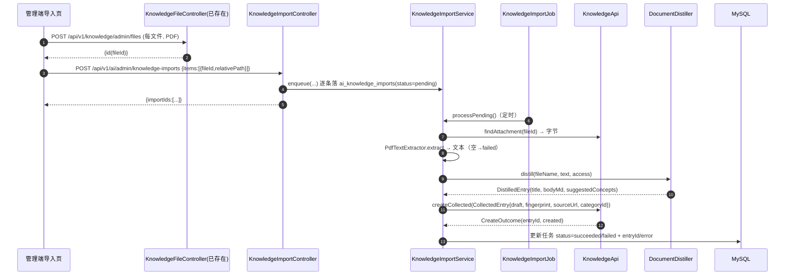
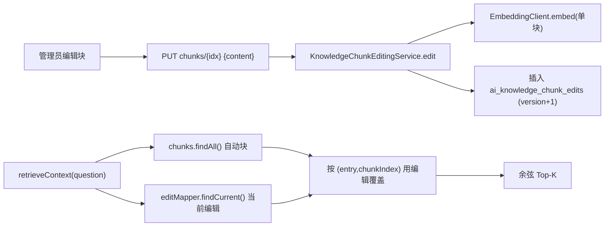

# 设计

## 系统上下文

- 使用者：管理员（Web 管理端）。学习者只读消费发布后的内容。
- 涉及模块：`paideia-knowledge`（条目/附件/分类契约）、`paideia-ai`（文档解析、蒸馏、块编辑、RAG 合并）、`paideia-app`（迁移与装配）、前端 `@paideia/knowledge` / `@paideia/admin` / `@paideia/app`。
- 外部依赖：本地 Ollama embedding（WORK-072 已接入）；模型调用经现有 AgentScope 端口；PDF 解析用本地 PDFBox（新增）。

## 组件与职责

### paideia-knowledge（只加契约，不加表）

- `KnowledgeApi`（包根，**计划新增**）：
  - `Optional<AttachmentContent> findAttachment(String fileId)` —— 供 ai 模块读取附件字节做解析；返回值类型 `record AttachmentContent(String id, String originalName, String contentType, long sizeBytes, byte[] bytes)`（计划）。
  - `long ensureCategoryPath(List<String> segments)` —— 按相对路径分段创建/复用分类，返回叶子分类 id；segments 已由调用方清洗（计划）。
  - 复用现有 `createCollected(CollectedEntry)`（已存在）：去重 + 定状态 + 记来源。
- `KnowledgeApiImplementation`（已存在）实现上述两个方法；`ensureCategoryPath` 走 `CategoryService`/`CategoryMapper`。

### paideia-ai

- **端口** `io.github.xiaou61.ai.DocumentDistiller`（计划）：
  - `DistilledEntry distill(String fileName, String text, ModelAccess access)`
  - `record DistilledEntry(String title, String bodyMarkdown, List<String> suggestedConcepts)`（计划）
  - 实现 `internal.provider.AgentScopeDocumentDistiller`，结构化输出 + 校验（title 非空、body 非空且为 Markdown）。
- `internal.importing`（计划）：
  - `PdfTextExtractor.extract(byte[] pdf): String`（PDFBox；加密/无文本抛 `BizException`）。
  - `KnowledgeImportService`：`long enqueue(...)`、`void processPending()`、`void retry(long id)`；编排“读附件 → 抽文本 → 蒸馏 → `KnowledgeApi.createCollected` → 记 telemetry/结算”。
  - `KnowledgeImportJob`（`@Scheduled` fixedDelay，沿用 `EssayCollectionJob` 模式，构造期注册）。
  - `KnowledgeImportController`：`/api/v1/ai/admin/knowledge-imports`。
  - `KnowledgeImportMapper` + `KnowledgeImport` 实体。
- `internal.rag`（在现有基础上增补）：
  - `KnowledgeChunkEditMapper` + `KnowledgeChunkEdit` 实体（计划）。
  - `KnowledgeChunkEditingService`：`list(entryId)`、`edit(entryId, chunkIndex, content, editorId)`、`revisions(...)`、`rollback(...)`；编辑只对**该块**调用一次 `EmbeddingClient.embed`。
  - `KnowledgeChunkAdminController`：`/api/v1/ai/admin/knowledge-entries/{entryId}/chunks`。
  - `KnowledgeRagService.retrieveContext`（已存在）改造：加载“当前编辑版本”，与自动块合并后打分。

## 请求或事件流程

### 文档导入（异步）



### 块编辑与合并检索



## 接口与数据

### HTTP 端点（全部 ADMIN，位于 `/api/v1/ai/admin/**`）

- `POST /api/v1/ai/admin/knowledge-imports`
  - 请求：`{ "categoryId": 12|null, "items": [ { "fileId": "uuid", "relativePath": "第一章/背景.pdf" } ] }`
  - 响应：`{ "importIds": [1,2] }`
- `GET /api/v1/ai/admin/knowledge-imports?status=pending|processing|succeeded|failed`
  - 响应：`[ { id, fileId, relativePath, status, entryId, error, createdAt, updatedAt } ]`
- `POST /api/v1/ai/admin/knowledge-imports/{id}/retry` → `{ "status": "pending" }`
- `GET /api/v1/ai/admin/knowledge-entries/{entryId}/chunks`
  - 响应：`[ { chunkIndex, content, origin: "auto"|"manual", version, updatedAt, conflict, orphaned } ]`
- `PUT /api/v1/ai/admin/knowledge-entries/{entryId}/chunks/{chunkIndex}` 请求 `{ "content": "..." }`
  - 响应：`{ "version": 3, "embeddingPending": false }`
- `GET /api/v1/ai/admin/knowledge-entries/{entryId}/chunks/{chunkIndex}/revisions`
  - 响应：`[ { version, content, editorId, createdAt } ]`
- `POST /api/v1/ai/admin/knowledge-entries/{entryId}/chunks/{chunkIndex}/rollback` 请求 `{ "version": 2 }`
  - 响应：`{ "version": 4 }`（追加一条历史版本内容的副本）

### KnowledgeApi 新增（计划）

```java
Optional<AttachmentContent> findAttachment(String fileId);
long ensureCategoryPath(List<String> segments);

record AttachmentContent(String id, String originalName, String contentType, long sizeBytes, byte[] bytes) {}
```

## 持久化与迁移

两条迁移，文件名用 14 位时间戳（实施时取当时时间，合并前核对不撞号）。

### `ai_knowledge_imports`（导入任务）

```sql
CREATE TABLE ai_knowledge_imports (
  id                 BIGINT UNSIGNED NOT NULL AUTO_INCREMENT,
  file_id            CHAR(36)        NOT NULL,
  relative_path      VARCHAR(512)    NULL,
  target_category_id BIGINT UNSIGNED NULL,
  status             VARCHAR(16)     NOT NULL DEFAULT 'pending', -- pending|processing|succeeded|failed
  entry_id           BIGINT UNSIGNED NULL,
  error              VARCHAR(1000)   NULL,
  operator_id        BIGINT UNSIGNED NOT NULL,
  created_at         DATETIME(3)     NOT NULL DEFAULT CURRENT_TIMESTAMP(3),
  updated_at         DATETIME(3)     NOT NULL DEFAULT CURRENT_TIMESTAMP(3) ON UPDATE CURRENT_TIMESTAMP(3),
  PRIMARY KEY (id),
  KEY idx_ai_knowledge_imports_status (status),
  KEY idx_ai_knowledge_imports_file (file_id)
) ENGINE=InnoDB DEFAULT CHARSET=utf8mb4 COLLATE=utf8mb4_0900_ai_ci;
```

### `ai_knowledge_chunk_edits`（块编辑版本，覆盖层）

```sql
CREATE TABLE ai_knowledge_chunk_edits (
  id                BIGINT UNSIGNED NOT NULL AUTO_INCREMENT,
  entry_id          BIGINT UNSIGNED NOT NULL,
  chunk_index       INT             NOT NULL,
  version           INT             NOT NULL,
  content           MEDIUMTEXT      NOT NULL,
  content_hash      VARCHAR(64)     NOT NULL,
  embedding         LONGBLOB        NULL,   -- 可为空：embedding 不可用时先存内容、待补嵌
  dimension         INT             NULL,
  base_content_hash VARCHAR(64)     NULL,   -- 编辑时该位置自动块的内容哈希，用于冲突检测
  editor_id         BIGINT UNSIGNED NOT NULL,
  created_at        DATETIME(3)     NOT NULL DEFAULT CURRENT_TIMESTAMP(3),
  PRIMARY KEY (id),
  UNIQUE KEY uk_ai_knowledge_chunk_edit (entry_id, chunk_index, version),
  KEY idx_ai_knowledge_chunk_edit_current (entry_id, chunk_index, version),
  CONSTRAINT fk_ai_knowledge_chunk_edit_entry FOREIGN KEY (entry_id)
    REFERENCES knowledge_entries (id) ON DELETE CASCADE
) ENGINE=InnoDB DEFAULT CHARSET=utf8mb4 COLLATE=utf8mb4_0900_ai_ci;
```

- **当前版本**定义：同 `(entry_id, chunk_index)` 下 `version` 最大的那一行（查询用相关子查询或 `MAX(version)`）。不维护 `is_current`，避免多处写标记不一致；回滚=追加新版本（version=max+1，内容复制自目标版本），保持只追加。
- 自动块 `ai_knowledge_chunks` 结构不变，仍可由正文重建；编辑表独立存在，重建不触碰。

## 失败处理与恢复

- **PDF 无文本/加密**：`PdfTextExtractor` 抛 `BizException`，任务置 `failed` 并记 error；不生成空条目。
- **蒸馏失败/结构非法**：端口抛异常，任务 `failed`，可 `retry`；不落半截条目（`createCollected` 要么成功要么不写）。
- **指纹重复**：`createCollected` 返回 `created=false`，任务记 `succeeded` 且 `entryId` 指向原条目（或标记 skipped），不重复建。
- **embedding 不可用（块编辑）**：PUT 仍 200，响应 `embeddingPending=true`，`embedding` 存 NULL；由 `KnowledgeRagService.reindexChanged` 在下一轮把 `embedding IS NULL` 的编辑补嵌；检索时该块暂回退用自动块。不抛 500。
- **并发 processPending**：沿用 `AtomicBoolean` 单飞锁（同 `KnowledgeRagService` 的写法），避免同一任务被两个 worker 处理。
- **正文变更导致块错位**：读取时若编辑的 `base_content_hash` 与当前自动块 hash 不同（`conflict=true`）或该位置已无自动块（`orphaned=true`），在管理端明确提示，不静默覆盖。

## 安全与权限

- 全部新端点位于 `/api/v1/ai/admin/**`，沿用现有 `hasRole('ADMIN')` 前缀规则（与 `AiCreditAdminController` 同级），不逐方法加注解。
- 文件上传复用 `/api/v1/knowledge/admin/files`（ADMIN，已有魔数白名单，PDF 已允许）。
- `ensureCategoryPath` 的 segments 清洗：去空段、去 `.`/`..`、去路径分隔符残留、长度上限，防目录穿越与超长 slug。
- `findAttachment` 是模块内端口，不是 HTTP 入口，不新增对外读取面；附件 HTTP 读取仍走既有免鉴权 `GET /files/{id}`（id 不可枚举的既有取舍不变）。
- 不把 PDF 原文全文写入日志；错误信息只记类型与摘要。

## 可观测性

- 蒸馏调用用现有 `RunSpec`（kind=`knowledge_import`）+ `RunSink` 记录 span 与 token 用量（`RunSpec.of(...)`/`withModel`）。
- 导入任务表自身是运行看板：状态、error、耗时可由 `GET knowledge-imports` 查看；纳入 AI 运行观测页（现有 `AiRuns*`）可选。
- 块编辑记录 `editor_id` 与 `created_at`，可审计。

## 实施顺序

1. 探针：PDFBox 抽文本验证（结论落 `.agent/notes/pdf-extraction.md`）。
2. `KnowledgeApi` 扩展 + 实现 + 单测。
3. `PdfTextExtractor` + 单测；`DocumentDistiller` 端口 + 实现 + 桩测试。
4. `ai_knowledge_imports` 迁移 + mapper + `KnowledgeImportService`/`Job` + controller + 单测/授权测试。
5. `ai_knowledge_chunk_edits` 迁移 + mapper + `KnowledgeChunkEditingService` + controller + `retrieveContext` 合并 + 单测。
6. 前端 admin-client + 导入页 + 块编辑页；学习者目录阅读页。
7. 结构图重生成、切片测试、e2e、验收报告。

## 测试策略

- 后端单测（模块内）：`PdfTextExtractorTest`、`DocumentDistillerValidationTest`、`KnowledgeImportServiceTest`（指纹去重、失败状态、无文本失败）、`KnowledgeChunkEditingServiceTest`（只重嵌该块、版本、回滚、冲突/孤儿、embedding 降级）。
- 集成（`paideia-app`）：`KnowledgeImportIntegrationTest`（上传→导入→草稿落库→发布→RAG 命中）、`KnowledgeChunkEditIntegrationTest`（编辑后检索结果变化、reindex 不覆盖）；`ApiContractTest`/`AuthorizationIsolationTest` 覆盖新端点的 401/403。
- 前端单测：admin-client 新方法；组件测试块编辑面板与导入页。
- e2e（`apps/admin/e2e`）：`knowledge-import.spec.ts`、`knowledge-chunks.spec.ts`；`apps/app/e2e`：`knowledge-wiki.spec.ts`。
- 迁移守卫：`MigrationVersionFormatTest`、`MigrationSeedOverlapTest`（新表只建结构，不插数据）。
- 架构图：重跑 `node scripts/gen-arch-diagram.mjs` 更新 `05-database-tables.md`，`--check` 通过。

## 需求追踪

见 proposal.md 的「验收映射」表；tasks.md 每个任务在「对应」列出 REQ/AC。

## 待决定事项

- PDFBox 版本/许可证与最大页数。
- 蒸馏是否扣管理员积分（或仅记 telemetry 不扣）；影响 `KnowledgeImportService` 是否调用结算。
- 长文档“单条目 vs 多条目”切分策略（首版单条目）。
- 学习者目录阅读页的落点：新路由 `/knowledge/wiki` 还是并入现有 `/knowledge`；需同步导航入口与 `preferredNav`。
