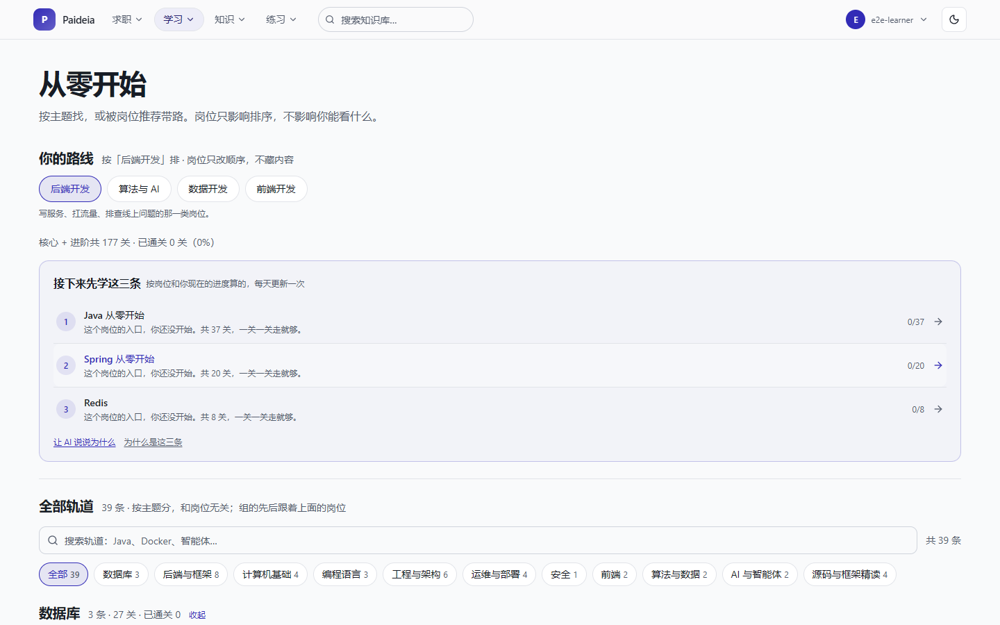
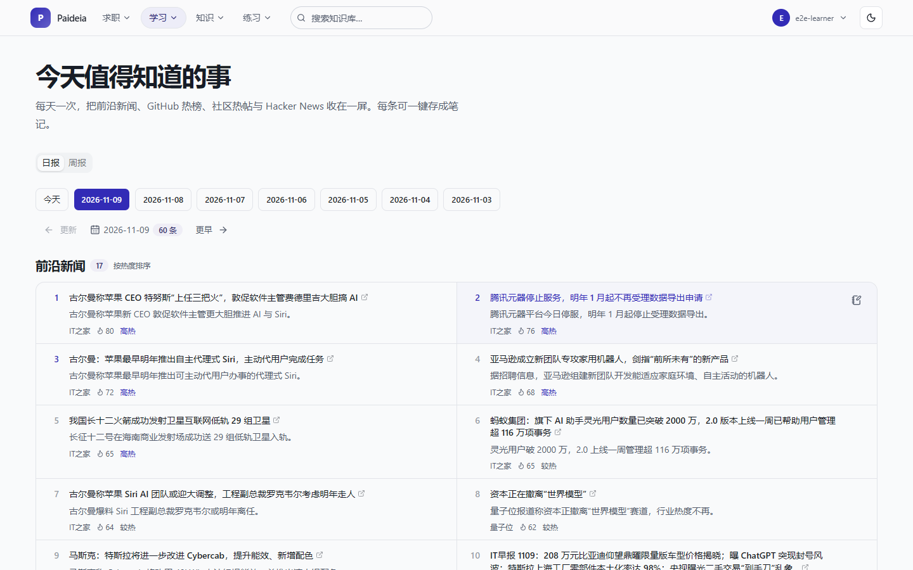
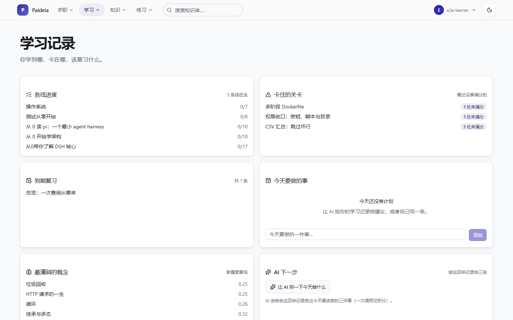
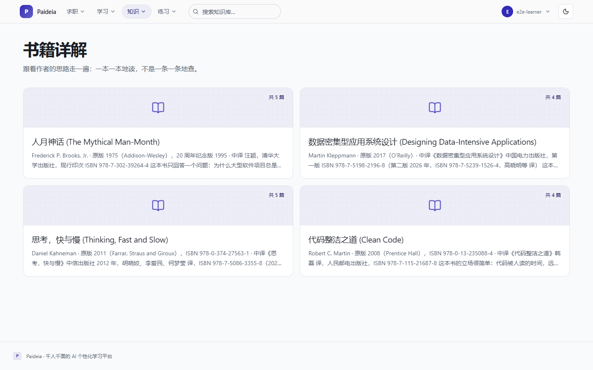
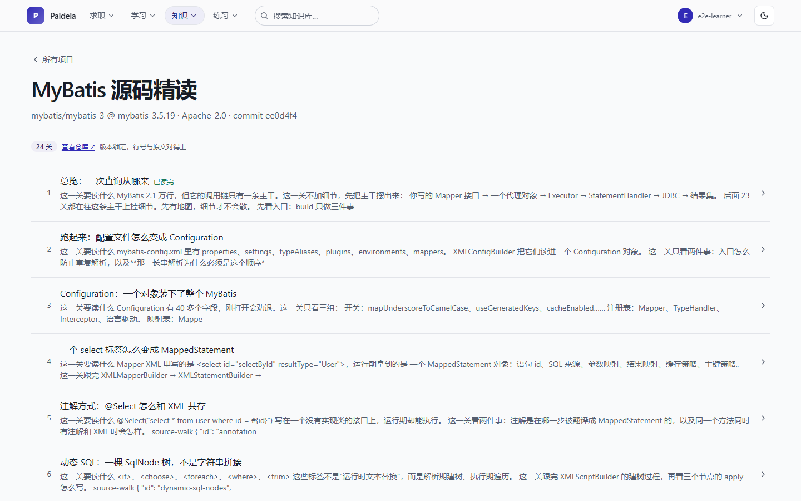
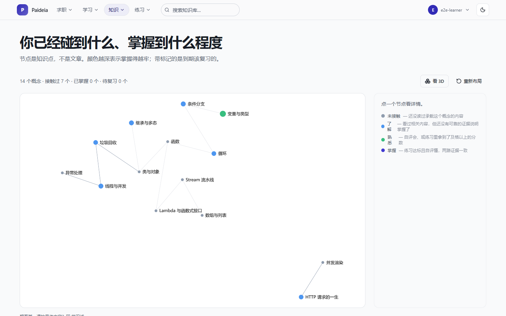
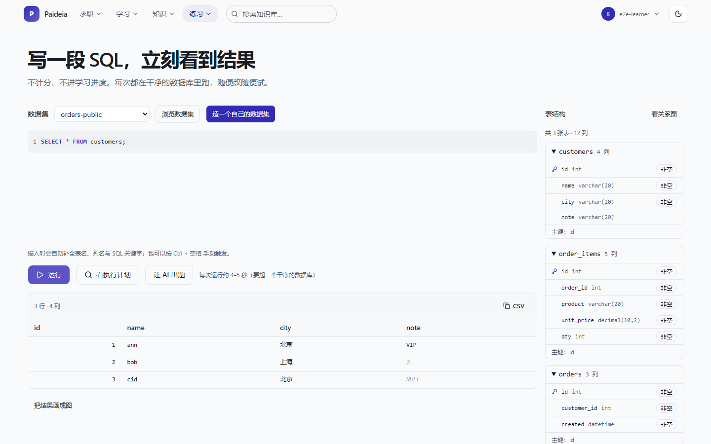

# Paideia

**一个会记住你的个性化学习平台。** 读知识库、跟着学习线从零学、每天看一条速递、在干净的数据集上练 SQL、模拟面试、把学到的东西记成笔记——这些行为沉淀成你自己的痕迹（自评、掌握度、复习排期、简历版本），再反过来决定首页推什么、今天该复习哪几条、AI 该给你什么建议。

<p>
  
  
  
  
  
</p>


## 这是什么

Paideia 把三件事放进同一个站点：

1. **内容**——一条条按主题组织的内容（分类树 + 条目 + 全文搜索），外面套着 39 条学习线：从零开始的编程课、按书读的书籍详解、按第三方项目逐关读的源码精读。每条线都是一站一站走，走完才算过。
2. **AI**——它不长成一个常驻的聊天框，而是嵌在每一步里：正文能生成带小标题的精简卡片、能按文章出题；每日速递把当天抓来的信息压成一句话；学习记录按"进度／卡关／到期／薄弱"四块排出今天该做的三件事；训练营、模拟面试、简历优化、笔记提要点各有一个明确入口。每处都按模型用量扣积分。
3. **痕迹**——自评（懂了／还不懂）、闯关进度、概念掌握度、复习档位、笔记、简历版本都留在这个账号下。首页那三格（待复习／学到一半／还不懂）、复习队列和知识图谱的颜色，都是从这些记录里长出来的，不是一层套一层的推荐算法。

AI 由平台统一出账，用户按积分消耗，不需要自备 Key。内容、附件与代码都在自己的一台服务器上；只有模型 API 与速递抓取（RSS／GitHub 趋势／Hacker News）要走外网。

## 界面

以下截图都取自线上实例（2026-11-09，1440×900，浅色主题）。

**学习主线**：39 条学习线，先按岗位排出"接下来先学这三条"，再一站一站走。岗位只改顺序，不改你能看到什么。



**每天打开的两页**：速递把当天值得知道的事压成一句话，每条可一键存成笔记；学习记录把各线进度、卡住的关卡、到期复习与最薄弱的概念摆在一屏，最后一格让 AI 按这四块排今天做什么。

| 每日速递 | 学习记录 |
| --- | --- |
|  |  |

**知识**：分类是层级树，点进去才是条目；条目正文右侧常驻目录，读到底才是上一篇／下一篇、关系邻域与自评。书籍详解按书读，源码精读按项目逐关读——**版本号与 commit 钉在标题下**，代码引用与行号以它为准。

| 知识库 | 条目 |
| --- | --- |
|  |  |

| 书籍详解 | 源码精读 |
| --- | --- |
|  |  |

**知识图谱**：节点是知识点而不是文章，颜色深浅是掌握度，标出来的是"到期该复习"。点一个节点能看到证据从哪来——看过、自评过，还是练习题达标过。



**练习**：SQL 每次都跑在一个干净的数据集里，能看执行计划、让 AI 按数据集出题，也能自己造一份数据集（可视化建表或直接写 DDL）。



**求职面**：模拟面试一次问一个问题，可以带一份简历进去，结束拿一份结构化点评；简历支持上传识别、站内编辑自动保存、体检、版本，投不同岗位时另存一份、主简历不动。

| 模拟面试 | 我的简历 |
| --- | --- |
|  |  |

**个人**：身份只影响推荐顺序与入口（求职者会多一个模拟面试入口），不构成任何权限；笔记支持 Markdown 编辑与预览、只读分享链接、AI 提要点。

| 身份与目标 | 我的笔记 |
| --- | --- |
|  |  |

**管理端**：独立的管理界面，负责分类、条目、概念、内容导入、用户、举报处理、SQL 数据集、AI 运行与积分审计、运维与事件。


## 功能一览

| 能力 | 说明 |
| --- | --- |
| 学习线 | 39 条轨道、177 关，按岗位排"接下来先学这三条"，逐关记进度与通过 |
| 知识库 | 分类树、条目正文（常驻目录／关系邻域／自评）、全文搜索、附件、按目录阅读 |
| 书籍详解 | 按书读：一本一本讲，不按条查 |
| 源码精读 | 第三方项目逐关读，版本与 commit 钉住，代码行号对得上 |
| 每日速递 | 每天抓 RSS／GitHub 趋势／Hacker News，AI 摘要成一句话，可存成笔记 |
| 复习 | 到期队列、答错顺延、答对进档；复习页能看错题解析 |
| 学习记录 | 进度、卡关、到期、最薄弱的概念 + AI 排今天做什么 |
| 训练营 | 用简历开 3／7 天训练营，按薄弱点排每天学什么，前后两次诊断并排看变化 |
| 知识图谱 | 概念为节点、掌握度为颜色、复习到期做标记；二维与 3D 两种看法 |
| SQL 练习 | 干净数据集里写 SQL、结果表与图、执行计划树、AI 出题、自建数据集 |
| AI 摘要与出题 | 条目正文生成精简卡片（可公开或只给自己）、按文章出题自测 |
| 模拟面试 | 多轮提问、流式回答、可带简历、结构化点评 |
| 简历 | 上传识别、站内编辑与自动保存、体检建议、版本、按岗位优化 |
| 笔记 | Markdown 编辑与预览、只读分享、举报、AI 提要点 |
| 身份 | 求职者等身份影响推荐顺序与入口，不构成权限 |
| MCP 接入 | 外部助手（ZCode、Claude Desktop 等）用访问令牌读写你的内容 |
| 代码沙箱 | Java／Python 代码运行、SQL 实训、Linux 判题练习场；**默认关闭**，开启需要本机 Docker |
| 桌面端 | Tauri 2 外壳，与 Web 共用同一套前端产物 |

## 快速开始

### 前置

JDK 25、Maven 3.9+、Node 20.19+（或 22.12+）、pnpm 12、MySQL 8。
可选：Redis（分类树与摘要缓存，缺了自动回退）、Docker（代码沙箱与 SQL 实训）、Ollama（向量检索，缺了退回关键词）。
桌面端另需 Rust（rustup，stable-msvc）与 MSVC 生成工具；运行需系统 WebView2（Windows 11 自带，Windows 10 需装运行时）。

### 1. 建库

```sql
CREATE DATABASE paideia CHARACTER SET utf8mb4 COLLATE utf8mb4_0900_ai_ci;
```

### 2. 本地配置

**仓库里没有示例文件**——`application-local.yml` 这个名字被 `.gitignore` 挡住（仓库是公开的），得自己在 `backend/config/` 下写一份。后端的工作目录必须是 `backend/`，它从这里读 `./config/`。至少需要：

```yaml
spring:
  datasource:
    url: jdbc:mysql://127.0.0.1:3306/paideia?connectionTimeZone=UTC&forceConnectionTimeZoneToSession=true&characterEncoding=utf8
    username: <你的账号>
    password: <你的口令>
paideia:
  auth:
    secret: <一串足够长的随机字符>
```

`connectionTimeZone=UTC` 与 `forceConnectionTimeZoneToSession=true` 必须成对出现，否则写入的时间会差 8 小时。

**没配 SMTP 时应用会启动失败**——验证码写日志等于注册后门，所以装配层宁可拒绝启动。只是想本地跑起来，加一行 `paideia.mail.allow-log-fallback: true`（仅限本地）。

AI 功能需要平台侧的上游凭据与价目表（`paideia.ai.billing.*`）；缺了**不影响启动**，只是点 AI 时会提示"平台尚未配置"。

### 3. 起后端

```bash
cd backend
mvn -B -DskipTests package
java -jar paideia-app/target/paideia-app-0.0.1-SNAPSHOT.jar --spring.profiles.active=local
```

Flyway 会自动建表；种子数据（示例条目、演示账号）在 `db/devdata`，默认不加载，需要时加进 `spring.flyway.locations`。

### 4. 起前端

```bash
cd frontend
pnpm install
pnpm dev          # 学习者端 http://localhost:5173
pnpm dev:admin    # 管理端   http://localhost:5174
pnpm dev:ui-kit   # 组件展览 http://localhost:5175（仅开发）
```

vite 把 `/api` 代理到 `http://127.0.0.1:8080`（`PAIDEIA_BACKEND_PORT` 可改）。两个端都是 Hash 路由，地址形如 `/#/learn`、`/admin/#/knowledge/entries`。

### 5. 灌内容（可选）

```bash
PAIDEIA_ADMIN_USER=<管理员账号> PAIDEIA_ADMIN_PASSWORD=<口令> \
  node scripts/import-course.mjs --dir content/courses --base-url http://127.0.0.1:8080
```

`--dry-run` 只打印会写什么、不落库；`--dir` 省略时按 `content/courses` 整个目录导入。凭据只从环境变量读，不进仓库。脚本的 `--base-url` 默认是 `http://127.0.0.1:8081`（本机发版后的端口），本地直接起 jar 记得显式传 8080。

### 桌面安装包

```bash
pnpm -w build:desktop
```

产物在 `frontend/apps/desktop/src-tauri/target/release/bundle/nsis/`，约 5MB。首次要编 Rust 依赖，几分钟起步；渲染来源是一份 SPA 产物的内嵌副本，壳本身不含业务代码。**NSIS 是每用户安装**（装进 `%LOCALAPPDATA%`），不能自选目录。

## 仓库结构

```
backend/           Spring Boot 4 多模块，每个模块一个 Maven 工程
  paideia-app        启动模块，也是集成测试与迁移的落点（db/migration 结构、db/devdata 种子）
  paideia-account    注册登录、验证码、OAuth、令牌轮换、账号注销
  paideia-security   鉴权与授权规则
  paideia-knowledge  知识库、分类、条目、附件、概念与掌握度、进度与复习、题库、学习轨道
  paideia-ai         摘要、对话、积分、速递、训练营、面试、简历、向量检索与 AI 观测
  paideia-note       笔记与分享
  paideia-mcp        MCP 网关、个人访问令牌、调用用量
  paideia-sandbox    代码执行、SQL 容器池、数据集
  paideia-ops        运维摘要、Analytics、事件与自诊断
  paideia-persistence / paideia-web / paideia-platform   数据访问、Web 基础设施、共享契约
frontend/          pnpm workspace（5 个可运行端 + 11 个库包）
  apps/app           学习者端（Web 与桌面共用）
  apps/admin         管理端
  apps/desktop       Tauri 2 外壳（内含 src-tauri）
  apps/public        预渲染静态页（SEO 入口，单独构建，不进主站）
  apps/ui-kit        组件展览（仅开发）
  packages/ui        设计系统：令牌、基元、外壳、markdown 渲染（全站唯一实现）
  packages/core      端口与 API 客户端
  packages/auth      令牌存储、401 刷新重放、登录门
  packages/identity  按身份决定推荐顺序与入口
  packages/assistant 摘要卡、积分面板、SSE 客户端
  packages/knowledge 知识库客户端、目录、图谱布局、学习进度
  packages/camp      训练营：薄弱点、主题表、每日计划
  packages/resume    简历 DTO、自动保存状态机、模板
  packages/sql-workbench SQL 编辑器、结果表、执行计划、数据集设计
  packages/platform-web / platform-desktop   平台能力的两个适配层
content/           内容源文件（markdown + front matter，导入成条目）
  courses/           学习线：从零开始的编程课
  reading/           按主题的内容，包含书籍详解
  source/            源码精读（按项目、按关）
scripts/           测试库、内容导入与校验、架构图生成、发版
docs/architecture/ 架构图（mermaid；四张结构图由脚本从代码生成）
```

约束：业务代码不得直接依赖模型客户端的类型（收在 `paideia-ai` 的端口之后）；前端不得直接引用桌面壳专有 API（收在 `@paideia/platform-*` 适配器之后）。

## 测试

三层，各有各的跑法：

```bash
# 后端单测（不碰库，几秒）
cd backend && mvn -B -pl paideia-ai test

# 后端全量（含集成测试，需要测试库）
scripts/test-db.sh

# 前端单测与类型检查
cd frontend && pnpm -r test && pnpm -r typecheck

# 端到端：改动哪一端就跑哪一端，先挑对应的 spec 文件（不是整个目录）
cd frontend && ../scripts/test-db.sh pnpm --filter @paideia/app test:e2e e2e/knowledge.spec.ts
cd frontend && ../scripts/test-db.sh pnpm --filter @paideia/admin test:e2e e2e/admin.spec.ts
```

**所有碰数据库的验证都走 `scripts/test-db.sh`**：它给每次运行分配一个独占的 `paideia_run_<时间>_<pid>` 数据库，成功后自动删除，失败时保留库名方便排查。共用同一个库会让并行会话互相删数据，单类跑全绿、全量跑红。

e2e 也可以直接打一个已部署实例（`E2E_BASE_URL`），这时凭据同样只从环境变量读；登录只做一次、全程复用会话，因为线上按来源限流。

还有一个陷阱：**没配测试库口令时，集成测试是"整模块跳过"而不是失败，构建仍然成功**。看结果要盯 `Skipped` 那一列，不要只看 `BUILD SUCCESS`。

（上面三条是 bash 脚本，Windows 上用 Git Bash 跑，不要用 cmd／PowerShell 直接执行。）

## 部署

一个 jar 同时提供 API 与两份前端产物：学习者端在 `/`，管理端在 `/admin/`；桌面安装包单独出，不进 jar。配置、口令与上游凭据只存在于服务器上，不进仓库；发版不会覆盖服务器上的 `application.yml`。

发版一条命令：

```bash
powershell -File scripts/release.ps1
```

默认后端 + 前端（前端自上次发版起没动过就跳过那次构建）。常用开关：`-SkipWeb` 只发后端、`-WithWeb` 强制重建前端、`-WithTests` 发版前先跑全量后端测试、`-ValidateOnly` 只跑内容校验，不打包也不连服务器。

脚本里不写任何凭据与地址：连服务器走本机的 SSH 别名，口令走 Windows 凭据管理器。换一台机器发版时，这条链路要按自己的服务器重新接一遍。

## 文档与协作

工程约定、决策记录、需求工件在 `.agent/`：常驻规范看 [`.agent/rules/always.md`](.agent/rules/always.md)，模块导航看 [`.agent/INDEX.md`](.agent/INDEX.md)，架构图看 [`docs/architecture/`](docs/architecture/README.md)，变更历史以 Git 提交信息为准。仓库是公开的，**任何凭据都不写入被 Git 跟踪的文件**。

## 授权

许可证尚未选定，当前保留所有权利。打算引用或复用其中代码，请先提 issue 沟通。
