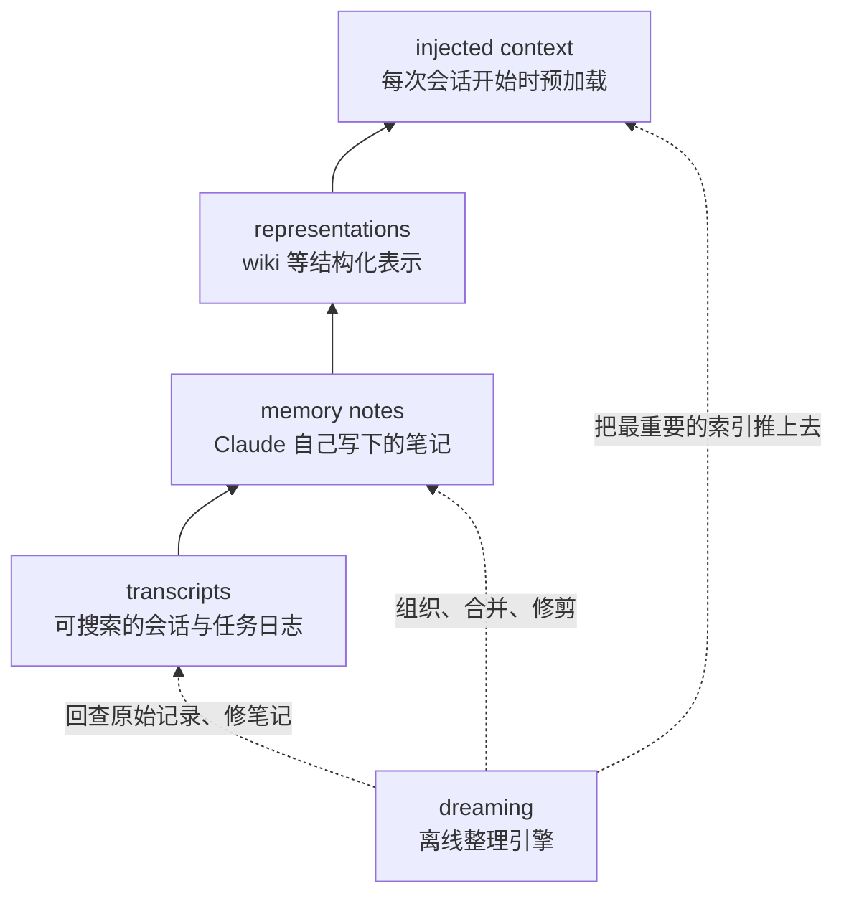

## 先把结构摆出来

Anthropic 把 Claude 的记忆分成四层，从下往上，离「当前这次会话」越来越近：



| 层 | 内容 | 谁写的 | 怎么用 |
| --- | --- | --- | --- |
| transcripts | 完整的会话与任务记录，可搜索 | 系统自动 | 出事时回查，是校验锚点 |
| memory notes | Claude 主动记下的显著事件、规则、陷阱 | Claude | 下次会话直接读 |
| representations | wiki 一类结构化知识，带链接 | Claude（dreaming 期间） | 当地图用，减少盲目搜索 |
| injected context | 每次会话自动加载的一小段 | harness + dreaming | 不搜索也能看到 |

这四层不是四个数据库，而是**四种成本不同的访问路径**：越往上越便宜（不用搜），容量越小；越往下越全（什么都在），但每次都要花动作去检索。

## dreaming 不是第五层

很多人第一次读会把 dreaming 当成「又一层存储」，其实它不是存东西的地方，而是**维护前面四层的进程**：

- 回查 transcript，发现笔记写错了，改掉；
- 把零散笔记合并成 wiki 页面，去掉重复、补上链接；
- 把最常用、最关键的索引推到顶层，把过时的细节往下压。

原文的比喻是睡眠：海马体在线的、快速的编码（相当于 session 里随手记），睡眠期间离线回放、巩固、整合进新皮层（相当于 dreaming 整理成长期知识）。人在线的时候记不住所有细节，靠的是睡一觉之后的整理。

## 生命周期，不是一次性搬运

四层之间没有「上传」这个动作，有的是一个流动过程：

```text
新经验  →  先落成笔记（便宜、粗糙、可能重复）
        →  多次被用到、验证过  →  升格成 wiki 页面
        →  高频、关键          →  只把标题和链接推到顶层
        →  环境变了、失效      →  下推、合并或删除
```

这个细节很重要：**新知识默认进最便宜的那一层，只有反复验证过才配往上走。** 反过来，往下走也是正常操作，不是失败——记忆系统里「删掉过时的」和「记住新的」同等重要。

## 边界：哪些不算记忆

原文特意划了三条线，把「不是记忆」的东西排除掉，因为混在一起会让讨论失焦：

| 不算 | 为什么 |
| --- | --- |
| 权重变化 | 那是训练，不是运行时能积累的东西 |
| 单次对话内的学习（in-context learning） | 会话结束就没了，不跨会话 |
| 上下文压缩（compaction） | 是为了让当前任务继续，属于同一场对话内的腾挪 |

判据可以压成三条，同时满足才算这篇讲的记忆：

1. 来自经验（跟用户交互、被指派的任务），不是预训练灌进去的；
2. **跨会话**保留；
3. 保留的形式是**模型之后能读的上下文**（文件、笔记、拼进 prompt 的片段）。

## 落到工程上是什么样

把上面这套翻译成你在自己项目里会写的代码，其实就三样东西：

**一、一份完整日志。** 会话记录原样落盘，能全文搜索。这份东西的价值不在「给模型看」，而在**出事时能对账**——第 4 篇那个位置记错的案例，全靠它能翻回原始记录。

**二、一个可写的笔记目录。** 模型能读、能写、能改。注意是「目录」而不是「一张表」：文件粒度让模型可以只改一行、只删一页。

**三、一个很小的注入头。** 每次请求固定拼进去的一段索引，内容不是知识本身，而是「我知道什么、在哪能找到」。

这三样东西的成本结构完全不同：日志是存储成本（便宜），笔记是维护成本（会膨胀），注入头是每次请求都付的 token 成本（最贵，所以必须小）。

## 常见误区

### 误区：记忆就是向量库

**你以为**：做个 embedding 索引，每次检索 top-k 塞进去，就是记忆系统了。
**其实**：检索解决的是「找得到」，这篇讲的是「该不该存、存错了谁改、下次先看什么」。原文里 wiki 的价值恰恰是**减少盲目搜索**（每题省约 2 万 token），而不是替代搜索。
**怎么验证**：看你的系统里有没有「改」和「删」的路径。只有写入没有修订，那不叫记忆，叫日志堆积。

### 误区：层数越多越完整

**你以为**：四层都要建，少了哪层都不专业。
**其实**：每一层都要花算力维护，最顶层还要每次请求都付 token。原文的评测里，wiki 在「答案集中在一篇文档」的任务上毫无增益，甚至还出现过膨胀到原文 1.77 倍的情况——那不是记忆，是把语料抄了一遍。
**怎么验证**：问一句「这一层省下了什么」。答不出来就该砍。

```quiz
{"id":"am-01-quiz","title":"四层结构与边界","questions":[
 {"question":"按原文的划分，下面哪一项不属于「agent memory」？","options":["上一次会话里写下的失败规则","跨会话保留的 wiki 页面","训练时改掉的模型权重","每次会话自动加载的索引"],"answer":2,"explain":"权重变化属于训练，不是运行时积累的经验；另外两项分别是笔记/表示层和注入层，都属于记忆。"},
 {"question":"dreaming 在四层结构里扮演什么角色？","options":["第五层存储，专门放长期知识","贯穿四层的维护进程：纠错、合并、上浮、下推","一个检索工具，用来查历史对话","模型权重更新的别名"],"answer":1,"explain":"它是维护引擎，不是存储层；它读 transcript 校验笔记，组织 wiki，把关键索引推到顶层。"},
 {"question":"「新知识先进最便宜的一层」这句话在实际系统里的含义是？","options":["先写进数据库，跑批之后再迁移","先落成粗糙笔记，反复验证过才升格成结构化表示","先进顶层注入，效果不好再下推","先交给人工审核，通过后才入库"],"answer":1,"explain":"原文强调四层之间是流动的：新经验先落笔记，稳定后上升，失效则下推或删除，也就是记忆有生命周期。"}
]}
```

