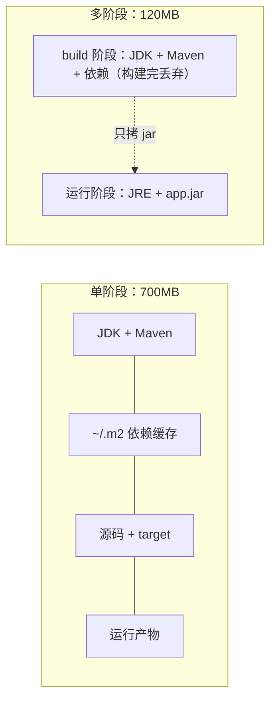

## 这一关在解决什么

你的 Spring Boot 项目镜像 **700MB**，里面有 Maven、JDK、`.m2` 缓存、源码、`target/`——
而运行时真正需要的只有一个 80MB 的 jar 和一个 JRE。

**结论先说**：用**多阶段构建**把"构建"和"运行"拆成两个镜像，最终镜像只留产物。

```sketch
{
  "title": "构建用大镜像，运行只留产物",
  "rows": [
    [
      { "id": "build", "title": "构建阶段", "sub": "Maven + JDK + 依赖缓存", "tone": "amber" },
      { "id": "jar", "title": "只拷出 jar", "sub": "target 里那一个文件", "tone": "blue" },
      { "id": "run", "title": "运行阶段", "sub": "JRE + jar，小得多", "tone": "green" }
    ]
  ],
  "arrows": [
    { "from": "build", "to": "jar" },
    { "from": "jar", "to": "run" }
  ]
}
```
同一个项目可以从 700MB 压到 120MB，而且攻击面也跟着变小（编译器、包管理器都不在了）。

## 先对齐几个词

- **阶段（stage）**：Dockerfile 里一个 `FROM` 到下一个 `FROM` 之间。每个阶段都是一个独立的中间镜像。
- **构建期 / 运行期**：编译需要 JDK、Maven、源码；运行只需要 JRE 和产物。
- **distroless**：谷歌做的"只有运行时、没有 shell 和包管理器"的基础镜像。

## 讲解

### 一张图看清两种写法的区别



### 一个阶段：所有东西都在一个镜像里

```dockerfile
FROM maven:3.9-eclipse-temurin-21
WORKDIR /app
COPY . .
RUN mvn -q -DskipTests package
CMD ["java", "-jar", "target/app.jar"]
```

这个 Dockerfile 能跑，但最终镜像里有：

- 整个 Maven 发行版（约 90MB）
- 完整的 JDK（含 `javac`、`jlink` 等，比 JRE 多 100MB+）
- `~/.m2` 里下载过的依赖（几百 MB，项目多的话上 GB）
- 源码与 `.git`

这些都是**构建期的需要**，运行时一样用不上。

### 两个阶段：`FROM ... AS build` + 只拷产物

```dockerfile
# 阶段一：构建。这个阶段的东西不进最终镜像
FROM maven:3.9-eclipse-temurin-21 AS build
WORKDIR /app
COPY pom.xml .
RUN mvn -q -DskipTests dependency:go-offline
COPY src ./src
RUN mvn -q -DskipTests package

# 阶段二：运行。只拷 jar
FROM eclipse-temurin:21-jre
WORKDIR /app
COPY --from=build /app/target/app.jar app.jar
EXPOSE 8080
CMD ["java", "-jar", "app.jar"]
```

关键只有一行：`COPY --from=build ...`。**只有被显式拷过去的东西才会留在最终镜像里**，
构建阶段的其余内容全部被丢弃（Docker 只保留最终阶段的层）。

### 为什么 `COPY pom.xml` 要单独一行

```dockerfile
COPY pom.xml .
RUN mvn -q -DskipTests dependency:go-offline
COPY src ./src
```

先只拷依赖清单、把依赖下好，再拷源码。这样改代码时**依赖层命中缓存**，构建只重跑编译那一段；
否则每次改一行都得重下几百 MB 依赖。（下一关专门讲缓存的机制。）

### 运行镜像还能再瘦：distroless / alpine / jlink

| 基础镜像 | 大小 | 代价 |
| --- | --- | --- |
| `eclipse-temurin:21-jre` | ~230MB | 有 shell，排查方便 |
| `eclipse-temurin:21-jre-alpine` | ~120MB | musl libc，个别 native 库不兼容；glibc 相关的坑要自己踩 |
| `gcr.io/distroless/java21` | ~90MB | **没有 shell**，`docker exec sh` 进不去；调试只能靠日志与远程 debug |
| `jlink` 自建运行时 | ~50MB | 要显式列模块，用错镜像功能就缺 |

**建议**：先用 `-jre`（能进容器排查），确认稳定后再换 distroless。反过来做，出问题时你会连
"容器里到底有什么"都查不了。

### 多阶段不止两层

```dockerfile
FROM node:20 AS frontend
WORKDIR /web
COPY web/ .
RUN npm ci && npm run build

FROM maven:3.9-eclipse-temurin-21 AS backend
WORKDIR /app
COPY pom.xml .
RUN mvn -q -DskipTests dependency:go-offline
COPY src ./src
COPY --from=frontend /web/dist ./src/main/resources/static
RUN mvn -q -DskipTests package

FROM eclipse-temurin:21-jre
COPY --from=backend /app/target/app.jar /app/app.jar
ENTRYPOINT ["java", "-jar", "/app/app.jar"]
```

前后端一个仓库时常见：前端产物**直接并进后端 jar**，最终镜像只有一个 jar，连 nginx 都不用。

## 动手

拿你手头任意一个能构建的项目：

```text
$ docker build -t demo:single .          # 先用单阶段版本
$ docker images demo:single              # 记下大小
$ docker history demo:single | head      # 看哪些层最胖
```

然后改成两阶段，再比一次：

```text
$ docker build -t demo:multi .
$ docker images | grep demo
```

## 检查一下

```quiz
{"id":"docker-13-quiz","title":"多阶段构建三问","questions":[
 {"question":"最终镜像里会保留哪些内容？","options":["只有最后一个 FROM 阶段的内容，加上被 COPY --from 显式拷过去的东西","所有阶段的内容都会累加","只保留声明了 AS 名字的阶段"],"answer":0,"explain":"Docker 只为最终阶段产层；前面阶段仅作为「可被 COPY 的来源」存在，构建完即丢弃。"},
 {"question":"为什么要把 COPY pom.xml 和 COPY src 分成两行？","options":["让依赖层单独缓存，改代码时不必重下依赖","pom 必须比 src 先解析","为了 COPY 语法要求"],"answer":0,"explain":"层缓存按指令顺序匹配；依赖清单不变则依赖层复用，只重建源码之后的层。"},
 {"question":"distroless 镜像最大的代价是什么？","options":["没有 shell，出了问题进不去容器排查","不能跑 Java","体积更大"],"answer":0,"explain":"distroless 去掉了包管理器与 shell，docker exec sh 会失败；调试只能靠日志、指标与远程 debug。"}
]}
```

## 常见误区

### 误区：多阶段构建会让构建变慢

**你以为**：多了一层镜像，构建肯定更久。
**其实**：构建阶段的层本来就要跑；多阶段只是**不让它们进最终镜像**。真要说变慢，是你没做依赖层缓存。
实测同一项目单阶段 3 分 10 秒、多阶段（带依赖缓存）首次 3 分 20 秒、之后改代码 25 秒。

### 误区：镜像越小越好，直接上 alpine 就对了

**你以为**：alpine 体积小一半，肯定更好。
**其实**：alpine 用 musl libc，遇到依赖 glibc 的 native 库（某些 JDBC 驱动、图像处理库、DNS 解析差异）
会出现"本地好好的、容器里连接超时"这类怪问题。体积和省事之间有个平衡点，**先能排查再谈瘦身**。

## 小结

多阶段构建解决的是"构建环境混进运行环境"。记住三件事：`FROM ... AS build` 隔离构建、
`COPY --from=build` 只搬产物、依赖清单单独占一层。剩下的瘦身（distroless、jlink、alpine）是锦上添花，
按排查能力换体积。
