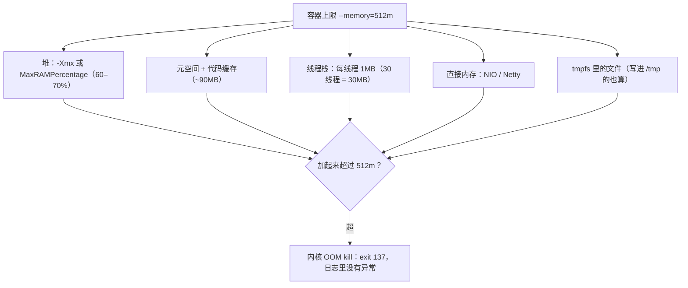

## 这一关在解决什么

Java 服务在容器里跑，`--memory=512m`，堆只设了 `-Xmx256m`，看起来绰绰有余，
结果进程**凭空消失**：`docker ps` 里没了，日志里一行报错都没有。

**结论先说**：容器里 JVM 的"内存"是 **cgroup 上限**加上**非堆开销**（元空间、线程栈、直接内存、
代码缓存），而 `--memory` 是给**整个进程**的。两者算法不同，中间那段就是 OOM kill 的空间。
更常见的第二个坑：JVM 看到的是**宿主机的内存**，于是它按 64G 来算堆——容器 512m 直接被撑爆。

## 先对齐几个词

- **cgroup**：Linux 的"资源配额"机制，`--memory` 就是写进 cgroup。JVM 10+ 会读它。
- **堆 / 非堆**：堆是 `-Xmx` 管的对象区；非堆是元空间、线程栈、直接内存、JIT 缓存。
- **137**：进程被 SIGKILL 杀掉时的退出码（128+9）。内核 OOM 杀进程用的就是它。

## 讲解

### 512MB 的容器里，内存都花在哪



### JVM 看到的内存是谁

JDK 10 之前，JVM 读 `/proc/meminfo` 判断物理内存，容器里的上限它完全不知道。
JDK 10+ 默认开启 `-XX:+UseContainerSupport`，它会读 cgroup 的 `memory.max`：

```text
$ docker run --rm --memory=512m eclipse-temurin:21-jdk \
    java -XX:+PrintFlagsFinal -version | grep -E "MaxHeapSize|UseContainerSupport"
bool UseContainerSupport = true
size_t MaxHeapSize = 134217728      # 128MB = 512m 的 1/4
```

默认 `MaxRAMPercentage=25`：堆最多是容器上限的四分之一。**剩下 75% 是留给非堆的**——
这不是浪费，是必须。

### 一笔账：512m 的容器里跑 Spring Boot

```text
堆（-Xmx256m）              256 MB
元空间 + 代码缓存             ~90 MB
线程栈（30 线程 × 1MB）       ~30 MB
直接内存（NIO、Netty）        ~30 MB
JVM 自身（JIT、GC 结构）      ~50 MB
--------------------------------------
合计                        ~456 MB
```

看起来还在 512m 里。但**页缓存、JIT 编译期的临时分配、GC 的额外空间**都不在这笔账里；
再加上镜像里 `/tmp` 如果用 tmpfs，**它也算容器内存**（这一点最容易忽略——本仓的 MySQL 沙箱
就因为把这个算漏了，`--memory=512m` 时 mysqld 被静默杀掉，日志一行错误都没有）。

### 三种"内存炸了"要分清

| 现象 | 谁杀的 | 特征 |
| --- | --- | --- |
| 容器消失、`docker ps` 没有、exit code **137** | 内核 OOM killer | 无 Java 异常，只有 `Killed` |
| 进程还活着、抛 `OutOfMemoryError: Java heap space` | JVM GC | 有堆栈、有 `-XX:+HeapDumpOnOutOfMemoryError` 的 dump |
| 进程活着、`OutOfMemoryError: Metaspace` / `Direct buffer memory` | JVM（非堆） | 堆没满但容器内存满，往往先被 137 杀 |

**137 = 128 + 9**（SIGKILL）。看到 137 就是内核干的，别去翻 Java 日志找异常。

### 正确的参数写法

```dockerfile
# 别写死 -Xmx：换机器、改容器上限就要改镜像
# 用百分比，让 JVM 自己按 cgroup 上限算
ENV JAVA_TOOL_OPTIONS="-XX:MaxRAMPercentage=70 -XX:InitialRAMPercentage=30 \
    -XX:+ExitOnOutOfMemoryError -XX:+HeapDumpOnOutOfMemoryError \
    -XX:HeapDumpPath=/tmp/heapdump.hprof"
```

- `MaxRAMPercentage=70`：堆占容器上限 70%，剩下 30% 给非堆与页缓存。
- `ExitOnOutOfMemoryError`：堆 OOM 直接退出，让编排重启，而不是半死不活地降级。
- `HeapDumpOnOutOfMemoryError`：**只给能写盘的环境用**；容器里要确保 `/tmp` 有空间，
  否则 dump 写失败等于没设。

### 和 `--memory-swap` 一起看

```text
$ docker run --memory=512m app
$ docker run --memory=512m --memory-swap=512m app
```

第一个命令里 swap 默认是内存的两倍——**JVM 的堆会被换出到磁盘**，GC 时间暴涨，表现为
"没崩但 RT 抖动"。生产一般把 `--memory-swap` 设成和 `--memory` 相等（禁用 swap），
让问题以 OOM 的形式暴露，而不是以 10 倍延迟的形式。

## 动手

```text
$ docker run --rm --memory=256m eclipse-temurin:21-jdk \
    java -XX:MaxRAMPercentage=70 -XX:+PrintFlagsFinal -version | grep MaxHeapSize
size_t MaxHeapSize = 183500800       # ≈ 175MB
```

再看被内核杀的现场：

```text
$ docker run --rm --memory=64m eclipse-temurin:21-jdk \
    java -Xmx256m -XX:+PrintFlagsFinal -version
$ echo $?
137
```

（JVM 自己申请不到堆就会抛 OOM，但当它坚持要 256m 而容器只给 64m 时，内核先动手。）

## 检查一下

```quiz
{"id":"docker-16-quiz","title":"容器里的 JVM 三问","questions":[
 {"question":"容器退出码 137 说明什么？","options":["被内核 OOM killer 用 SIGKILL 杀了","Java 抛了 OutOfMemoryError","镜像不存在"],"answer":0,"explain":"137 = 128 + 9(SIGKILL)。内核杀进程不留 Java 堆栈，所以日志里看不到异常。"},
 {"question":"为什么推荐 -XX:MaxRAMPercentage 而不是 -Xmx？","options":["让 JVM 按 cgroup 上限算堆，换机器或改上限时不用改镜像","百分比能省内存","-Xmx 在容器里不生效"],"answer":0,"explain":"MaxRAMPercentage 读 cgroup memory.max 的百分比；写死 -Xmx 会在换环境时过小或过大。"},
 {"question":"容器内存里最容易被漏算的一项是什么？","options":["tmpfs 里的文件（例如写进 /tmp 的数据库目录）","JVM 的元空间","线程栈"],"answer":0,"explain":"tmpfs 属匿名页，计入容器内存。本仓 MySQL 沙箱就因此被无声 OOM；设 1g 才稳。"}
]}
```

## 常见误区

### 误区：`-Xmx` 加起来不超过 `--memory` 就安全

**你以为**：堆 256m + 容器 512m，还有一半余量。
**其实**：非堆开销随负载变化（线程数、GC 结构、JIT 缓存、直接内存）。见过不少服务在压测时
才炸，因为平时线程只有 20 个、压测时 300 个，每个 1MB 栈就是 300MB。
**经验值**：堆占比 60–70%，别超过 75%。

### 误区：容器里 OOM 是"内存设小了"，加内存就好

**你以为**：`--memory` 从 512m 加到 1g 就没事了。
**其实**：先分清是哪一种 OOM。堆 OOM（有异常）是内存不足或泄漏；137 是**总内存**超了，
可能是一条大 SQL 的排序、一个超大响应体、或者 tmpfs 磁盘占用。加内存只是推迟问题，
真正的修法是找到"非堆增长源"（本仓实测过：`--memory=512m` 起 mysqld 必死，1g 才正常，
因为 78MB 的 datadir 在 tmpfs 里也计入）。

## 小结

容器里给 JVM 定内存，先记住三层：`--memory` 是**整个进程组**的天花板；JVM 用
`MaxRAMPercentage` 从 cgroup 上限里按比例取堆（60–70%）；剩下的是元空间、线程栈、直接内存和
tmpfs。退出码 137 是内核杀的、没有 Java 异常；`--memory-swap` 与 `--memory` 相等可禁用 swap，
把抖动换成明确的 OOM。
