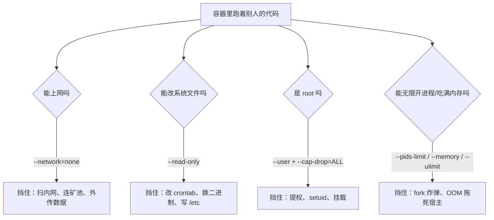

## 这一关在解决什么

你要跑**别人写的代码**（用户提交的作业、不可信的脚本），它可能删库、可能扫内网、可能挖矿。
默认的 `docker run` 拦不住这些——容器里的 root 就是 root，能写整个文件系统，能上网。

**结论先说**：把容器"焊死"靠六个参数：`--user`、`--read-only`、`--cap-drop=ALL`、
`--network=none`、`--pids-limit`、`--memory/--cpus`。下面每个都给出它到底挡住了什么，
以及**焊死之后踩到过的坑**（本仓线上沙箱的真实记录）。

## 先对齐几个词

- **capability**：把 root 的特权拆成几十项（改网络、挂文件系统…）。`--cap-drop=ALL` 是"一项都不给"。
- **只读根**：容器里的 `/` 不可写。要写只能写挂进来的 tmpfs。
- **fd（文件描述符）**：进程能同时打开的文件数上限，`--ulimit nofile` 管它。
- **tmpfs**：内存里的临时文件系统，容器退出即消失，**且计入容器内存**。

## 讲解

```sketch
{
  "title": "跑不可信代码：几个参数把它焊死",
  "rows": [
    [
      { "id": "user", "title": "--user", "sub": "不是 root", "tone": "blue" },
      { "id": "ro", "title": "--read-only", "sub": "根文件系统只读", "tone": "blue" },
      { "id": "cap", "title": "--cap-drop=ALL", "sub": "不留特权", "tone": "blue" },
      { "id": "net", "title": "断网", "sub": "扫不了内网", "tone": "green" }
    ]
  ],
  "arrows": []
}
```

### 一道请求要过六道门



### 一个真实的最小加固命令

```text
$ docker run --rm -i \
    --network=none \
    --read-only \
    --tmpfs /tmp:rw,size=64m,exec \
    --user 65534:65534 \
    --cap-drop=ALL \
    --security-opt=no-new-privileges \
    --pids-limit 64 \
    --memory 256m --memory-swap 256m --cpus 0.5 \
    --ulimit nofile=64 --ulimit nproc=64 \
    --entrypoint sh \
    eclipse-temurin:21-jdk-alpine -c 'javac Main.java && java Main'
```

逐条解释：

| 参数 | 挡住什么 |
| --- | --- |
| `--network=none` | 没有网络栈（除了 lo）。扫内网、连矿池、外传数据全都失败 |
| `--read-only` | 根文件系统只读。改系统文件、写 crontab、替换二进制都不行；要写只能写挂进来的 tmpfs |
| `--tmpfs /tmp` | 唯一可写处，且有大小上限，容器退出即消失 |
| `--user 65534:65534` | 不以 root 运行（nobody）。配合 `--cap-drop` 才完整 |
| `--cap-drop=ALL` | 丢掉全部 Linux capabilities（`CAP_NET_RAW`、`CAP_SYS_ADMIN`…） |
| `--security-opt=no-new-privileges` | 禁止 setuid 提权 |
| `--pids-limit` | 挡住 fork 炸弹 |
| `--memory/--cpus` | 挡住把宿主机吃干 |
| `--ulimit nofile/nproc` | 挡住 fd 泄漏与进程数爆炸 |

### 焊死之后才会遇到的三个坑

**坑一：`/tmp` 太小，编译直接失败**

`--read-only` 下 `javac` 连 class 文件都写不了，必须给 tmpfs。而 tmpfs 默认 `noexec` 时
连执行都不行——`--tmpfs /tmp:rw,size=64m,exec` 里的 `exec` 不是可选的。

**坑二：`--read-only` 让 Java 找不到 `$HOME`**

基础镜像往往把 `MAVEN_CONFIG=/root/.m2` 写死在环境变量里。非 root 用户读不到 `/root`，
于是 Maven 报"无法写 copy_reference_file.log"，然后**是一堆看起来像依赖缺失的错**。
修法是显式给可写 HOME：

```text
-e HOME=/tmp/home -e MAVEN_CONFIG=/tmp/home/.m2
```

**坑三（最反直觉）：`--ulimit nofile=64` 让 Maven 报"类缺失"**

本仓的 Spring 沙箱第一版就死在这：

```text
[ERROR] Execution default-resources of goal maven-resources-plugin:3.3.1:resources failed:
        A required class was missing while executing ...: org/apache/commons/lang3/StringUtils
```

看着像依赖没下全，其实是**打开文件数被限死**，Maven 加载插件时某个 jar 打不开，
表现为"类缺失"。把 `nofile` 提到 1024 就好了。

**教训**：`--ulimit` 不是为了安全把数字压到最小，而是"压到刚好够用"。压过头，
错误会伪装成别的问题。

### 与"生产环境"的差别：这些参数不是为了跑得顺

生产环境的应用容器一般**不**这么焊：它要访问数据库（有网络）、要写日志文件（可写层）。
焊死这套是给**执行不可信代码**的场景用的——判题沙箱、CI 构建、多租户函数计算。

判断标准很简单：**这段代码的作者是不是你信任的人？** 不是，就焊死。

### 用什么验证真的焊死了

```text
# 看实际生效的参数
$ docker inspect --format '{{json .HostConfig}}' <容器> | python3 -m json.tool

# 在容器里试三件事
$ docker run --rm --network=none --read-only --cap-drop=ALL alpine sh -c \
    'wget -T2 http://1.1.1.1 ; touch /root/x ; ping -c1 127.0.0.1'
wget: network unreachable
touch: /root/x: Read-only file system
```

三条都失败，说明方向对了。

## 动手

用本仓的 Spring 镜像实操一次（镜像名按你本地实际改）：

```text
$ docker run --rm --network=none --read-only --tmpfs /tmp:rw,size=512m,exec \
    --user 65534:65534 --cap-drop=ALL --security-opt=no-new-privileges \
    --pids-limit 256 --memory 1g --memory-swap 1g --cpus 2 \
    --ulimit nofile=1024 --ulimit nproc=256 \
    --entrypoint sh paideia-spring:3 \
    -c 'mkdir -p /tmp/app /tmp/home && cp -a /opt/skeleton/. /tmp/app/ && cd /tmp/app \
        && HOME=/tmp/home MAVEN_CONFIG=/tmp/home/.m2 \
           mvn -o -q -Dmaven.repo.local=/opt/m2/repository test'
```

再把 `nofile=1024` 改成 `64` 跑一次，看它如何用"类缺失"的措辞骗你。

## 检查一下

```quiz
{"id":"docker-17-quiz","title":"容器加固三问","questions":[
 {"question":"--read-only 之后，程序要临时写文件应该写到哪？","options":["挂进来的 tmpfs（例如 /tmp），容器退出即消失","可写层","/dev/shm 之外都不行"],"answer":0,"explain":"根文件系统只读时唯一可写处是显式挂的 tmpfs；注意要带 exec 才能执行里面的二进制。"},
 {"question":"--ulimit nofile=64 在 Maven 项目里会表现成什么？","options":["「类缺失」这类看起来像依赖没下全的错","明确的 too many open files","网络超时"],"answer":0,"explain":"fd 打不开时类加载器报 ClassNotFoundException / class missing，日志中看不到 EMFILE，极具误导性。"},
 {"question":"哪一类场景最需要这套加固？","options":["运行不可信代码：判题沙箱、CI 构建、多租户函数","普通生产 Web 服务","本地开发环境"],"answer":0,"explain":"生产服务需要网络与可写目录，通常只需要非 root 与只读根；焊死这套是给「代码作者不可信」的场景。"}
]}
```

## 常见误区

### 误区：容器就是沙箱，天然安全

**你以为**：跑在容器里，出不了事。
**其实**：默认的容器里是 root、能上网、能写整个文件系统、有几十个 capability。
容器隔离的是**资源与命名空间**，不是"恶意代码"。要安全就得逐条关掉。

### 误区：参数越严越好，能跑就行

**你以为**：把所有限制压到最小最安全。
**其实**：压过头会让**错误伪装成别的问题**（nofile → 类缺失；tmpfs 小 → 编译失败；
只读根 → 依赖解析失败）。而且每次都要重新排查。正确做法是"刚好够用 + 留可观测"：
限制设成已知能跑的最小值，并把 `docker inspect` 的 HostConfig 记进文档。

## 小结

六个参数构成一套完整的"焊死"：无网络、只读根（+ tmpfs 可写）、非 root、丢能力、限进程数、
限内存与 CPU。它们挡住的是"不可信代码"的最基本四件事：外联、篡改、提权、吃干宿主。
两条实战经验：`/tmp` 要 `exec`，`nofile` 不能压太低（否则 Maven 用"类缺失"骗你）。
