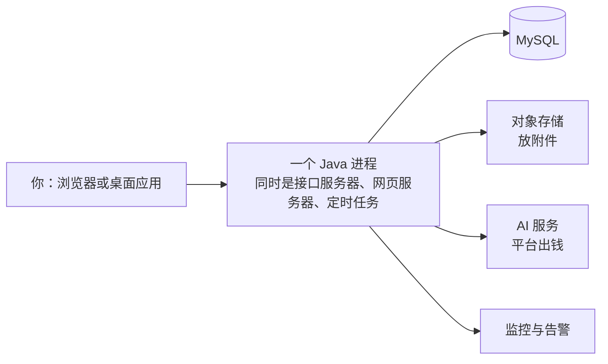

## 这条线讲什么

你在别的教程里学到的是「知识点」：SQL 怎么写、Redis 有什么数据结构。这条线讲的是另一件事——**一个真的在跑的系统，是怎么把这些知识点拼成产品的**。

九篇，全部从业务流程讲起，一层层落到实现细节：

- 你点一个按钮，请求经过谁的手；
- AI 回你一句话，钱在哪一步动；
- 你在练习页跑的 SQL，实际在哪台机器上执行；
- 夜里没人看的时候，出问题怎么被抓住。

**这不是源码导读。** 源码带你看「这个函数写了什么」，这条线带你看「为什么必须这么写」——每一个设计背后都有一个具体的约束，不写清楚约束，抄来的结构只会变成负担。

## 怎么读

按顺序读最省力，因为后面的篇目会用到前面建立的概念。如果只想挑一篇，挑 **03（AI 对话与积分）**——它是全站最复杂的一条链路，把「钱、流式、工具调用」三件事撞在了一起。

后面几篇会出现一些代码片段，那是**证据**，不是要求你背下来。看不懂代码也没关系，每张图前面都有一句人话解释。

## 先建立一个整体印象

这套系统没有微服务、没有消息队列。**一台机器、一个 Java 进程、一个数据库**，前端静态文件由同一个进程顺带发出去。



所以「某个服务挂了」这种事不存在——出问题就是那个进程直接报错。这个选择有明确代价，第一篇会讲。

## 这条线不会告诉你的

- **不会教你写代码。** 语法、框架用法在别的线里。
- **不会给出全部实现。** 只挑「有约束、有取舍、踩过坑」的部分，常规的增删改查不值得占篇幅。
- **数字会过期。** 凡是写出来的数量（几个模块、几个接口），都以仓库里的代码为准；这条线只保证「判断」不过期。

## 路线图

```learning-path
{
  "title": "从一次点击到一个系统",
  "steps": [
    { "title": "一个进程装下所有东西", "summary": "为什么不是微服务，代价是什么", "minutes": 12 },
    { "title": "一次请求的一生", "summary": "四道闸，四种拒绝，一把令牌", "minutes": 14 },
    { "title": "AI 回答一句话，钱在哪一步动", "summary": "先冻结再调用、工具循环、流式事件", "minutes": 18 },
    { "title": "助手是怎么「记住」你的", "summary": "三条写入、一条召回、三个开关", "minutes": 12 },
    { "title": "从一篇文章到一次答题", "summary": "内容即代码、题目不建表、掌握度会失准", "minutes": 16 },
    { "title": "在别人的服务器上跑你的代码", "summary": "一次性容器、三道检查、执行计划的坑", "minutes": 18 },
    { "title": "字在长，画面不抖", "summary": "流式渲染与可交互的代码块", "minutes": 14 },
    { "title": "系统自己写事故报告", "summary": "告警看燃尽率、取证是固定查询", "minutes": 16 }
  ]
}
```
