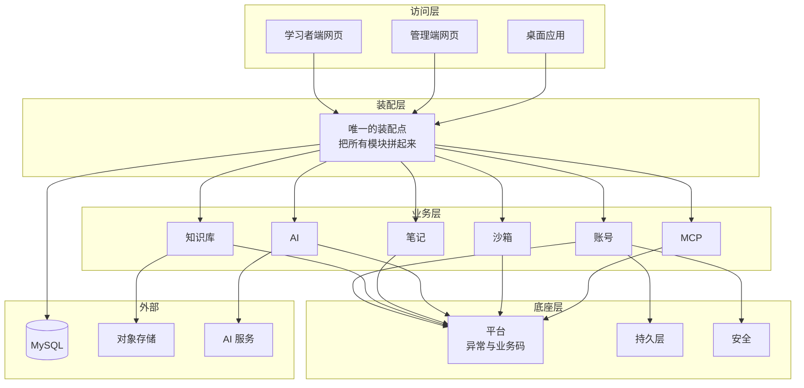

## 先把结论摆出来

这套系统的部署形态是：**一台机器、一个 Java 进程、一个数据库**。前端网页也由这个进程顺带发出去。

它内部被切成十来个模块（账号、知识库、笔记、AI、沙箱、MCP……），但那些模块是**编译期边界**，不是部署单元——它们全部打进同一个 jar，由同一个系统服务跑起来。

所以有三件事在这个系统里不存在：

- **没有「某个服务挂了」。** 出问题就是那个进程报错。
- **没有服务之间的 HTTP 调用。** 跨模块就是普通的方法调用，不会超时、不会重试。
- **没有「后端发了、前端没发」** 这种错位。它们本来就在同一个包里。

## 为什么要切成模块

两个理由，都不是「看起来专业」：

1. **改一处不牵连全仓。** 模块之间只许通过公开接口说话，实现类改名、拆类、换存储，外面感觉不到。
2. **让编译器替你守边界。** 依赖只许单向；跨模块去动别人的内部实现，构建直接失败。这比 code review 靠谱——reviewer 会累，编译器不会。



注意业务层的六个模块之间**没有箭头**：它们彼此不认识，只认识底座层。唯一的例外是 AI 模块会用知识库和沙箱的**公开能力**（读条目、跑 SQL），而不是直接读它们的表。

## 代价写在明面上

单体不是没有代价，把代价讲清楚才算讲完设计：

- **不能按模块独立发版。** 改一行笔记模块的代码，也要重启整个进程。一次纯后端发布大约一分钟，可以接受；但如果一天要发十次，就该考虑拆。
- **一个模块把内存打爆，全体一起挂。** 目前只有 AI 长文本与代码沙箱有这种潜力，所以沙箱被单独上了资源上限。
- **边界靠构建守，不靠网络隔离。** 有人在同一个模块内部乱来，谁也拦不住。

**什么时候该拆？** 三个信号：AI 调用成为主要负载、需要给沙箱单独设资源上限、或者要按模块独立发版。在那之前，拆只会多出两份运维负担。

## 一个容易被忽略的细节

模块之间虽然不共享表，但也**没有外键**。所以「删用户」这件事不是数据库级联帮你做的，而是每个模块自己去删自己那张表。

代价很具体：**新增一张带用户 id 的表，必须同时把它加进注销清单**，否则用户注销后数据还在，而且没有任何报错、没有任何测试会变红。这是后面第 05 篇「内容与学习」会再提到的一条。

## 小测

```quiz
{
  "title": "检查一下",
  "questions": [
    {
      "question": "这套系统的模块边界主要靠什么保证？",
      "options": [
        "靠网络隔离，每个模块是独立进程",
        "靠构建期检查：依赖单向、不许跨模块引用内部实现",
        "靠开发者的自觉"
      ],
      "answer": 1,
      "explain": "模块全部打进同一个 jar，是编译期边界。构建期检查挡循环依赖与跨模块访问内部实现；网络隔离在这里根本不存在。"
    },
    {
      "question": "把系统拆成微服务，在这个项目里最直接的代价是什么？",
      "options": [
        "代码会变多",
        "「扣积分 + 落消息 + 写流水」这类必须原子完成的事，要引入分布式事务或最终一致",
        "不能再写 SQL"
      ],
      "answer": 1,
      "explain": "事务边界在库里，不在网络里。拆开之后要么分布式事务，要么接受最终一致——为一个人的项目换来的复杂度不划算。"
    }
  ]
}
```
