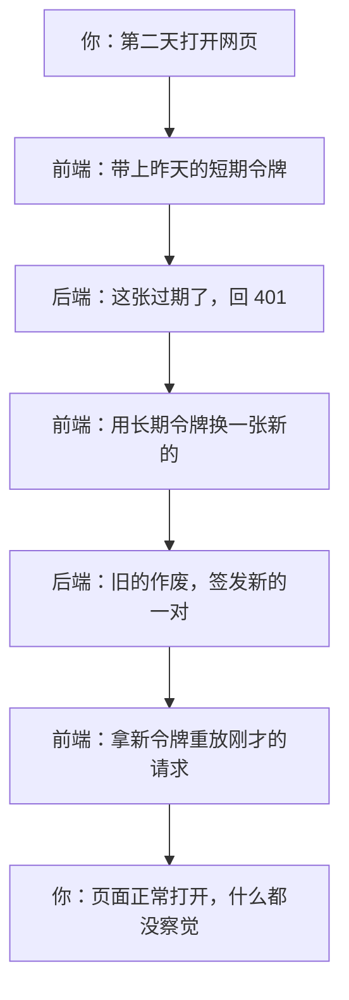
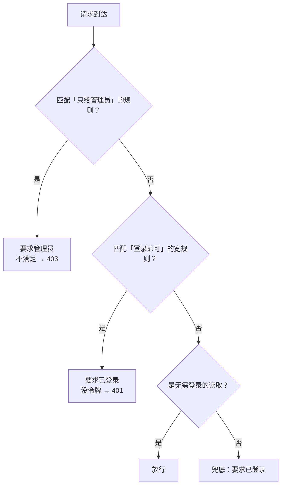

## 先把结论摆出来

每个请求最多被拒绝四次，而且**每种拒绝的含义完全不同**：

| 状态 | 谁拒的 | 含义 | 前端该怎么办 |
| --- | --- | --- | --- |
| 401 | 鉴权层 | 你没证明你是谁（没令牌 / 过期 / 签名不对） | 悄悄换一张令牌重试 |
| 403 | 鉴权层 | 证明了，但你不是这个角色 | 不要重试 |
| 402 | 业务层 | 你是对的人，但余额不够 | 提示去看积分，不要重复提交 |
| 429 | 限流 / 排队 | 太快了，或现在太忙 | 等一下再说 |

**401 与 403 是两件事，别混。** 混在一起就会出现「没权限时疯狂重试换令牌」这种无意义的循环。

## 一、令牌是两张，不是一张

短的用来干活，长的只用来换短的。为什么必须两张？因为一张做不到：**又要每次带上、又要不能长期有效**。



**换令牌这一步必须无感。** 用户能感觉到它，就说明设计错了。

## 二、令牌被盗用了怎么办

长期令牌在换新的时候会**作废旧的**。如果旧的又被用了一次，只有两种可能：你重复刷新了，或者有第二个人拿着它。

这两种情况在代码里被当成同一件事处理：**把整条链一起作废**，要求重新登录。

```text
UPDATE refresh_tokens
   SET revoked_at = ?
 WHERE id = ? AND revoked_at IS NULL
```

这条语句影响的行数，就是「谁抢到了这次轮换」的唯一信号。影响 0 行，说明别人刚换过——按盗用处理。**并发刷新不打架，也不靠锁**，靠的就是一条带条件的更新。

代价要说清楚：**登出不能立刻生效**。登出只作废长期令牌，已经签发的短期令牌在剩余寿命内仍然能用。这是无状态令牌的固有取舍；要立刻失效，就得引入黑名单，那就变回有状态了。

## 三、规则按顺序判定，第一条匹配就停

这是全站最容易出错的地方，因为它**不会报错**。



问题出在 Q1 和 Q2 的顺序上：如果把「登录即可」写在「只给管理员」前面，管理员那条**永远不会被走到**。它不报错、不告警，只会在某天表现为「任何登录用户都能改别人的数据」。

已经有过一次真实缺陷：一个管理端接口写在了宽规则后面，任何登录用户都能下架别人的数据集。它是被接口契约测试抓到的，不是被人发现的。

**所以有一条命名纪律**：管理端接口一律挂在 `/模块/admin/**` 下面。不是这个形状的路径会直接落到兜底规则，看起来加了 `admin`，其实谁都能调。

## 四、两个响应维度

一次响应的 HTTP 状态码和响应体里的业务码是**两个维度**：

- 运维看 HTTP 状态码；
- 前端只认业务码。

两者都必须对。历史上有一个坑：业务码正确，但映射表漏了兜底分支，于是一个「余额不足」被报成了 500——前端看到的是「服务器内部错误」，用户以为系统崩了。

还有一条容易忽略：**未知路径要显式返回 404**。否则它会被兜底成 500，把「你路径写错了」显示成「服务端崩了」，顺便掩盖了「这个接口本该存在」这个事实。

## 小测

```quiz
{
  "title": "检查一下",
  "questions": [
    {
      "question": "接口返回 403 时，前端应该做什么？",
      "options": [
        "换一张令牌重试",
        "提示没有权限，不要重试",
        "等一会儿重试"
      ],
      "answer": 1,
      "explain": "403 表示身份已确认、角色不够。换令牌或重试都不会改变结果，只有 401 才该走换令牌重试。"
    },
    {
      "question": "为什么管理端接口必须挂在 /模块/admin/ 下？",
      "options": [
        "好看",
        "只有这个形状能被写在任何宽规则之前，否则会落到兜底规则、等于人人可调",
        "为了做日志分类"
      ],
      "answer": 1,
      "explain": "规则按声明顺序第一条匹配生效。管理端规则必须排在「登录即可」的宽规则之前；换个路径形状就匹配不上，直接落到兜底。"
    }
  ]
}
```
