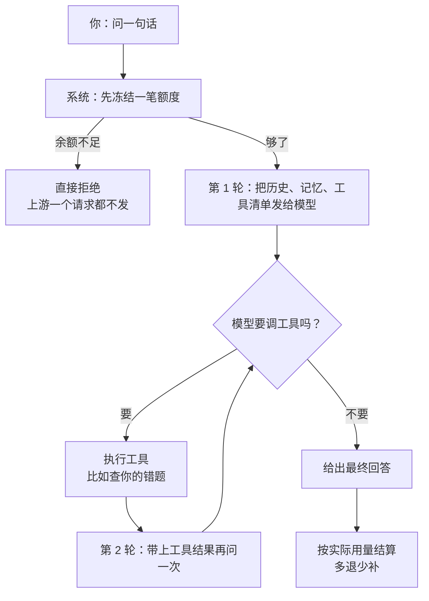

## 先把结论摆出来

你打一句话点发送，系统做的第一件事**不是**去问 AI，而是先从你的余额里冻结一笔钱。冻结不成功，一个请求都不会发出去。

回答写完后，按实际用量结算：冻结的退回，只扣真正花掉的那一点。线上真实跑过一次——**冻结 1000，实扣 2**，其余退回。

**「先冻结、后结算」不是记账美化，是唯一能防欠费的形状。** 事后结算意味着你已经把上游的钱花出去了，才去问用户有没有钱；并发场景下这是必然透支。

## 一、一条回答可能花掉好几轮的钱

这是最容易误解的一点。用户看到一次回答，账单上可能是 2 到 5 次调用。



所以「工具循环」不是花哨的说法，它就是字面意义的循环：**每一轮都是一次真实的请求，也都计一次费**。

早期这里有一个只有真跑才看得见的缺陷：每轮都调了上游，但只上报**最后一轮**的用量。结果账少记了，而单测全绿——因为测试把上游端口桩掉了，桩不会抱怨。

## 二、流式回答只有几种事件

浏览器的连接一旦建立，HTTP 状态码就没用了：后面所有的成功与失败都只能以事件的形式推回来。

| 事件 | 作用 |
| --- | --- |
| `thinking` | 模型的思考片段，默认折叠 |
| `content` | 回答正文，一个字一个字地来 |
| `draft` | 生成的笔记草稿，弹窗问你要不要存 |
| `done` | 结束，带消息 id 与追踪 id |
| `error` | 失败，附一句人话 |

**这个分界很重要**：只有连接建立之前的错误能返回正常的 HTTP 状态码（参数不对、余额不足、会话不存在）。连接建立之后，再出事只能靠 `error` 事件，前端必须两边都处理。

## 三、为什么是先冻结

把它想成押金，而不是账单：

```text
冻结 1000  →  调用上游（可能失败）
           →  成功：按实际用量结算，退 998
           →  失败：全额退还
           →  排队满：全额退还 + 告诉用户「太忙了」
```

最后那一行值得单独说。生成任务跑在一个**有界的线程池**里，队列满的时候任务根本没启动。这时预留已经发生了，如果没有补偿出口，用户就会被白扣一次钱——而且界面上看到的是一句「服务器内部错误」。所以那里显式退款，并返回 429。

## 四、账本按用途分开记

余额看一眼账户表就知道；明细在流水表里，一笔一行，自带模型名与输入输出 token 数。

流水**不是一个大类**，而是分开的：

- 对话
- 自动整理记忆
- 面试点评
- 简历解析与改写
- 训练营生成
- 复习出题
- 运维诊断

分开记是需求，不是洁癖：用户要能回答「最近改简历花了多少」「自动整理记忆为什么花了钱」。合成一类，这个账就永远算不清。

## 五、上下文是有预算的

每次发给模型的内容分五段，顺序固定：

1. 系统提示与场景说明（所有人一样）
2. 命中的记忆（最多几条）
3. 对话历史窗口（越老越先掉出去）
4. 当前页面上下文（你在哪篇文章里问的）
5. 你这一句话

回答质量下降时，第一件事是看这五段各自给了多少，而不是先怀疑模型。

## 小测

```quiz
{
  "title": "检查一下",
  "questions": [
    {
      "question": "为什么必须先冻结额度再调用 AI？",
      "options": [
        "为了让账好看",
        "因为事后结算意味着钱已经花出去了，并发下必然透支",
        "因为上游要求先付款"
      ],
      "answer": 1,
      "explain": "冻结是唯一能在「发出第一个请求之前」拒绝的形状。事后结算在并发场景下一定会出现用户余额不够但钱已经花掉的情况。"
    },
    {
      "question": "用户看到一次回答，为什么账单上可能有 3 次调用？",
      "options": [
        "系统重复请求了",
        "工具循环：每轮要调工具都算一次真实调用并计费",
        "显示错误"
      ],
      "answer": 1,
      "explain": "模型可能要调工具，把结果回填后再问一次。每一轮都是真实的上游请求，所以按轮计费才是对的。"
    }
  ]
}
```
