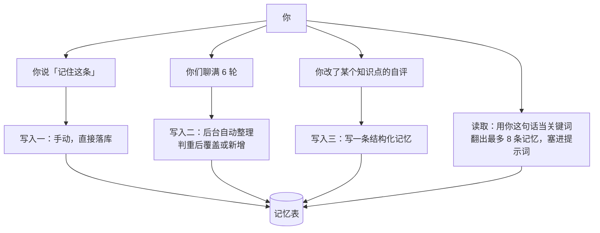

## 先把结论摆出来

助手不会自己决定记什么。记忆是**三条明确的写入路径**，加一条**每轮都自动跑的读取路径**。



所以「加一个开启个性化记忆的开关」这句需求，如果按字面理解会做错：**召回本来就在跑**，缺的从来不是读取，而是写入的自动化程度。

## 一、为什么是「覆盖」而不是「追加」

自动整理的时候，系统不会先去检索有没有相似的记忆，而是把**最近几十条记忆全部喂给模型**，让它判断「这条已经有了」还是「这是一条新的」。

理由很具体：检索做不到语义判重。「我不爱看视频」和「偏好文字教程」字面上没有共同词，但它们是同一件事。先检索再判，这类重复就会漏掉；全喂给模型，代价只是每次整理多几百个 token。

重复时用覆盖，不追加。否则聊得越久，记忆表越长越自相矛盾。

## 二、游标是抢来的

自动整理是异步的：不占用你这一轮问答的时间。但异步会带来一个问题——两个线程同时触发，会不会把同一段对话整理两次？

解法是一条带条件的更新：谁把「已经整理到第几轮」这个游标推过去，谁负责整理。影响 0 行就说明别人刚抢到，自己直接退出。和上一篇「换令牌」用的是同一招：**用一条语句的返回值当锁**。

## 三、三个开关，不是一个

- 总开关：关掉之后写入停止、召回跳过；
- 引用已存记忆：关掉只是不再把它们塞进提示词；
- 引用对话历史：关掉只是不再带上历史。

**关掉不等于删除。** 用户关开关的心理预期是「别再用它」，不一定是「销毁它」。真要销毁，有一个明确动作：清空并关闭。这两个步骤合在一个动作里，是为了避免「先删后关」中间被打断、数据又被写回来。

## 四、提示词里它们排第几

顺序固定：系统提示 → 记忆 → 历史窗口 → 当前页面 → 你这句话。

所以「它有时候像记得、有时候像忘了」通常不是模型的问题，而是这一轮你的问题没有命中任何记忆的关键词。召回是按关键词找人，不保证每次都找得到。

## 五、这条链路已知的缺口

**写入之前没有做敏感信息过滤。** 你把一个 token 粘进对话，自动整理可能把它写成一条记忆。这是一个读代码就能看到、但确实还没补的缺口——写在这里，是因为它比任何「已实现」的功能都更值得知道。

## 小测

```quiz
{
  "title": "检查一下",
  "questions": [
    {
      "question": "关掉记忆总开关之后，已经写进去的记忆会怎样？",
      "options": [
        "全部删除",
        "保留，只是不再写入也不再召回",
        "自动搬到别的地方"
      ],
      "answer": 1,
      "explain": "开关只控制「用不用」，删除是另一个明确动作。把两者合成一个，会让用户在两个不同意图之间没有选择。"
    },
    {
      "question": "为什么自动整理要等聊满几轮才做，而不是每句话都做？",
      "options": [
        "因为模型太慢",
        "因为每句话都整理成本高，而且单句往往还不足以提炼出稳定的信息",
        "因为数据库吞吐不够"
      ],
      "answer": 1,
      "explain": "批量整理既省成本，也让提炼质量更好——一两句话提炼出来的「记忆」大多是噪音。"
    }
  ]
}
```
