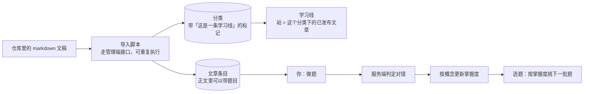

## 先把结论摆出来

学习不是只有「看文章」。一条完整链路是：**读 → 练 → 判 → 记 → 选**。



这里有三个「反直觉」的设计，每一个都是为了**同一份事实只有一个来源**。

## 一、内容是代码，不是后台里手录的

课程与阅读线的正文放在仓库的 `content/` 目录里，是普通 markdown 文件。改内容走代码提交，然后跑一次导入脚本。

导入脚本走的是**管理端已有的写接口**，不新增导入接口，而且**幂等**：第二次运行应当「新建 0、更新 0」。

为什么不直接在管理端编辑？

- 内容改动可以 review、可以回滚、可以跟代码一起发版；
- 手录的内容改一个字都没有审计；
- 一条学习线的名字、顺序写在目录的总览文件里，不用改代码就能新增一条线。

代价也很明确：改内容要跑脚本，所以脚本必须幂等、必须支持试运行，并且在源文件被删时**宁可留一条旧文章，也不静默删线上数据**。

## 二、题目没有表

这是整条链路最反常识的一处：题干、选项、答案**只存在于正文的围栏块里**，数据库里没有任何一张「题目表」。

为什么？因为一旦有了题目表，正文和表就会有一天不一致，而没人知道该信哪个。

那统计怎么做？靠一个四元组：

```text
entry_id     哪一篇文章
block_key    正文里的第几个围栏块
question_key 块里的第几题
fingerprint  题干 + 选项 + 答案的哈希
```

前三个回答「是哪一道题」，第四个回答「**还是不是同一道题**」。内容一改，指纹就变，旧的统计自动失效，不会被错误地套到新题上。

## 三、掌握度会自己骗自己

「你哪块弱」是算出来的：每次答题按概念更新一个掌握度分数，然后按掌握度换算成能力值，再**挑难度接近能力的题**给你。

听起来很合理，但实测结果不好看：

```text
按掌握度选题：信息增益 0.6303
随机选题：    信息增益 0.7619
```

**比随机低了约 17%。** 根因就在回路里：难度永远贴着能力走，于是模型永远拿不到「明显太难」或「明显太简单」的题——而恰恰是这类题最能提供信息。结果掌握度长期在 50% 正确率附近来回震荡，爬不上去。

这条结论是**跑离线模拟量出来的**，不是猜的；代码里也有一条测试断言「当前是错的」，它的作用是防止有人把缺陷当成正常。

## 四、复习会单独记一次

复习不是把错题再推一遍那么随意，它有自己的会话记录：一张会话表里存着你这次要复习的概念与题目（**含答案与解析**），但接口返回时由服务端裁剪成「题号 / 题干 / 选项」——**答案绝不能下发**。

把整行数据直接返回给前端，是这一块最容易犯的错。

## 小测

```quiz
{
  "title": "检查一下",
  "questions": [
    {
      "question": "为什么数据库里没有「题目表」？",
      "options": [
        "因为题目太少",
        "因为正文才是唯一权威，多一份就会不一致，而且没人知道该信哪个",
        "因为查询太慢"
      ],
      "answer": 1,
      "explain": "题目存在正文的围栏块里，统计靠「文章 + 块 + 题号 + 指纹」定位。内容一改指纹就变，旧统计自动失效。"
    },
    {
      "question": "「挑难度接近能力的题」为什么会降低学习效率？",
      "options": [
        "因为题目太难",
        "因为难度跟着能力走，永远拿不到能提供新信息的题，掌握度卡在中间",
        "因为选题太慢"
      ],
      "answer": 1,
      "explain": "太简单和太难的题都不提供信息，中等偏难才提供。把难度锁在能力附近，等于一直做「刚刚好」的题，模型学不到东西。"
    }
  ]
}
```
