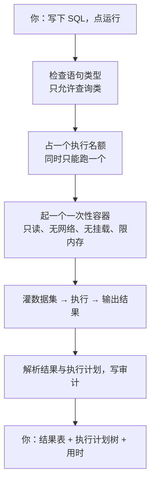

## 先把结论摆出来

你在练习页写一句 `SELECT` 点运行，三秒后拿到结果表和执行计划。这背后**没有「你的数据库」**——每一次运行都是一次性的：起一个容器、灌入数据集、执行、销毁。



## 一、容器参数就是安全边界

启动容器的命令行被拆成了一个**独立的纯函数**，每条加固标志都被单元测试钉死。

理由写在代码注释里：**少写一个加固标志就等于没隔离，而这件事在本地根本测不出来。**

几条硬约束：

- **不挂载宿主目录。** 代码通过标准输入送进容器，宿主机文件系统不出现在里面。
- **镜像来自配置，不来自请求。** 用户输入永远进不了命令行——这是「命令注入」在这个子系统里的唯一入口。
- **根文件系统只读，但 `/tmp` 可写。** 不给可写的 `/tmp`，编译型语言连 class 文件都写不出来。
- **内存与 CPU 按语言取值。** SQL 容器的数据库进程常驻就要三百多兆，按普通语言的限额配会直接被系统杀掉。
- **不截断用户的源码。** 截断后的代码编译不过，报错会指向一段用户看不懂的地方——比直接拒绝更糟。

## 二、代码送进去要「分帧」

一个很小但很致命的细节。

最直觉的写法是：`cat > Main.java`，把代码和程序输入一起倒进去。问题是 `cat` 会一直读到输入结束——**用户传入的程序输入会被追加进源码**，变成莫名其妙的编译错误，而程序自己拿到的是空输入。

正确做法是分帧：先读一行「源码有多少字节」，再精确读那么多字节当源码，剩下的才是程序的标准输入。

## 三、数据集上传：三道检查，顺序不能换

数据集是用户传的 SQL 文件，会被**所有人**在练习时反复执行。所以上传时要过三道：


顺序反了会怎样？一个 10 MB 的垃圾文件会先烧掉一次容器启动，然后才被大小检查拒掉。

**为什么必须干跑？** 不跑的话，用户会拿到一个永远起不来的数据集，而发现时机是**别人用它做题的时候**——那时既不知道是谁传的，也不知道错在哪。

**为什么是白名单，不是黑名单？** 因为 `CREATE TRIGGER`、`CREATE PROCEDURE`、`LOAD DATA` 在数据库里**都是合法语句**。数据集会被反复执行，里面藏一个触发器，就等于把「一次性上传」变成「**每次别人跑都要执行一次**」。黑名单永远会漏，白名单漏掉最多是「某个合法写法被拒」，可以补。

## 四、执行计划：整棵树在一个字段里

一个真实的坑：命令行导出的执行计划，是把整棵树塞进**一个字段值**里的，多行之间用换行符分隔。也就是说结构信息不在结果集里，只能从文本还原。

还原只是第一步。判断「这一步是走了索引还是全表扫描」只能靠字符串匹配，而匹配顺序本身有陷阱：

```text
"Index scan"  包含 scan
"Table scan"  也包含 scan
```

如果先判「包含 scan 就算走索引」，就会把**全表扫描**标成「走了索引」——用户会得到一条假的性能结论。所以判定被收进一个纯函数并单测：先判全表扫描，再判索引族；`Filter` / `Sort` 这类算子一律标「其它」，不参与判断。

## 五、配额：被拒绝的也要留痕

- 每人同时只能跑一个（执行很贵，一次启动就要几秒）；
- 当天次数有上限，按 **UTC 日切**——不为「看起来像本地的一天」引入时区，那会让跨时区部署的计数不一致；
- **被拒绝的请求也写审计，但不计入次数**。审计是为了回答「他为什么被挡」；只在成功时写，用户说「我明明没跑几次」时就无从对账。

## 小测

```quiz
{
  "title": "检查一下",
  "questions": [
    {
      "question": "为什么数据集上传要用白名单而不是黑名单？",
      "options": [
        "白名单写起来更短",
        "因为合法语句里也有能「持续执行」的（比如触发器），黑名单永远会漏",
        "因为数据库不支持黑名单"
      ],
      "answer": 1,
      "explain": "触发器、存储过程、LOAD DATA 都是合法语句。数据集会被别人反复执行，漏掉一个就等于把一次性上传变成持续执行。"
    },
    {
      "question": "为什么编译型语言的容器必须给 /tmp 可写？",
      "options": [
        "为了能下载依赖",
        "因为编译器要往磁盘写中间产物（比如 class 文件）",
        "为了日志"
      ],
      "answer": 1,
      "explain": "根文件系统只读是对的，但没有一处可写的临时目录，编译就没法进行。所以给一个容量受限的内存盘当 /tmp。"
    }
  ]
}
```
