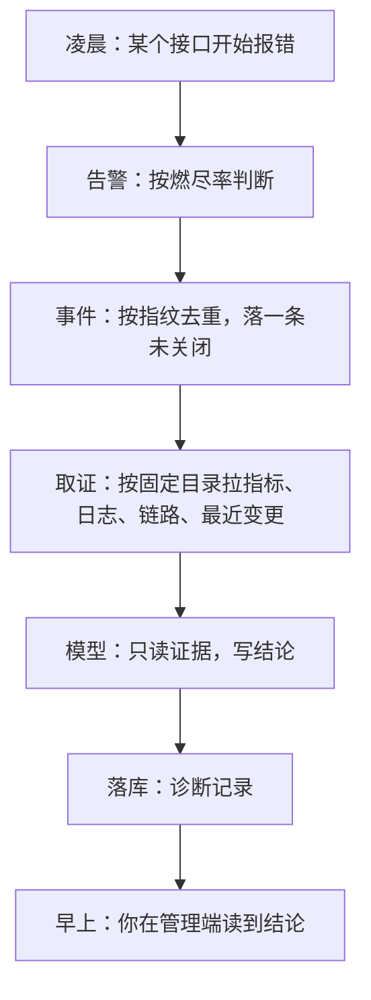

## 先把结论摆出来

凌晨没人看屏幕，服务器出问题怎么被抓住？

不是靠「错误率超过 5% 就叫」，而是靠**错误预算的消耗速度**：按现在这个烧法，这个月的可用性还能撑几天。这个指标叫燃尽率，它对「一直小错」和「突然大错」都敏感，而单一阈值只能顾一头。

告警之后，系统自己收集证据、写出一段结论。你早上看到的不是几十张曲线，而是：**哪个接口、从几点开始、最可能跟什么有关、还有什么没法确认**。



## 一、取证：查询是写死的，模型不能自己编

采集器里有一份固定的指标目录：目标是否可达、CPU、内存、磁盘、错误率、慢请求……每个名字绑定一条写死的查询语句。

这不是偷懒，是边界。让模型自己写查询会同时引入三个问题：

- 它可能编出不存在的指标名；
- 查询会变成注入面；
- **同一份证据每次都不一样，诊断就无法复现**。

所以「加一个新指标」是一次代码改动，不是换一句提示词。

## 二、拿不到数据时，要如实说

监控系统本身也可能挂。这时不能让整次诊断失败，也不能假装「没有异常」。

做法是把拿不到的项标成「未知」；日志为空时写的是「无匹配日志（**或日志服务不可达**）」——把不确定性如实交给模型，而不是让它以为自己看到了全部。

## 三、告警去重：只取稳定标签

一条告警带着几十个标签。指纹只取其中稳定的几个（告警名、级别、实例、服务、挂载点……）。

如果把全部标签都算进指纹，故障期间每次告警都会变成「新事件」——一次故障刷出几十条，反而把真正的问题淹没。

规则是：同一指纹**同时只能有一个未关闭事件**；恢复之后再次触发，是一条**新**事件——因为「抖了一下又好了」和「一直没好」是两件不同的事。

## 四、诊断的编排：单飞、冷却、不排队

| 场景 | 处理 | 原因 |
| --- | --- | --- |
| 同一告警重复来 | 冷却期内跳过 | 告警风暴时可能每分钟都来 |
| 管理员手动触发 | **不冷却** | 人是主动来的，重复点最多多花一次钱 |
| 已有诊断在跑 | 单飞，忙时直接拒绝 | 并发跑多次会让两份报告互相矛盾 |
| 排在队列里等 | **不做** | 排队会让最后那份报告基于过期证据 |
| 应用刚重启过 | 超过 10 分钟的进行中状态视为残留，清掉 | 否则会永远卡在「诊断中」 |

## 五、最容易被忽略的一类 bug：没有数据时

告警规则里最常见的错误不是阈值写错，而是**没有数据时它算出了什么**。真实演练抓到过三个：

1. **错误率在完全没有请求时是空集**，被当成「无数据」——告警既不触发也不恢复，卡在一个说不清的状态。
2. **成功率在没有样本时算出的是「非数」**，而「非数」参与比较永远为假，还会被当成一个数值往下传。
3. **序列化会省略零值字段**，于是「状态：正常」在解析后变成了空串，按字符串比较的代码把它判成「异常」。

三个都不是逻辑写错，而是「没数据时的默认行为」。它们只在演练里出现，因为平时的流量总能让表达式有值。

## 六、怎么知道诊断本身准不准

有一套固定的评测集：十几条典型故障（错误率、CPU、延迟、上游 401、撞库、磁盘、数据库、缓存、定时任务、慢链路、采集不可达……），每条给一份固定证据，断言模型输出里必须出现的关键判断。

分两种模式：

- **提示词模式**：不调真实模型，只验结构解析与约束，能在 CI 里跑；
- **实调模式**：真的调十几次模型，默认关闭——要花钱，而且结果有随机性，放进 CI 就是掷硬币。

**这不是「证明了模型准」，是「证明了它至少不胡说」。** 真实的准确率没有标定过，所以这里也不写任何「准确率百分之多少」的数字。

## 七、这条线没做的

- **只诊断，不自动修复。** 自动修复需要一个动作库和一套回滚保证，而误判的代价远高于晚几分钟。现在最激进的自动化只是「生成事件 + 写结论」，人还是决定者。
- **实调评测没在真实环境跑过。** 这一点写在验收报告里，不是遗漏。
- **真实高流量下的快烧没验过。** 现在只在合成数据上验过。

## 小测

```quiz
{
  "title": "检查一下",
  "questions": [
    {
      "question": "为什么取证查询必须是写死的目录，不能让模型自己生成？",
      "options": [
        "因为模型不会写查询",
        "因为会引入编造指标名、注入面与不可复现三个问题",
        "因为查询语言太复杂"
      ],
      "answer": 1,
      "explain": "固定目录等于白名单：加指标是改代码。让模型现编，同一份故障每次证据都不同，诊断就无法复盘。"
    },
    {
      "question": "「同一指纹同时只能有一个未关闭事件」解决的是什么问题？",
      "options": [
        "数据库容量",
        "故障期间告警风暴把事件表刷爆，真正的问题被淹没",
        "告警延迟"
      ],
      "answer": 1,
      "explain": "告警会重复触发。如果不按稳定标签去重，一次故障会产生几十条事件，值班的人根本看不出主线。"
    }
  ]
}
```
