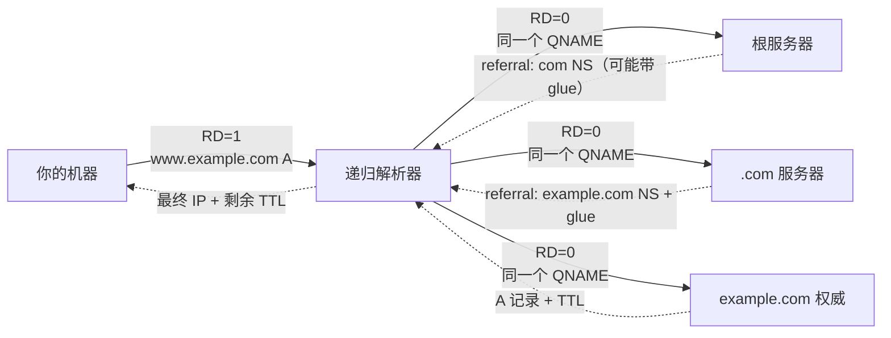

## 改完 A 记录，同事到了新站，你还在旧 IP

```text
PS> curl.exe -s -o NUL -w "dns=%{time_namelookup}s connect=%{time_connect}s tls=%{time_appconnect}s total=%{time_total}s remote=%{remote_ip}`n" https://example.com/
dns=0.041858s connect=0.232561s tls=0.394985s total=0.596660s remote=172.66.147.243
```

这是 2026-11-19 在 Windows 11、curl 8.0.1 上对 `example.com` 的实测，只用来示范输出格式。把域名换成你刚改的那个，这条命令会把问题切成三块：

- `time_namelookup`：解析花了多久。它大，才是解析慢。
- `remote_ip`：这次实际连了谁。它还是 `<旧 IP>`，就是解析错。
- 退出码 6 和 `Could not resolve host`：解析失败，连 IP 都没拿到。

```text
PS> curl.exe -sS https://no-such-host.invalid/
curl: (6) Could not resolve host: no-such-host.invalid
PS> $LASTEXITCODE
6
```

如果你刚把 `www.example.com` 的 A 记录从 `<旧 IP>` 改成 `<新 IP>`，同事打开是新站，你的浏览器还连旧 IP，先别清浏览器缓存。先用上面第一条命令看 `remote_ip`：它证明的是「这台机器这次连了谁」，不是「DNS 里现在是什么」。这两个问题经常不是同一个答案。

`curl.exe -v` 会把选中的地址直接打出来：

```text
*   Trying 172.66.147.243:443...
* Connected to example.com (172.66.147.243) port 443 (#0)
```

## 你只打一次电话，前台在里面转接

域名变 IP 不是一次全局广播。你的机器把问题交给配置里的**递归解析器**（recursive resolver）：运营商给的、公司内网的、`223.5.5.5`、`8.8.8.8`，都是这个角色。它负责把答案找全，或者告诉你查不到。配置里可能有多台，失败会换一台重试。

真正持有记录的是**权威服务器**（authoritative server）。它只回答自己管的那部分，别的区不归它管，也不替你去问。

根服务器和 `.com` 服务器也是权威服务器，只不过它们是各自区的权威：根区里有 `com.` 的委派，`.com` 区里有 `example.com.` 的委派。对你问的 `www.example.com`，它们没有这条记录，只能给你一条**委派**（delegation）：「这个区归下面这些 NS 管」。

机制上更像你只打一次电话给前台：前台说「我来处理」，然后在内部转接；你看不到它最后转给了哪个分机，只拿到结果。客户端到解析器是**递归**查询（RD=1，请对方替你把事办完）；解析器到根、顶级域、权威是**迭代**查询（RD=0，只问这一跳，不要求对方递归）。

这个分工是为了让根服务器不被每台机器直接打爆。答案集中缓存在解析器上，一个人查一次，后面的人复用。但「你只打一次电话」说的是角色关系，不是包数：你的机器可能同时发 A 和 AAAA，失败会重试，解析器也可能走 TCP。这个后面再说。

## 一次冷启动：每一跳都问同一个名字

假设 `www.example.com` 的 A 记录没有任何缓存。下面这张图是骨架：



冷启动的问答按这个顺序发生（协议形态，不是本机抓包）：

```text
递归解析器 → 根服务器
  QNAME=www.example.com, QTYPE=A, RD=0
根 → 递归解析器
  referral: com. NS a.gtld-servers.net（可能带 glue）
递归解析器 → a.gtld-servers.net
  QNAME=www.example.com, QTYPE=A, RD=0
.com → 递归解析器
  referral: example.com. NS ns1.example.com
  additional: ns1.example.com A <glue IP>
递归解析器 → ns1.example.com
  QNAME=www.example.com, QTYPE=A, RD=0
ns1.example.com → 递归解析器
  www.example.com. A <IP>, TTL <TTL>
递归解析器 → 你的机器
  <IP>（TTL 已经按路上花的时间减过）
```

关键点：

- **每一跳的 QNAME 都是 `www.example.com`，QTYPE 都是 A，RD=0。** 不是先问「`.com` 谁管」，再问「`example.com` 谁管」。`com. NS`、`example.com. NS` 是回复里的 authority 记录，不是 question。
- 根和 `.com` 返回的是 **referral**：authority 段是子区的 NS，additional 段可能有 glue。它们不给最终 A。
- **glue** 是父区附上的 A/AAAA，用来打破循环依赖。`example.com` 委派给 `ns1.example.com`，这个 NS 名字在子区里；如果 `.com` 不附它的地址，解析器为了问 `example.com` 得先解析 `ns1.example.com`，而后者又要问 `example.com`。
- 如果 NS 是 `ns1.example-dns.com`，它不在 `example.com` 区里，`.com` 不保证附它的地址。解析器得单独解析这个 NS 名字，可能多出几轮。`example.com` 的真实 NS 是 `elliott.ns.cloudflare.com` / `hera.ns.cloudflare.com`，两个都不在 `example.com` 区里；所以 `.com` 对 `example.com` 的委派不保证附它们的地址。上面用 `ns1.example.com` 只是为了演示 glue。
- **三个委派层级是骨架，不是三个包。** NS 地址不在 glue 里、CNAME、DNSSEC 的 DNSKEY/DS、UDP 截断转 TCP、超时换服务器重试，都可能增加查询。客户端还可能并行发 A/AAAA。所以「最坏三个一问一答」和「你只发了一个包」都不成立。
- 冷启动才从根开始。解析器缓存里有 `.com` 的 NS 时，它可能直接从 `.com` 或权威开始。你的等待也不永远是一次往返：缓存未命中时，你要等解析器把整条链跑完。

本机没法直接复现上面这段 referral：我用原始 UDP 包向 `198.41.0.4` 和 `192.5.6.30` 发过 `RD=0`、`QNAME=www.example.com` 的查询，回来的都是 `RA=1`、`AN=2`、没有 NS 段的递归答案。这条出口把 53 端口接管了。所以上面的流程按 [RFC 1034 §4.3.2](https://www.rfc-editor.org/rfc/rfc1034) 的协议形态写，没有逐包对照。

## 三个缓存、一个静态覆盖、一个权威源

把「缓存」和「权威」分开，表就好读了。答案会在三个地方被缓存，另有一个本地静态覆盖，最后才是权威数据源：

| 位置 | 现象 | 怎么验证 | 怎么清 |
| --- | --- | --- | --- |
| 浏览器 | 同一台机器，无痕窗口或另一个浏览器已经是新 IP，当前窗口还是旧 IP；启用了 DoH 时更明显 | 开无痕/另一浏览器对比；Chromium 系看 `chrome://net-internals/#dns`（Edge 用 `edge://`），Firefox 看 `about:networking#dns` | 清浏览器 host cache，关掉该浏览器的所有进程再开；检查 Secure DNS / DoH 设置 |
| Windows DNS Client | `curl`/`ping` 用旧 IP，`nslookup` 却是新 IP | `ipconfig /displaydns` 看 `Time To Live` 和 `A (Host) Record` | `ipconfig /flushdns` |
| 递归解析器 | 同一解析器下的多台机器都旧；换 `223.5.5.5` 查是新 | `nslookup -type=A example.com 223.5.5.5` 对比默认；直接问权威 NS | 你清不了别人的解析器；等 TTL，或换解析器；自己的递归解析器看软件是否支持清缓存 |
| hosts | 只有这台机器/这个容器不对；`nslookup` 正常，应用连另一个 IP | `Get-Content C:\Windows\System32\drivers\etc\hosts`；`curl -v` 看 `Trying` 后面 | 改/删对应行；`ipconfig /flushdns`；重启应用或浏览器 |
| 权威服务器 | 所有解析器都旧；直接问权威也是旧 | `nslookup -type=NS example.com` 找 NS，再 `nslookup -type=A example.com "<NS 名字>"` | 不是缓存，不能清；改记录，等各缓存 TTL 过期 |

TTL 是秒数，表示这个答案还能被缓存多久。权威给的是原始值，每经过一个缓存就递减；`ipconfig /displaydns` 里看到的是剩余值。2026-11-19 本机清完缓存后跑了一次 `curl`，缓存里出现的是（只摘一条 A）：

```text
Record Name . . . . . : example.com
Record Type . . . . . : 1
Time To Live  . . . . : 238
Data Length . . . . . : 4
Section . . . . . . . : Answer
A (Host) Record . . . : 104.20.23.154
```

这解释了「有人立刻生效、有人几小时后生效」：不是网络快慢，也不是服务器只对部分人生效，而是各自链路上还有哪个缓存没过期。TTL 设成 86400（举例，一天），改完在遵守 TTL 的缓存里最长要等一天；所以变更前先把 TTL 调小，等旧值走完，再改记录，最后调回来。解析器可能给 TTL 设上限或下限，实际时间还要看它。

查不到（NXDOMAIN）也会被缓存，时长取 SOA 的 TTL 和 MINIMUM 里较小的那个。刚建记录却一直报「不存在」，可能是负缓存还没过。

`hosts` 要单独说：它是**静态覆盖**，不是递归解析器里的 TTL 缓存。系统解析器在缓存未命中、发 DNS 查询前会看它，命中就直接用；它本身没有 DNS TTL。但「写上就生效」不对：Windows DNS Client 会把它装进自己的缓存，浏览器有自己的缓存和 DoH，容器有自己的 `/etc/hosts`，部分程序直接绕过系统解析器。顺序是：改 hosts → `ipconfig /flushdns` → 重启应用/浏览器 → 用 `curl -v` 或 `ping` 验证。`nslookup` 看不到 hosts。

`ipconfig /displaydns` 里 hosts 条目也会显示 TTL，那是 Windows 缓存条目的计时，不是 DNS 记录里的 TTL；别拿它当权威值。

本机就有一条 `github.com` 的 hosts 映射。`nslookup github.com` 返回 `20.205.243.166`，`curl.exe -v https://github.com/` 却显示：

```text
*   Trying 140.82.114.3:443...
* Connected to github.com (140.82.114.3) port 443 (#0)
```

两个都没错，只是走的不是同一条路。我一开始也拿 `nslookup` 当「实际解析结果」，直到 `curl -v` 打出另一个 IP 才改过来。所以「hosts 改了但浏览器仍旧 IP」先查浏览器缓存/DoH 和系统缓存，不是先去改权威。

## 记录类型：A、AAAA、CNAME、MX、NS、TXT

| 类型 | 回答什么 | 本机 2026-11-19 查到的例子 |
| --- | --- | --- |
| `A` | IPv4 地址 | `example.com` → `104.20.23.154`、`172.66.147.243` |
| `AAAA` | IPv6 地址 | `example.com` 当前没有 AAAA：`*** No IPv6 address (AAAA) records available for example.com` |
| `CNAME` | 这个名是另一个名的别名 | `www.github.com` → `github.com` |
| `MX` | 邮件该送到哪 | `example.com` → `0 .`（null MX，表示没有授权任何邮件服务器） |
| `NS` | 这个区由谁负责（委派/权威 NS） | `example.com` → `elliott.ns.cloudflare.com`、`hera.ns.cloudflare.com` |
| `TXT` | 任意文本，常用于验证所有权、邮件防伪 | `example.com` → `v=spf1 -all` |

`CNAME` 有两个容易踩的点。第一，同一个名字不能同时有 `CNAME` 和 `A`/`AAAA`/`MX`/`TXT` 等普通记录；DNSSEC 的 `RRSIG`、`NSEC` 是例外。apex（`example.com` 本身）不能放 `CNAME`，因为它必须有 `SOA` 和 `NS`，否则这个区没有起点。第二，`CNAME` 只是别名，解析器拿到它之后还要继续查目标；链太长或成环时，解析器会报错或放弃，具体上限看实现。

`MX 0 .` 不是配置漏了，是 [null MX（RFC 7505）](https://www.rfc-editor.org/rfc/rfc7505)：这个域明确表示不收邮件。`TXT` 里的 `v=spf1 -all` 也不是随便写的字符串，它表示没有授权任何主机代发这个域的邮件。

## 跑一遍：先分清解析慢还是解析错

### 1. 看应用实际连了谁

```text
PS> curl.exe -v -s -o NUL https://example.com/ 2>&1
```

```text
*   Trying 172.66.147.243:443...
* Connected to example.com (172.66.147.243) port 443 (#0)
```

输出里有关地址的是这两行；后面还会跟 `schannel`、`ALPN` 之类的握手细节。`Trying` 后面就是实际 IP。只想取数字用 `-w "%{remote_ip}\n"`。这一步看的是应用，不是 DNS 服务器。

`ping` 也能显示它选了哪个 IP，但 ICMP 可能被挡：本机 `ping example.com` 显示 `172.66.147.243` 后是 `Request timed out`，同一时刻 `curl` 仍能通。所以 `ping` 只用来读 IP，不用来判断服务。

### 2. 看 DNS 服务器返回什么

```text
PS> nslookup -type=A example.com 223.5.5.5
```

```text
Non-authoritative answer:
Server:  public1.alidns.com
Address:  223.5.5.5

Name:    example.com
Addresses:  104.20.23.154
	  172.66.147.243
```

`nslookup` 直接问指定的 DNS 服务器，不读 hosts，也不查 Windows DNS Client 缓存；默认不打印 TTL。它只能证明「那台服务器返回了什么」，不能证明应用用了它。要 TTL 用 `nslookup -d2`，输出里会有 `ttl = 52 (52 secs)` 这样的行。

这台机器上 `Resolve-DnsName` 没加载成功：PowerShell 7.6.3 和 5.1 都报 `Resolve-DnsName` 不是 cmdlet。如果你那边有 DnsClient 模块，清缓存后对比的写法是：

```text
ipconfig /flushdns
Resolve-DnsName example.com -Server 223.5.5.5
```

标准形态，本机未实跑；下面用等价的 `nslookup` 实跑。

### 3. 看系统缓存有没有被填充

```text
PS> ipconfig /flushdns
Windows IP Configuration
Successfully flushed the DNS Resolver Cache.
PS> nslookup -type=A example.com 223.5.5.5
...
PS> ipconfig /displaydns | Select-String example.com
（无输出）
PS> curl.exe -s -o NUL https://example.com/
PS> ipconfig /displaydns | Select-String example.com -Context 0,8
```

```text
Record Name . . . . . : example.com
Record Type . . . . . : 1
Time To Live  . . . . : 238
Data Length . . . . . : 4
Section . . . . . . . : Answer
A (Host) Record . . . : 104.20.23.154

Record Name . . . . . : example.com
Record Type . . . . . : 1
Time To Live  . . . . : 238
Data Length . . . . . : 4
Section . . . . . . . : Answer
A (Host) Record . . . : 172.66.147.243
```

`nslookup` 查完，系统缓存里没有 `example.com`；`curl` 查完，缓存里才出现记录和 TTL。这是本机实跑的结果。别拿 `nslookup` 当「应用实际用了哪个 IP」的证据。

`nslookup` 的返回顺序也不代表优先级。默认解析器、`223.5.5.5`、`8.8.8.8` 在同一时间段返回的 A 集合相同，但顺序不一样；`curl` 两次分别连了 `172.66.147.243` 和 `104.20.23.154`。顺序和选哪个地址，取决于权威服务器、解析器和客户端，不是 DNS 协议保证的轮询。一个域名有多条 A 记录时，解析器可以轮换、可以固定顺序、也可以只返回一条；连续 `nslookup` 还可能命中解析器缓存。别用两次输出推断「轮询正常」。

### 解析慢：按这个顺序查

1. 先用 `curl -w` 确认 `time_namelookup` 占总时间的比例。DNS 段大，才继续查 DNS。
2. `ipconfig /displaydns` 看一眼，再 `ipconfig /flushdns` 后重跑。第一次慢、第二次快，是冷缓存，不是修好了。
3. 换解析器对比：`nslookup -type=A example.com 223.5.5.5`。它快、默认慢，问题在本地解析器或到它的网络。
4. 直接问权威：先 `nslookup -type=NS example.com` 拿 NS，再 `nslookup -type=A example.com "<NS 名字>"`。权威也慢，是这个域/权威的问题。
5. 看有没有重试或截断。超时会换服务器重试，UDP 响应截断会走 TCP；这些等待都算在 `time_namelookup` 里。浏览器走 DoH 时，`curl` 和浏览器的解析路径还可能不是同一条。

没有「按概率排」这回事；上面是排查顺序，不是原因出现频率。

### 解析错：按这个顺序查

1. `curl -v` 或 `-w "%{remote_ip}"` 确认实际 IP。`Could not resolve host` 是解析失败，不是慢。
2. `ipconfig /flushdns` 后重跑。变新了，就是系统缓存。
3. 查 hosts。`nslookup` 仍会显示 DNS 的新 IP，所以它正常不代表应用正常。`Get-Content C:\Windows\System32\drivers\etc\hosts` 看有没有这个域名（编辑要管理员权限）。
4. 换解析器：`nslookup -type=A example.com 223.5.5.5`。默认旧、公共新，是默认解析器缓存或上游的问题；两个都旧，继续往下。
5. 直接问权威：`nslookup -type=NS example.com`，再 `nslookup -type=A example.com "<NS 名字>"`。权威新、解析器旧，等 TTL 或换解析器；权威旧，记录没改或没发布。
6. 浏览器 DoH/应用自带解析器：`nslookup` 正常、浏览器仍旧，先关掉浏览器的 Secure DNS 或换一个没有 DoH 的浏览器对比。
7. 如果查的是 CNAME，继续查目标名。旧目标的 A 记录也会被缓存。

如果是内网分流或 GeoDNS，两个解析器返回不同地址是设计如此；先确认你比的是不是同一条记录。

hosts 放在前面查，不是因为它出现得最多，而是因为它会让 `nslookup` 看起来完全正常，把排查带偏。

## 动手：把解析和服务分开

```text
# 1. 记录当前实际连的 IP
curl.exe -s -o NUL -w "%{remote_ip}\n" https://example.com/

# 2. 清系统缓存后再看
ipconfig /flushdns
curl.exe -s -o NUL -w "%{remote_ip}\n" https://example.com/

# 3. 绕过 DNS，只换解析，不改 Host/SNI
curl.exe --resolve "example.com:443:<IP>" -s -o NUL -w "remote=%{remote_ip}\n" https://example.com/
```

第 3 条把 `<IP>` 换成一条 A 记录。PowerShell 会把裸 `<` 当保留字符，所以占位参数用引号包住。本机用 `104.20.23.154` 跑时输出 `remote=104.20.23.154`。`--resolve` 只影响这次 `curl`，不改系统 DNS，也不改浏览器。

不要用 `https://<IP>/` 代替：证书校验和虚拟主机看的是域名，直接换 IP 会撞上证书不匹配或站点不对。`--resolve` 保留域名，只换解析，这才是「服务本身没问题，只是解析指错」的验证方法。

## 检查一下

```quiz
{"id":"net-03-quiz","title":"域名解析四问","questions":[
 {"question":"递归解析器去问根服务器时，发的查询是什么？","options":["只问「.com 谁管」，不带完整域名","完整 QNAME，但 RD=1，让根服务器递归","完整 QNAME、QTYPE A、RD=0；根返回 referral（NS，可能带 glue）","先查 hosts，再问根"],"answer":2,"explain":"迭代查询每一跳都带完整 QNAME；RD=0 表示请对方不要递归。根和 .com 返回 NS referral（可能带 glue），最终 A 由权威服务器给。"},
 {"question":"改完 A 记录后，同事已是新 IP，你的浏览器还是旧 IP。先做什么？","options":["先用 curl.exe -w 「%{remote_ip}」 或 -v 看实际连了谁，再清缓存和查 hosts","重启服务器","改 TTL","换浏览器主题"],"answer":0,"explain":"先确认应用这次连了哪个 IP，再分缓存、hosts、解析器三条路查；重启服务器和改 TTL 都不解决本地旧答案。"},
 {"question":"hosts 改了但浏览器仍旧 IP，先查什么？","options":["先改权威服务器","先重装网卡驱动","先把 TTL 改成 86400","先看浏览器缓存/DoH 和系统 DNS 缓存，ipconfig /flushdns 后重开，再用 curl -v 确认实际连接"],"answer":3,"explain":"hosts 不是「改完对所有程序立刻生效」；浏览器缓存、DoH、Windows DNS Client 缓存都可能继续用旧答案。先清这些，再用应用层命令确认。"},
 {"question":"nslookup example.com 返回了新 IP，但浏览器还连旧 IP，最可能说明什么？","options":["nslookup 证明浏览器一定用了新 IP","nslookup 只证明 DNS 服务器返回什么；浏览器可能走 hosts、自己的缓存或 DoH","DNS 记录还没生效","浏览器不会解析域名"],"answer":1,"explain":"nslookup 直接问 DNS 服务器，不读 hosts，也不查系统缓存；它和浏览器看到的不是同一条路径。"}
]}
```

## 还差的

- 没有在本机抓到真实的根/ `.com` referral 包。这条出口把 53 端口接管了：我向 `198.41.0.4` 和 `192.5.6.30` 发 `RD=0` 的原始 UDP 查询，回来的都是 `RA=1`、`AN=2` 的递归答案，没有 NS 段。冷启动流程按 RFC 1034 的协议形态写，未逐字节对照。
- 没有覆盖 DNSSEC 验证链。`DS`、`DNSKEY`、`RRSIG` 的查询顺序，验证失败时解析器返回什么，本文只提到它会增加查询。
- 没有在 Chrome/Firefox 上逐项复现 DoH 对 hosts、系统缓存和 `nslookup` 的影响。文中只写了「可能绕过」，没有给出两家浏览器的对照实验。
- 没有验证 CNAME 链长的具体上限。不同解析器实现不同，本文只说会有限制/循环检测，没有给数值。
- 没有写 Windows 以外的清理方式。macOS 的 `dscacheutil`、Linux 的 `resolvectl`/`systemd-resolved` 都没在本文里跑过。
