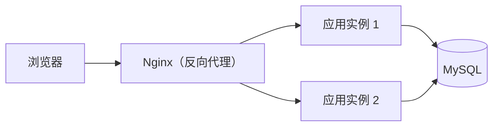

# 上线与运维

## 这条线写给谁

你写过能跑的服务，也 `docker compose up` 起过本地环境，但**第一次把它放到公网**时一堆问号：
域名怎么指过来、HTTPS 证书怎么续、进程挂了谁重启、发布出问题怎么退回去、
半夜报警了先看什么。

这条线不讲"运维体系"，只讲**一个人把一个小服务上线并活下去**需要的那几件事。

## 为什么值得学

因为线上问题和本地问题的性质不同：本地错了可以重来，线上错了**用户已经看到**。
而线上最容易出事的不是业务代码，是这四样——**代理配错、进程没人管、没备份、
出事了不知道先看哪**。它们的共同点是：**出事时你只有几分钟**，必须提前想好。

## 先对齐三个词（新手最常卡在这）

**反向代理**：站在你服务前面的那个"前台"。用户只认识它，它把请求转给你真正的程序。
好处是：端口只开一个、证书只在它这里配、你的程序崩了它还能回一个像样的错误页。

**上游（upstream）**：反向代理眼里的"后端"。Nginx 的 `upstream` 块就是一张"后端名单"，
可以写两台机器，它负责轮着转发。

**探针（probe / healthcheck）**：一句"你还行吗"的自动询问。答得上来才算就绪，
答不上来就别给它分流量（或重启它）。



记住这张图：**后面九关讲的都是这五个框里的事**——怎么让 Nginx 转对（01–02）、
怎么让应用活着（03–05）、怎么知道它出事了（06–09）。

## 九关怎么排

分三段：

- **进来（01–02）**：Nginx。它是几乎所有 Java 服务前面那一层——反向代理、静态资源、
  HTTPS、负载均衡、限流。两关都围绕一件事：**请求到底被哪条规则接走了**。
- **活着（03–05）**：systemd 把 jar 变成受管服务（挂了自动重启、日志进 journald）、
  发布与回滚（出问题怎么三分钟内退回去）、备份与恢复（没演练过的备份不算备份）。
- **看得见（06–09）**：监控与告警（四条黄金信号、告警三条纪律）、排障五层顺序
  （从 load 到线程栈）、K8s 的最小闭环与排障。

```learning-path
{"title":"上线与运维 · 九关","steps":[
 {"title":"Nginx：反向代理与静态资源","summary":"location 匹配顺序；proxy_pass 的斜杠陷阱","minutes":26},
 {"title":"Nginx：HTTPS、负载均衡与限流","summary":"证书与续期；upstream；limit_req 的漏桶","minutes":26},
 {"title":"systemd：把 jar 变成服务","summary":"unit 文件；Restart；日志进 journald；优雅停止","minutes":24},
 {"title":"发布与回滚","summary":"蓝绿、滚动、金丝雀；回滚要能在三分钟内完成","minutes":26},
 {"title":"备份与恢复","summary":"逻辑与物理备份；恢复演练；备份的三个问题","minutes":28},
 {"title":"监控与告警","summary":"四条黄金信号；SLI 与 SLO；告警三条纪律","minutes":26},
 {"title":"排障顺序：从上到下五层","summary":"load → 内存 → 磁盘 → 网络 → 应用线程栈","minutes":28},
 {"title":"K8s 最小闭环：上线与回滚","summary":"八个命令；Deployment/Service；rollout undo","minutes":30},
 {"title":"K8s 排障：从 Pod 状态到事件","summary":"Pending/CrashLoop/ImagePull；describe 与 events","minutes":28}
]}
```

## 一个前提

需要一台能 ssh 的 Linux 机器（1 核 1G 也够）。没有的话：
云厂商的按量实例开一小时就删，成本几毛钱。**这条线的每一步都能真做**。

## 跟其它线的关系

- **Docker 从零开始**：容器怎么跑。这条线里的 Nginx、K8s 都可以用镜像跑。
- **Linux 从零开始**：命令与文件系统。排障那一关会用到 `ss`、`df`、`journalctl`。
- **系统设计**：上量之后的事（缓存、分库、一致性）。这条线只管"一台机器怎么活好"。
