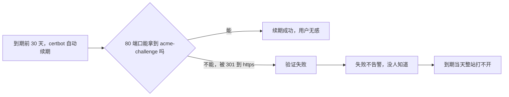

## 这一关在解决什么

三件事：**证书过期**（半夜整站打不开）、**多实例怎么分流**（两台后端，一台机器重启）、
**被刷**（一个脚本把你的接口打到 100% CPU）。

**结论先说**：证书用 ACME 自动续期并加到期告警；负载均衡用 `upstream` + 被动健康检查；
限流用 `limit_req` 的**漏桶**，先设成"能接受的上限"，而不是"看起来合理"。

## 先对齐几个词

- **证书链**：不是一张证书，是一串（你的 + 中间 CA）。少一张浏览器就报"不安全"。
- **ACME**：自动签发证书的协议，Let's Encrypt 用它。验证方式之一是"我能在你的 80 端口放个文件"。
- **漏桶**：限流的模型——请求像水，桶底有个固定大小的洞（平均速率），桶满了就溢（拒绝）。
- **并发连接**：此刻还没结束的连接数。它和"每秒请求数"是两件事。

## 讲解

### 证书为什么会"半夜挂掉"



这张图解释了一个很常见的现象：**续期"配置了"但不生效**，而问题出在 80 端口的跳转顺序上。

### HTTPS：20 行配置 + 一处最容易忘

```nginx
server {
    listen 443 ssl http2;
    server_name example.com;

    ssl_certificate     /etc/letsencrypt/live/example.com/fullchain.pem;
    ssl_certificate_key /etc/letsencrypt/live/example.com/privkey.pem;
    ssl_protocols       TLSv1.2 TLSv1.3;
    ssl_session_cache   shared:SSL:10m;

    location / { proxy_pass http://127.0.0.1:8080; }
}

# 80 端口只做两件事：跳 HTTPS、给 ACME 验证
server {
    listen 80;
    server_name example.com;
    location /.well-known/acme-challenge/ { root /var/www/certbot; }
    location / { return 301 https://$host$request_uri; }
}
```

**最容易忘的一条**：80 端口的 `/.well-known/acme-challenge/` 必须**在跳转之前放行**。
否则证书续期时验证请求被 301 到 https，ACME 拿不到挑战文件，续期失败——
而失败只在到期前 30 天才发生，等你发现时已经快过期了。

续期用 certbot：

```text
$ sudo certbot renew --dry-run          # 先演练
$ sudo systemctl list-timers | grep certbot   # 确认计时器在
```

**再加一层**：证书到期前 14 天告警（`openssl s_client -connect example.com:443 </dev/null 2>/dev/null | openssl x509 -noout -dates`）。
自动续期也可能失败，告警是最后一道保险。

### 负载均衡：`upstream` 与"一台挂了会怎样"

```nginx
upstream backend {
    server 10.0.0.11:8080 max_fails=3 fail_timeout=30s;
    server 10.0.0.12:8080 max_fails=3 fail_timeout=30s;
    keepalive 32;
}

server {
    location / { proxy_pass http://backend; }
}
```

默认是**轮询**。`max_fails=3 fail_timeout=30s` 是**被动健康检查**：
30 秒内失败 3 次 → 摘掉 30 秒。注意它是"按请求失败"统计的，不是主动探测，
所以**第一个打到坏机器的用户会失败**。

想更稳就加主动探测（商业版 `health_check`，或开源版用 `nginx_upstream_check_module`），
或者干脆让上游可发现（Consul / K8s Service）——这也是容器编排更受欢迎的原因之一。

三种策略怎么选：

| 策略 | 适用 |
| --- | --- |
| 轮询（默认） | 后端能力相同 |
| `least_conn` | 请求耗时差异大（有的 5ms 有的 2s） |
| `ip_hash` | 有会话粘性需求（但更好的是把会话拿出去存 Redis） |

### 限流：`limit_req` 是漏桶，不是令牌桶

```nginx
# 定义：每个 IP 平均 10 请求/秒，允许突发 20 个
limit_req_zone $binary_remote_addr zone=api:10m rate=10r/s;

location /api/ {
    limit_req zone=api burst=20 nodelay;
    limit_req_status 429;
    proxy_pass http://127.0.0.1:8080;
}
```

- `rate=10r/s`：**平均**速率。Nginx 的实现是"每 100ms 放一个"。
- `burst=20`：最多攒 20 个（桶的容量）。
- `nodelay`：突发的那 20 个**立刻处理**而不是排队慢慢放（不写则排队，用户看到延迟）。

**设多少**？别凭感觉：先压测拿到"单实例能扛多少 QPS"，限流设成它的 **70%**——
留 30% 给正常突发，超过就该挡。

一个常见误用：对**登录接口**用同一档限流。登录的合理频率是"每分钟几次"，
用 `10r/s` 挡不住撞库。登录单独一个 zone：`rate=5r/m`。

### 一层层挡住：`limit_conn` 与请求体

```nginx
limit_conn_zone $binary_remote_addr zone=conn:10m;
limit_conn conn 20;                 # 单 IP 最多 20 个并发连接
client_max_body_size 10m;           # 请求体上限（上传接口单独放宽）
client_body_timeout 30s;
```

## 动手

```text
$ sudo nginx -t && sudo nginx -s reload

# 验证限流：连打 100 个请求，看有多少 429
$ for i in $(seq 100); do curl -s -o /dev/null -w "%{http_code}\n" http://127.0.0.1/api/health; done | sort | uniq -c

# 验证证书还有多久到期
$ echo | openssl s_client -connect example.com:443 2>/dev/null | openssl x509 -noout -dates
```

## 检查一下

```quiz
{"id":"ops-02-quiz","title":"HTTPS 与限流三问","questions":[
 {"question":"80 端口里 acme-challenge 的 location 为什么必须放在 301 跳转之前？","options":["否则续期验证请求被跳转到 https，ACME 拿不到挑战文件","否则证书无法安装","否则 443 起不来"],"answer":0,"explain":"ACME 的 http-01 验证只能走 80；被 301 之后验证失败，而失败通常要等到期前才暴露。"},
 {"question":"limit_req 的 burst 不写 nodelay 会怎样？","options":["超出速率的请求排队等待，用户看到延迟而不是 429","直接拒绝所有请求","突发请求全被丢弃"],"answer":0,"explain":"漏桶默认会把超出的请求排队按速率放行；nodelay 让突发立刻处理，超出 burst 的才 429。"},
 {"question":"upstream 里 max_fails 的被动健康检查有什么固有缺陷？","options":["它按请求失败统计，第一个打到坏机器的用户一定会失败","它需要额外模块","它只在 https 下生效"],"answer":0,"explain":"被动检查是事后统计：先失败、再摘除。要避免首个请求失败得上主动探测或服务发现。"}
]}
```

## 常见误区

### 误区：买了证书就再也不用管

**你以为**：证书一年有效，装上就完事。
**实情**：一年后**整站打不开**，而且浏览器不给任何"续期"提示。要么用 ACME 自动续期 + 到期告警，
要么把续期写进日历。前者靠工具，后者靠人——**靠人的那一种，一定会忘**。

### 误区：限流设得很低，安全

**你以为**：`rate=1r/s` 更安全。
**实情**：真实用户的首屏往往并发十几个请求（HTML、JS、CSS、图片、接口），
`1r/s` 会让**正常用户**看到 429。限流不是越低越好，它是"挡住明显异常"的下限，
真正的防刷要在应用层（验证码、账号维度、行为分析）。

## 小结

HTTPS 三件：证书链对不对、80 端口给 ACME 留路、到期告警兜底。负载均衡记住
`max_fails` 是被动的（首个请求会失败），要稳就上主动探测或服务发现。限流是漏桶：
`rate` 是平均、`burst` 是容量、`nodelay` 决定突发是"立刻处理"还是"排队"——按压测值的 70% 设，
登录这类敏感接口单独一档。
