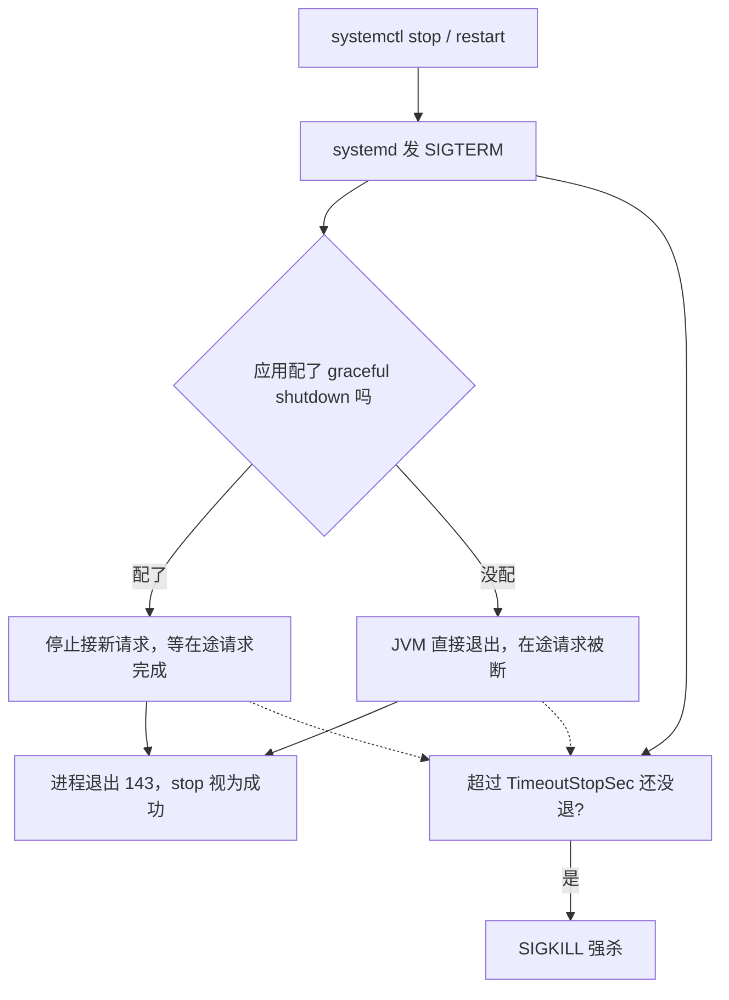

## 进程还活着，但没人管它

一台临时接手的机器上，我要重启一个 Java 服务。先按老习惯找进程：

```text
$ pgrep -af demo.jar
8421 /usr/bin/java -jar /opt/demo/demo.jar
```

进程在。但接着：

```text
$ systemctl status demo
Unit demo.service could not be found.
```

**它活着，systemd 却不认识它。** 这意味着：机器重启它不会起来、它崩了没人拉、它的日志不知道写去了哪、谁也不知道上一个操作它的人做了什么。

这就是"手工起服务"的真实终局——不是起不来，而是**起来之后没人对它负责**。

这一篇讲的就是把这层责任交出去：一个 unit 文件，二十来行，把启动、重启、日志、停止信号全接管掉。

## 先纠正一个流传很广的说法

很多教程开头写"`nohup java -jar app.jar &` 起了服务，关掉终端它就没"。**这句是反的。**

`nohup` 干的事就是忽略 `SIGHUP`——终端断开时内核发给会话进程组的那个信号。加了 `nohup`，关终端它**反而还在**，这也是它名字的由来。真正会随终端消失的是这两条：

```text
$ java -jar app.jar &     # 断终端时可能收到 SIGHUP，跟着死
$ java -jar app.jar       # 前台，Ctrl-C 就没了
```

所以 `nohup` 不是"关终端会死"，而是"关终端不会死，但也仅此而已"。它带来的是另外四个问题：

- **机器重启不会自己起**（nohup 不管开机）；
- **崩了没人拉**（它只挡 SIGHUP，不监控退出）；
- **日志进 `nohup.out`，永不轮转**；
- **停止时直接 SIGKILL 或干脆 kill -9**，在途请求全断。

这四个问题正好是 systemd 的四件事。

## unit 里真正决定成败的几行

```ini
# /etc/systemd/system/demo.service
[Unit]
Description=demo
After=network-online.target
Wants=network-online.target

[Service]
Type=exec
User=app
WorkingDirectory=/opt/demo
ExecStart=/usr/bin/java -XX:MaxRAMPercentage=70 -jar /opt/demo/demo.jar
Restart=on-failure
RestartSec=5
SuccessExitStatus=143
KillSignal=SIGTERM
TimeoutStopSec=40
Environment="TZ=Asia/Shanghai"
EnvironmentFile=-/opt/demo/demo.env
MemoryMax=1G

[Install]
WantedBy=multi-user.target
```

| 配置 | 不管它会发生什么 |
| --- | --- |
| `Type=exec` | 用 `Type=simple` 时 systemd 认为"fork 出去就算起来了"，jar 因为参数错立刻退出也算成功启动；`exec` 会等 `execve` 成功才判定，配错当场在 `status` 里暴露 |
| `User=app` | 用 root 跑业务，一个 RCE 就是整机 |
| `Restart=on-failure` | 不配就崩了不管；配成 `always` 则**正常退出也会重启**，对有"跑完就退"语义的任务会无限循环 |
| `RestartSec=5` | 不配时默认是 **100ms**，崩了几乎立刻重试 |
| `SuccessExitStatus=143` | 见下面"143 到底管什么" |
| `TimeoutStopSec=40` | 默认 90s；但如果它比应用自己的收尾超时还短，systemd 会抢在应用收尾前 SIGKILL |
| `EnvironmentFile=-` | 前面的 `-` 表示文件可以不存在；密钥走这里，**不进 unit 文件**（unit 默认 644，谁都能读） |
| `MemoryMax=1G` | 不设上限，一个内存泄漏能把整机拖到 OOM 杀别人 |

### 143 到底管什么

143 = 128 + 15，意思是"被 SIGTERM 终止"。

先澄清一个常见误解：**`systemctl stop` 发起的停止不会被算成失败**。系统本来就是要它停，退出码 143 完全在预期内，不会触发 `on-failure` 重启。

`SuccessExitStatus=143` 管的是**不是 systemctl 发起的那些退出**——比如别人手工 `kill 8421`、发布脚本直接 kill、上层编排工具强停。这些情况下 systemd 看到一个"被信号杀掉的退出码"，不认就会被判为失败，然后按 `Restart=on-failure` 把它拉起来。你要的是"被 SIGTERM 好好收尾"算正常结束，就写上它。

## 停止时到底发生了什么



注意 `E` 的后果**取决于前面有没有反向代理**：

- 背后有 Nginx / 网关：连接被断，客户端看到 **502 / 504**；
- 客户端直连：看到的是连接重置或空回复（`curl` 报 `(56) Recv failure` / `(52) Empty reply`），不是 502——502 是代理才会给出的状态码。

这个区别在排障时很重要：日志里没有 5xx 却有大量客户端断连，说明断点在更靠前的位置。

## 应用侧得配合：Spring Boot 的 graceful shutdown

`KillSignal=SIGTERM` 只是发信号，**响应要靠应用自己**。Spring Boot 2.3 起内置：

```yaml
server:
  shutdown: graceful
spring:
  lifecycle:
    timeout-per-shutdown-phase: 30s
```

含义是：收到 SIGTERM 后新请求被拒绝、在途请求最多等 30 秒、然后退出。

**这里有个必须对齐的时序**：如果 `spring.lifecycle.timeout-per-shutdown-phase=30s`，而 systemd 的 `TimeoutStopSec=30`，两者相等——JVM 还在收尾，systemd 的计时也到了，直接 SIGKILL，等于优雅停止白配。规矩是**systemd 那边要留余量**：

```text
TimeoutStopSec = 应用收尾超时 + 5~10 秒
```

上面模板里应用 30s、systemd 40s，就是这个关系。

## 三个坑，都是我自己踩过的

**一、"每秒重启一次"的说法不准，实际更糟。** 很多文章说 `Restart=always` 配错会"每秒重启一次"。实测不是——默认 `RestartSec=100ms`，然后 systemd 还有启动频率限制：`StartLimitIntervalSec=10s`、`StartLimitBurst=5`。也就是说 10 秒内尝试 5 次之后，systemd 直接放弃，服务停在：

```text
Active: failed (Result: start-limit-hit)
```

这个状态比"疯狂重启"更难查：日志看起来"就试了五次"，容易以为是程序挂了五次，其实是被 systemd 锁死了。解开要 `systemctl reset-failed demo`。

**二、`Restart=always` 与 `on-failure` 不是保险程度的差别，是语义差别。** `on-failure` = 只有非正常退出才拉起；`always` = 无论退出码都拉起。服务型进程用 `on-failure` 更安全，因为它能暴露"启动配置错了"这个事实，而不是把它埋进重启日志里。

**三、`daemon-reload` 忘了，你会以为改动没生效。** systemd 缓存 unit 定义，改完文件必须：

```text
$ sudo systemctl daemon-reload
$ sudo systemctl restart demo
```

只 restart 不 reload，跑的还是旧配置。这一条踩过一次就很难忘——因为你改了三遍都没反应，而 `systemctl cat demo` 显示的内容是新的（它读文件），实际执行的却是缓存里的。

## 日志：别再用 `nohup.out`

```text
$ journalctl -u demo -f                      # 实时跟随
$ journalctl -u demo --since "10 min ago"    # 最近十分钟
$ journalctl -u demo -p err --since today    # 今天所有 error 及以上
$ journalctl -u demo -o cat                  # 只留应用自己打的内容
```

`-o cat` 那条特别实用：默认输出会带时间戳、主机名、`demo[8421]:` 前缀，把 JSON 日志或带缩进的栈打乱；`-o cat` 剥掉这些前缀，看到的才是应用原样输出。

journald 默认按磁盘空间封顶（`SystemMaxUse`，默认取 `/var/log/journal` 所在分区的 10%），想固定下来：

```ini
# /etc/systemd/journald.conf
SystemMaxUse=500M
```

**别再把 stdout 重定向到文件。** 那等于自己造一个永不轮转的日志，迟早写满磁盘——而写满磁盘之后，最先坏掉的往往不是这个服务，是同一台机器上所有要写日志的东西。

## 动手

```text
# 1. 专用用户（无登录 shell）
$ sudo useradd --system --no-create-home --shell /usr/sbin/nologin app

# 2. 写 unit（把上面模板里路径换成你的）
$ sudo tee /etc/systemd/system/demo.service >/dev/null <<'EOF'
[Unit]
Description=demo
After=network-online.target

[Service]
Type=exec
User=app
WorkingDirectory=/opt/demo
ExecStart=/usr/bin/java -jar /opt/demo/demo.jar
Restart=on-failure
RestartSec=5
SuccessExitStatus=143
EOF

# 3. 先验配置语法（能挡掉大半低级错误）
$ sudo systemd-analyze verify /etc/systemd/system/demo.service

# 4. 起起来
$ sudo systemctl daemon-reload && sudo systemctl enable --now demo
$ systemctl status demo --no-pager | head -5

# 5. 验证"崩了会自己起来"，并核对重启计数
$ sudo kill -9 "$(systemctl show demo -p MainPID --value)"
$ sleep 8
$ systemctl show demo -p NRestarts --value    # 应该是 1

# 6. 验证停止信号与超时
$ sudo systemctl stop demo
$ journalctl -u demo -n 5 -o cat              # 看应用有没有走收尾流程
```

第 3 步的 `systemd-analyze verify` 值得单独说：它会检查 `ExecStart` 的路径是否存在、unit 里的字段名有没有拼错。**字段名拼错 systemd 会静默忽略那一行**，比如把 `RestartSec` 写成 `RestartSecs`，不报错、不生效——这类问题没有 verify 只能靠猜。

第 5 步的 `NRestarts` 是我现在必看的一项。`status` 里那行 `Main PID` 会变，但"重启过几次"只有这个字段说得清。

## 检查一下

```quiz
{"id":"ops-03-quiz","title":"systemd 三问","questions":[
 {"question":"改了 unit 文件之后必须做什么？","options":["systemctl daemon-reload，然后 restart","直接 restart 即可","重启服务器"],"answer":0,"explain":"systemd 缓存了 unit 定义；不 reload 的话 restart 用的还是旧配置。注意 systemctl cat 读的是文件，会显示新的，更容易误判。"},
 {"question":"RestartSec 不配，崩了之后 systemd 多久重试？","options":["默认 100ms，而且 10 秒内 5 次后会 start-limit-hit 放弃","默认 5 秒，一直无限重试","默认不重试"],"answer":0,"explain":"默认 RestartSec=100ms，配合默认 StartLimitBurst=5 / StartLimitIntervalSec=10s，很快进入 start-limit-hit；要 reset-failed 才能再起。"},
 {"question":"为什么 TimeoutStopSec 要比应用的收尾超时更长？","options":["否则 systemd 会抢在应用收尾完成前 SIGKILL","否则 unit 文件校验不过","因为 socket 需要额外时间"],"answer":0,"explain":"两个超时相等时，应用还在等在途请求，systemd 计时也到了，直接强杀，优雅停止等于没配。"}
]}
```

## 这一篇之后

判断一个服务有没有"被管起来"，看四件事就够了：**重启后它自己起来吗、崩了有人拉吗、日志按时间能查吗、停止时在途请求走完了吗**。

四条都过，才叫受管。少一条，就还是"某个人某天手工起的进程"。

现在它受管了，但发布还是手工：scp 一个 jar、停服务、起服务。下一篇把发布与回滚变成一条命令——以及出问题时怎么在两分钟内回到上一个版本。
