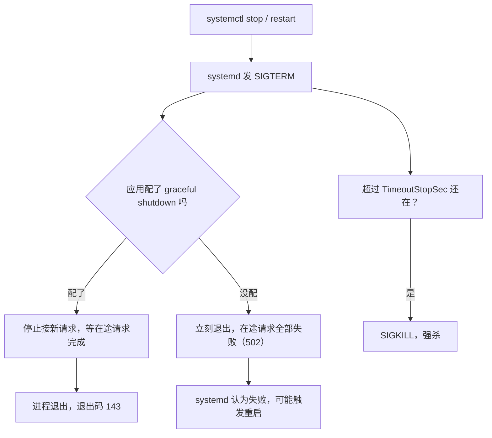

## 这一关在解决什么

`nohup java -jar app.jar &` 起了服务，关掉终端它就没了；服务器重启后它也不会自己起来；
挂了没人知道，日志全在 `nohup.out` 里越写越大。

**结论先说**：把进程交给 **systemd**——它负责开机自启、崩了重启、日志进 journald、
停止时先发 SIGTERM 让应用收尾。一个 20 行的 unit 文件换掉一整套手工作业。

## 先对齐几个词

- **unit**：systemd 的一个配置文件，描述"这个服务怎么启动、怎么停、挂了怎么办"。
- **SIGTERM / SIGKILL**：前者是"请你收尾后退出"，进程可以处理；后者是"立刻死"，无法拒绝。
- **journald**：systemd 的日志系统，自动按磁盘比例轮转，`journalctl` 就是查它。
- **退出码 143**：128 + 15，意思是"被 SIGTERM 干掉的"，属于正常停止。

## 讲解

### 停止时到底发生了什么



### 一个能上生产的 unit

```ini
# /etc/systemd/system/paideia.service
[Unit]
Description=Paideia app
After=network-online.target
Wants=network-online.target

[Service]
Type=simple
User=app
WorkingDirectory=/opt/app
ExecStart=/usr/bin/java -XX:MaxRAMPercentage=70 -jar /opt/app/app.jar
Restart=on-failure
RestartSec=5
SuccessExitStatus=143
Environment="TZ=Asia/Shanghai"
EnvironmentFile=-/opt/app/app.env

# 停止：先 SIGTERM 等 30 秒，再 SIGKILL
KillSignal=SIGTERM
TimeoutStopSec=30

[Install]
WantedBy=multi-user.target
```

几个不显然但重要的点：

| 配置 | 为什么 |
| --- | --- |
| `User=app` | 不要用 root 跑业务；配一个没有登录 shell 的系统用户 |
| `Restart=on-failure` | 崩了重启；**正常退出**（exit 0）不重启，避免"退出循环" |
| `RestartSec=5` | 立刻重启会在依赖没起来时疯狂循环，把日志刷爆 |
| `SuccessExitStatus=143` | 143 = 128+15（SIGTERM）。JVM 收到 SIGTERM 优雅退出时是 143，不认它会误判为失败 |
| `EnvironmentFile=-` | 前缀 `-` 表示文件可选；**密钥走这里，不进 unit 文件**（unit 是 644 可读的） |
| `After=network-online.target` | 别在网卡没起来时就启动（要绑定端口/连数据库） |

### jar 的优雅停止：不做会怎样

`KillSignal=SIGTERM` 只是发信号，**应用得自己响应**。Spring Boot 从 2.3 起内置：

```yaml
server:
  shutdown: graceful       # 收到 SIGTERM 后：停止接新请求、等在途请求完成
spring:
  lifecycle:
    timeout-per-shutdown-phase: 30s
```

不配的话，服务被 kill 的瞬间：正在处理的请求全部返回 **502**，
连接池里的未提交事务被回滚。发布频繁的服务，用户能明显感知到"总有几个请求失败"。

### 日志：别再 `nohup.out`

```text
$ journalctl -u paideia -f                     # 实时
$ journalctl -u paideia --since "10 min ago"   # 最近十分钟
$ journalctl -u paideia -p err                 # 只看 error 级别
```

journald 会自动轮转（默认按磁盘空间的 10% 上限）。**别再把 stdout 重定向到文件**——
那是自己给自己造一个不会轮转的日志。

想限制 journal 占多大：

```ini
# /etc/systemd/journald.conf
SystemMaxUse=500M
```

### 常用命令

```text
$ sudo systemctl daemon-reload        # 改完 unit 必须执行，否则不生效
$ sudo systemctl enable --now paideia # 开机自启 + 立刻启动
$ systemctl status paideia            # 看状态与最近日志
$ sudo systemctl restart paideia      # 重启
$ systemctl show paideia -p MainPID   # 拿 PID（jstack 用）
```

**`daemon-reload` 是最常忘的一步**：改了 unit 文件不 reload，重启的还是旧配置。

## 动手

```text
# 1. 建一个专用用户
$ sudo useradd --system --no-create-home --shell /usr/sbin/nologin app

# 2. 写 unit 文件（照上面的模板，路径按实际改）
$ sudo tee /etc/systemd/system/demo.service >/dev/null <<'EOF'
[Unit]
Description=demo
After=network-online.target
[Service]
User=app
WorkingDirectory=/opt/demo
ExecStart=/usr/bin/java -jar /opt/demo/demo.jar
Restart=on-failure
RestartSec=5
SuccessExitStatus=143
[Install]
WantedBy=multi-user.target
EOF

# 3. 启动并验证"崩了会自己起来"
$ sudo systemctl daemon-reload && sudo systemctl enable --now demo
$ sudo kill -9 $(systemctl show demo -p MainPID --value)
$ sleep 8 && systemctl status demo --no-pager | head -3
```

## 检查一下

```quiz
{"id":"ops-03-quiz","title":"systemd 三问","questions":[
 {"question":"改了 unit 文件之后必须做什么？","options":["systemctl daemon-reload，然后 restart","直接 restart 即可","重启服务器"],"answer":0,"explain":"systemd 缓存了 unit 定义；不 reload 的话 restart 用的还是旧配置，很容易以为改动没生效。"},
 {"question":"SuccessExitStatus=143 是为什么？","options":["JVM 收到 SIGTERM 优雅退出时退出码是 143，不认它会被当成失败而反复重启","143 是端口号","为了兼容 Windows"],"answer":0,"explain":"143 = 128 + 15(SIGTERM)。正常停止时 systemd 会把它算作失败，触发 on-failure 重启。"},
 {"question":"为什么不要用 nohup 把日志写进文件？","options":["文件不会轮转，迟早写满磁盘；journald 自带轮转与过滤","nohup 不支持 Java","文件权限不对"],"answer":0,"explain":"journald 按磁盘比例自动轮转，还能按时间/级别过滤；裸文件只有你自己负责清理。"}
]}
```

## 常见误区

### 误区：`Restart=always` 比 `on-failure` 更保险

**你以为**：always 会让服务永远活着。
**实情**：配置错误导致进程启动即退出时，`always` 会造出**每秒重启一次**的风暴，
日志刷爆、CPU 打满，还掩盖了真正的原因。`on-failure` + `RestartSec` 才是安全组合；
排查问题时甚至应该临时 `systemctl stop` 掉自动重启。

### 误区：systemd 只是"开机自启"

**你以为**：它就是个启动脚本管理器。
**实情**：它还管 cgroup（可以给服务设内存上限 `MemoryMax=`）、日志（journald）、
依赖顺序、停止信号与超时。**用 systemd 就不需要 nohup / supervisor / 自定义启停脚本**。

## 小结

systemd 的价值是四件事：开机自启、崩了重启（`on-failure` + `RestartSec` 防风暴）、
日志进 journald（自动轮转、可按级别过滤）、停止时先 SIGTERM（配合应用的 graceful shutdown，
否则发布时在途请求全 502）。改 unit 记得 `daemon-reload`，密钥走 `EnvironmentFile` 不进 unit。
