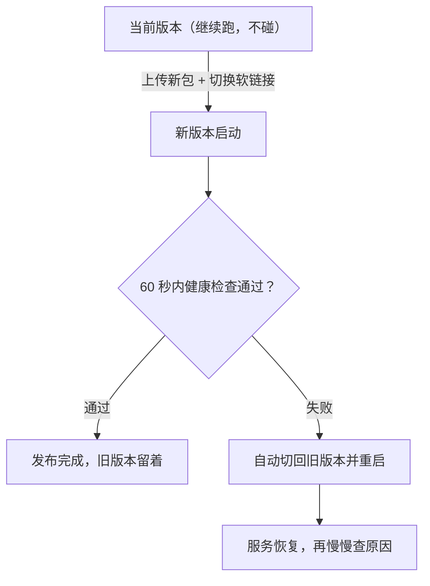

## 这一关在解决什么

新版本上线十分钟后，用户反馈"下单报错"。你想回滚，却发现：**旧的 jar 被覆盖了**、
数据库已经跑过新迁移、配置文件也被改过。

**结论先说**：发布不是"传一个新包"，而是一套**可回退的动作**。判据只有一条——
**出问题时能不能三分钟内回到上一个已知好状态**。做不到，就不算会发布。

```sketch
{
  "title": "回滚的前提：旧的还在",
  "rows": [
    [
      { "id": "over", "title": "jar 直接覆盖", "sub": "旧版本当场没了", "tone": "amber" },
      { "id": "dir", "title": "按版本号放目录", "sub": "app-20261030/", "tone": "blue" },
      { "id": "link", "title": "软链指向 current", "sub": "回滚就是换软链", "tone": "green" }
    ]
  ],
  "arrows": [
    { "from": "over", "to": "dir" },
    { "from": "dir", "to": "link" }
  ]
}
```

## 先对齐几个词

- **蓝绿 / 滚动 / 金丝雀**：三种发布方式。蓝绿是两套环境切流量、滚动是逐台替换、金丝雀是先给一小部分用户。
- **已知好状态**：最后一次确认没问题的那个版本，回滚的目标。
- **在途请求**：已经开始处理、还没返回的请求。

## 讲解

### 一次发布会经过哪几步



这张图里最重要的一步是 **E**：回滚是脚本自动做的，不是人等发现之后再动手。

### 发布前必须存在的三样东西

1. **上一个版本的产物**（旧 jar / 旧镜像），且**没被覆盖**；
2. **一个明确的"好状态"标记**（哪个版本是最后验证过的）；
3. **一个回滚动作**（一条命令，不需要现场思考）。

```text
/opt/app/
  app.jar -> releases/app-20261029-1530.jar    # 软链接，切换即发布
  releases/
    app-20261029-1530.jar
    app-20261028-1100.jar        # 上一个已知好版本，保留
```

发布 = 换软链接 + 重启；回滚 = 换回去 + 重启。**不要覆盖同名 jar**。

### 三种发布方式与它们的真实代价

| 方式 | 做法 | 代价 |
| --- | --- | --- |
| **停机发布** | 停服务 → 换包 → 起服务 | 中断几秒到几十秒；简单、可预期 |
| **蓝绿** | 起一套新的（绿），切流量，旧的（蓝）留着 | 双倍资源；回滚最快（切回即可） |
| **滚动** | 逐台替换，每台就绪后再下一台 | 需要负载均衡 + 健康检查；版本混跑期要兼容 |

**金丝雀**是滚动的变体：先给 5% 流量，看指标没问题再放大。它需要能按比例分流（网关/服务网格），
小项目往往不值得。

### 单机小服务的最小发布脚本

```bash
#!/usr/bin/env bash
# deploy.sh —— 幂等：同一个包跑两次结果一样
set -euo pipefail
STAMP=$(date +%Y%m%d-%H%M)
TARGET=/opt/app/releases/app-$STAMP.jar

[ -f /tmp/app.jar ] || { echo "缺少 /tmp/app.jar"; exit 1; }

# 1) 先落盘新版本，不碰正在跑的
install -m 644 /tmp/app.jar "$TARGET"

# 2) 切换 + 重启
ln -sfn "$TARGET" /opt/app/app.jar
systemctl restart app

# 3) 健康检查（最多等 60 秒）
for i in $(seq 60); do
  if curl -fsS http://127.0.0.1:8080/actuator/health >/dev/null 2>&1; then
    echo "发布成功：$TARGET"; exit 0
  fi
  sleep 1
done

# 4) 起不来就自动回滚到上一个
PREV=$(ls -t /opt/app/releases/*.jar | sed -n 2p)
ln -sfn "$PREV" /opt/app/app.jar
systemctl restart app
echo "发布失败，已回滚到 $PREV"; exit 1
```

四点值得注意：

- **`set -euo pipefail`**：任何一步失败就停，别带着半成品继续。
- **健康检查是发布的一部分**：不是"起进程就算成功"，是"接口能返回健康"。
- **失败自动回滚**：人手回滚会犹豫，脚本不会。
- **保留旧版本**：`ls -t | sed -n 2p` 依赖"旧包还在"，所以别在发布后立刻清理。

### 数据库迁移：唯一不能"切回去"的东西

代码可以切回旧版本，**已经执行的 `ALTER TABLE` 不能**。所以纪律是：

1. **迁移只做加法**：加列（可空）、加表、加索引。删列/改类型拆成"两次发布"——
   先上线兼容两版的代码，再删。
2. **回滚时旧代码要能在新 schema 上跑**。做不到，就说明这个迁移应该拆开。
3. **大表改结构要单独发**：`ALTER TABLE` 在亿级表上可能锁几分钟，和业务发布混在一起会让回滚变成灾难。

## 动手

```text
# 1. 看看你有没有"上一个版本"
$ ls -lt /opt/app/releases | head

# 2. 演练一次回滚（**上线前就该做一次**）
$ ln -sfn $(ls -t /opt/app/releases/*.jar | sed -n 2p) /opt/app/app.jar
$ systemctl restart app && sleep 5 && curl -fsS localhost:8080/actuator/health

# 3. 记录耗时：从下决心到恢复，用了几分钟？
```

## 检查一下

```quiz
{"id":"ops-04-quiz","title":"发布与回滚三问","questions":[
 {"question":"为什么不能覆盖同名 jar 来发布？","options":["旧版本没了，出问题时无法快速回退","jar 会被锁定","systemd 会缓存文件句柄"],"answer":0,"explain":"覆盖 = 永久销毁上一个已知好状态；发布的最小前提是旧产物还在。"},
 {"question":"蓝绿发布相对于滚动发布，最大的优势是什么？","options":["回滚最快（切流量即可），因为旧的一套还完整跑着","资源占用更少","不需要健康检查"],"answer":0,"explain":"蓝绿留着一套完整旧环境，回滚就是切回；代价是双倍资源。滚动发布回滚要再滚一遍。"},
 {"question":"哪一种变更无法靠切换代码版本回滚？","options":["已经执行的数据库结构迁移","配置文件改动","JVM 参数"],"answer":0,"explain":"ALTER TABLE 是破坏性且不可逆的；所以迁移要做成只加不删、拆成多次发布。"}
]}
```

## 常见误区

### 误区：回滚就是"再发一次旧版本"

**你以为**：旧 jar 还在，回滚随时能做。
**实情**：如果新版本已经跑过一次**删除列的迁移**，旧代码启动时会因为找不到列而失败——
你既回不去也不确定改成什么样。**回滚能力是发布前设计出来的，不是事后想办法**。

### 误区：发布失败就是代码有 bug，回滚等于掩盖问题

**你以为**：回滚是懦弱，应该现场修。
**实情**：线上第一优先级是**恢复服务**，不是找 bug。回滚把用户从故障里救出来之后，
你有的是时间在本地复现。**先止血、再诊断**，顺序反了就是拿用户的时间做实验。

## 小结

发布是一套可回退的动作：保留旧产物、用一个明确的好状态、回滚是一条命令。
单机最小方案是"软链接 + 健康检查 + 失败自动回滚"。数据库迁移是唯一不能切回去的部分，
所以只做加法、拆两次发布。金丝雀/蓝绿/滚动按需选，小服务用停机发布也完全正当——
前提是**三分钟内能退回去**。
