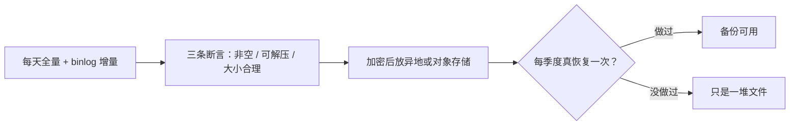

## 这一关在解决什么

每天凌晨 3 点 `mysqldump` 到 `/backup`，脚本跑了半年，从没出过事——直到有一天要恢复，
发现**备份文件是空的**（mysqldump 报错但脚本没检查退出码），或者文件在、恢复出来的库
少了最近一个月（备份的是从库，从库早就停止同步了）。

**结论先说**：备份的价值**只在恢复那一刻**体现。没演练过的备份，等于没有备份；

```sketch
{
  "title": "没恢复过的备份，只是些文件",
  "rows": [
    [
      { "id": "dump", "title": "每天 dump", "sub": "跑了半年没出事", "tone": "gray" },
      { "id": "drill", "title": "真的恢复一次", "sub": "到空库上跑一遍", "tone": "blue" },
      { "id": "done", "title": "恢复成功才算数", "sub": "否则出事那天才发现", "tone": "green" }
    ]
  ],
  "arrows": [
    { "from": "dump", "to": "drill" },
    { "from": "drill", "to": "done" }
  ]
}
```
而"能恢复"要回答三个问题：**多久以前的数据（RPO）**、**多久能恢复（RTO）**、**怎么验证**。

## 先对齐几个词

- **RPO**：出事时最多能接受丢多少数据（"丢 1 小时"还是"丢 5 分钟"）。
- **RTO**：出事之后多久能恢复（"1 小时"还是"15 分钟"）。
- **binlog**：MySQL 的变更日志。全量备份 + 重放 binlog，能恢复到"误删前一刻"。
- **逻辑 vs 物理**：逻辑是导出 SQL 文本（可读、慢），物理是拷数据文件（快、不可读）。

## 讲解

### 备份与恢复是一个环



### 备份的三个问题（先答清楚再写脚本）

| 问题 | 含义 | 典型答案 |
| --- | --- | --- |
| **RPO** | 最多能接受丢多少数据 | 每天一次 = 最多丢 24 小时；binlog 增量 = 丢几分钟 |
| **RTO** | 出事后多久必须恢复 | 小服务 1 小时；核心业务 15 分钟 |
| **验证** | 怎么证明备份可用 | 定期恢复到临时实例并跑校验查询 |

只答前两个不答第三个，就会出现"备份一直在跑、从来没人恢复过"的经典事故。

### MySQL：逻辑备份 vs 物理备份

**逻辑备份（mysqldump）**——导出成 SQL 文本：

```text
$ mysqldump -u root -p --single-transaction --routines --triggers \
    --set-gtid-purged=OFF paideia | gzip > /backup/paideia-$(date +%F).sql.gz
```

- `--single-transaction`：InnoDB 下拿到**一致快照**，不锁表（没这个参数，备份期间写入会导致数据不一致）。
- 优点：可读、可改、能只恢复一张表；缺点：**大库慢**（几十 G 要几十分钟）、恢复更慢。

**物理备份（xtrabackup / 文件拷贝）**——直接拷数据文件：

- 优点：快，几百 G 也只要几分钟；缺点：版本相关、要配套工具、不可读。

**小项目建议**：`mysqldump` + binlog 增量。恢复 = 全量 + 重放 binlog 到误删前一刻。

### 恢复演练：唯一能证明备份可用的方法

```text
# 1. 起一个临时实例（不碰生产）
$ docker run -d --name restore-test -e MYSQL_ROOT_PASSWORD=tmp -p 3307:3306 mysql:8
$ sleep 20

# 2. 恢复
$ gunzip -c /backup/paideia-2026-10-28.sql.gz | mysql -h127.0.0.1 -P3307 -uroot -ptmp paideia

# 3. 校验（比对行数与关键聚合，不是"能看到表就算成功"）
$ mysql -h127.0.0.1 -P3307 -uroot -ptmp -e \
  "select count(*) from paideia.knowledge_entries; select max(created_at) from paideia.knowledge_entries;"

# 4. 删掉临时实例
$ docker rm -f restore-test
```

**第 3 步是关键**：比对"行数 + 最新时间戳"。只 count 行数会漏掉"最近的数据没进去"这种情况。

### 脚本必须检查退出码

```bash
#!/usr/bin/env bash
set -euo pipefail
OUT=/backup/paideia-$(date +%F).sql.gz
mysqldump -u root -p"$DB_PASSWORD" --single-transaction paideia | gzip > "$OUT"

# 三个断言，任何一个失败就告警
[ -s "$OUT" ] || { echo "备份文件为空"; exit 1; }                    # 非空
gunzip -t "$OUT" || { echo "备份文件损坏"; exit 1; }                  # 可解压
[ $(stat -c%s "$OUT") -gt 100000 ] || { echo "备份文件过小，可疑"; exit 1; }
```

没有这三条，`mysqldump` 失败时脚本照样"成功"——它把错误写进 stderr，而 stderr 被你重定向到了别处。

### 备份要放在哪

- **不能只放本机**：磁盘坏了、实例被误删，备份一起没。
- **异地或对象存储**：`rclone` / `aws s3 cp`，加生命周期（保留 30 天）。
- **加密**：备份里有用户数据，落盘前 `gpg` 或服务端加密。
- **保留策略**：日备保留 7 天、周备保留 4 周、月备保留 6 个月——按 RPO 算，不是凭感觉。

## 动手

```text
# 完整演练一次（约 15 分钟，值得）
$ ls -lh /backup | tail -3          # 备份文件有吗、多大
$ gunzip -t /backup/*.sql.gz && echo "可解压"   # 文件完整吗
# 按上面的四步恢复到临时实例并比对行数
```

## 检查一下

```quiz
{"id":"ops-05-quiz","title":"备份与恢复三问","questions":[
 {"question":"mysqldump 为什么必须加 --single-transaction？","options":["InnoDB 下拿到一致快照，避免备份期间写入导致数据不一致","加速备份","为了不锁表还能增量"],"answer":0,"explain":"不加时导出的各表可能来自不同时刻，恢复后外键与业务数据会互相矛盾。"},
 {"question":"怎么证明一个备份是可用的？","options":["真的恢复到临时实例并比对行数与最新时间戳","文件大小正常","备份脚本退出码为 0"],"answer":0,"explain":"退出码 0 与文件大小都不能证明内容完整；只有恢复 + 校验能。"},
 {"question":"脚本里 [ -s 文件 ] 与 gunzip -t 分别在防什么？","options":["文件为空，以及文件损坏（截断/写一半）","权限不足，以及空间不足","编码问题"],"answer":0,"explain":"mysqldump 失败时常留下 0 字节或半截文件；只检查存在会漏掉这两种。"}
]}
```

## 常见误区

### 误区：备份在跑就等于有备份

**你以为**：cron 每天跑，日志里没报错，一切正常。
**实情**：三种静默失败极常见：① 命令失败但退出码被管道吃掉（`cmd | gzip` 拿到的是 gzip 的码）；
② 备份了从库而复制早已断开；③ 备份文件写到磁盘满了之后只剩前几 MB。
所以必须**非空 + 可解压 + 大小合理 + 定期真恢复**。

### 误区：有了主从复制就不需要备份

**你以为**：从库就是备份。
**实情**：主从复制同步的是**错误**。`DELETE FROM t` 会在几毫秒内复制到从库；
误删表、错误的迁移、被注入的清库语句，从库一样干净地执行。复制是**可用性**手段，
备份是**可恢复性**手段，两者不能互相替代。

## 小结

备份要回答三个问题：RPO（能丢多少）、RTO（多久恢复）、怎么验证（真恢复一次）。
小项目用 `mysqldump --single-transaction` + binlog 增量，脚本里三条断言（非空/可解压/大小），
文件放异地的加密存储。最重要的一条：**每季度真的恢复一次**——那是唯一能证明备份存在的时刻。
