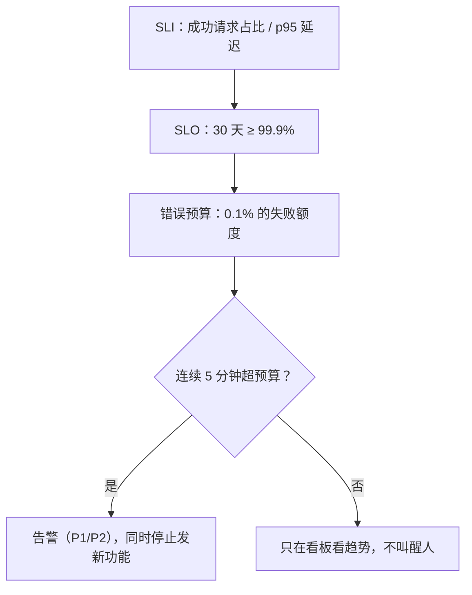

## 这一关在解决什么

告警群一天响几十次：CPU 过 80%、磁盘过 70%、有个 5xx。**大部分可以无视**，
于是真正出事那次你也无视了。

**结论先说**：告警不是"指标越界就喊"，而是**用户可感知的坏状态**。判断标准只有一条：
**这条告警响的时候，用户是不是正在受影响？**不是，就别响（或只进看板）。

## 先对齐几个词

- **SLI**：你实际测到的数（成功请求占比、p95 延迟）。
- **SLO**：你给用户承诺的目标（30 天可用性 ≥ 99.9%）。
- **错误预算**：SLO 允许的失败额度。用完就该停止发新功能，先修稳定性。
- **p95**：把 100 个请求按耗时排队，第 95 个的耗时。它比平均值更能反映"用户感觉慢不慢"。

## 讲解

### 从指标到告警，中间隔了三层



### 四条黄金信号（先看这四个，别的都往后放）

| 信号 | 含义 | 常见指标 |
| --- | --- | --- |
| **延迟** Latency | 请求多快 | p50 / p95 / p99 响应时间 |
| **流量** Traffic | 有多少请求 | QPS、并发连接数 |
| **错误** Errors | 有多少失败 | 5xx 占比、业务错误率 |
| **饱和度** Saturation | 资源多满 | CPU、内存、连接池、队列长度 |

**先有这四个，再谈别的**。它们分别回答：慢不慢、忙不忙、错不错、还剩多少余量。

### SLI / SLO：把"好不好"变成数字

- **SLI**（指标）：`成功请求数 / 总请求数`、`p95 延迟`
- **SLO**（目标）：`30 天内可用性 ≥ 99.9%`、`p95 < 300ms`
- **错误预算**：`0.1%` 的失败额度，用完就该停止发新功能、先修稳定性

有了 SLO，告警才有意义：

```yaml
# 例：连续 5 分钟 5xx 比例 > 1%（错误预算的消耗速度）
- alert: HighErrorRate
  expr: sum(rate(http_requests_total{status=~"5.."}[5m])) / sum(rate(http_requests_total[5m])) > 0.01
  for: 5m
```

`for: 5m` 是很重要的一行：**瞬时抖动不该叫醒人**。

### 告警的三条纪律

1. **每条告警都要有动作**。收到之后"怎么办"写不清的告警，删掉或降级成看板。
2. **按症状告警，不按原因告警**。报"下单成功率掉了"，不要报"CPU 80%"——
   后者大概率是正常负载，前者才是用户在疼。
3. **分级**：`P1` 立刻打电话（用户已受影响且面广）、`P2` 群里 @ 人（部分受影响）、
   `P3` 进日报（趋势，不用现在动）。

### 最小可用组合

小项目不用一上来就 Prometheus + Grafana + Alertmanager 全家桶：

```text
# 1) 应用暴露指标（Spring Boot Actuator + Micrometer）
management.endpoints.web.exposure.include=health,metrics,prometheus
management.metrics.tags.application=paideia

# 2) 一台机器上的采集与看板
docker run -d -p 9090:9090 -v /opt/prom:/etc/prometheus prom/prometheus
docker run -d -p 3000:3000 grafana/grafana

# 3) 告警先接到一个地方（群机器人 / 邮件），别一上来就接电话
```

**先有"看得见"，再谈"喊醒人"**。没有历史趋势的告警只会让你更焦虑。

### 日志与指标的边界

| 想问的问题 | 用什么 |
| --- | --- |
| 现在整体慢不慢、错多少 | 指标（Prometheus） |
| 这个请求为什么慢、慢在哪一段 | 链路追踪（Tempo/Jaeger） |
| 这一行日志说了什么、哪个用户 | 日志（Loki/ES） |

三者不能互相顶替：指标看不到单请求细节，日志算不出聚合趋势，追踪需要采样。

## 动手

```text
# 1. 抓一次自己的接口延迟分布（没有 Prometheus 也能先看）
$ for i in $(seq 50); do curl -s -o /dev/null -w "%{time_total}\n" http://127.0.0.1:8080/actuator/health; done | sort -n | tail -5

# 2. 看健康检查端点返回什么（有没有连数据库）
$ curl -s http://127.0.0.1:8080/actuator/health | python3 -m json.tool
```

## 检查一下

```quiz
{"id":"ops-06-quiz","title":"监控与告警三问","questions":[
 {"question":"为什么按「症状」告警而不是「原因」？","options":["原因是猜测，症状直接对应用户是否受影响","症状更容易采集","原因指标不准"],"answer":0,"explain":"CPU 高不一定影响用户（可能是正常压测），而下单失败率上升一定影响用户。"},
 {"question":"告警规则里的 for: 5m 解决什么问题？","options":["过滤瞬时抖动，避免短暂越界就叫醒人","限制告警频率","设置告警有效期"],"answer":0,"explain":"没有 for 时一次抓取越界就触发；加上持续时间才是「持续异常」。"},
 {"question":"四条黄金信号是哪四个？","options":["延迟、流量、错误、饱和度","CPU、内存、磁盘、网络","请求、响应、超时、重试"],"answer":0,"explain":"Google SRE 的四条黄金信号以「用户视角」组织，资源指标只是饱和度的来源之一。"}
]}
```

## 常见误区

### 误区：监控就是把所有指标都采上来

**你以为**：指标越多，越有安全感。
**实情**：指标越多，**看板越没人看、告警越没人理**。先定你的 SLI（哪几件事定义"好用"），
再围绕它采 5–10 个指标。剩下的按需加，加之前先问"它对应哪个告警动作"。

### 误区：告警越多越负责

**你以为**：宁可多报也不漏。
**实情**：告警疲劳是真实事故的**直接原因**——一天响 50 次之后，第 51 次没人看。
纪律是：**每一条告警都必须能对应一个具体动作**；做不到就降级成看板。
宁可少而准，也不要多而废。

## 小结

监控以四个黄金信号起步，用 SLI/SLO 把"好用"变成数字与错误预算；告警按**症状**分级，
每条都要有动作、都有 `for` 去抖。小项目先"看得见"（指标 + 看板），再"喊醒人"（分级告警），
日志、指标、追踪各管一件事，不能互相顶替。
