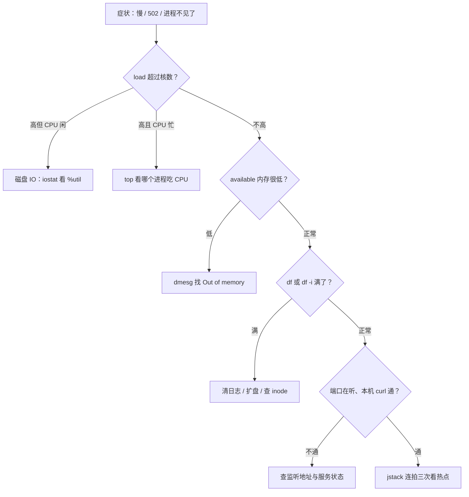

## 这一关在解决什么

"服务慢了"——你打开日志翻半天，没线索；重启一下好了，过两天又冒出来。
或者"502 了"，你在 nginx、应用、数据库之间反复横跳，每次都从零开始猜。

**结论先说**：排障要有**固定顺序**，而且顺序是"从外到内、从粗到细"：
**负载 → 内存 → 磁盘 → 网络 → 应用**。每一层都有 1–2 条命令先给出"这层有没有事"，
没就往下走，别跳。**跳着看是排障最慢的方式**。

## 先对齐几个词

- **load average**：正在跑 + 在等（主要等磁盘）的进程数。大于核数说明满了。
- **available 内存**：真正还能用的（`free` 里的 `buff/cache` 可以回收，别看错）。
- **inode**：每个文件占一个。小文件太多时，磁盘有空间也写不进新文件。
- **线程栈（jstack）**：把 Java 进程此刻每个线程"卡在哪一行"打出来。

## 讲解

### 一张图记住顺序



### 第 0 步：先确认"谁在疼"

```text
$ curl -s -o /dev/null -w "code=%{http_code} time=%{time_total}\n" http://127.0.0.1:8080/actuator/health
code=200 time=0.012
```

- 本机直连都慢 → 问题在应用/数据库，不在入口。
- 本机快、外面慢 → 问题在 nginx / 网络 / DNS / 客户端。

这一步花 3 秒，能省掉半小时的错误方向。

### 第 1 层：负载

```text
$ uptime
 09:40:01 up 12 days,  load average: 8.42, 6.11, 3.20
$ nproc      # 4 → 8.42 已经超过 2 倍核数，饱和
```

`load` ≈ 正在运行 + 等待的进程数。经验阈值：**大于核数就是满，大于 2 倍核数要看**。
但要分清是 CPU 忙还是 IO 等：

```text
$ top -bn1 | head -5           # %Cpu(s): 3.2 us, 1.1 sy, 0.0 wa → CPU 不是瓶颈
$ iostat -x 1 3                # %util 接近 100 → 磁盘饱和（load 高但 CPU 闲，就是它）
```

### 第 2 层：内存

```text
$ free -h
              total   used   free  shared  buff/cache  available
Mem:           15Gi   13Gi  512Mi   1.2Gi       1.4Gi       1.1Gi
$ dmesg -T | grep -i "out of memory" | tail -5
[Mon Oct 28 03:12:44 2026] Out of memory: Killed process 12831 (java) ...
```

两个关键：**看 `available` 而不是 `free`**（`buff/cache` 可以回收）；
**`dmesg` 里有没有 OOM**——有的话，一切"莫名其妙消失"都有了解释。

### 第 3 层：磁盘

```text
$ df -h /
Filesystem      Size  Used Avail Use% Mounted on
/dev/sda2        79G   74G  5.0G  93% /
$ du -sh /var/log/* | sort -h | tail -3
2.1G  /var/log/journal
```

磁盘满了会表现为：写日志失败、MySQL 报错、容器起不来、甚至 `systemd` 起不来。
**先看 `/var/log`、`/var/lib/docker`、应用的临时目录**，这三处占九成。

顺手看 inode（小文件太多也会"满"）：

```text
$ df -i /          # IUse% 100% 时磁盘还有空间也写不进
```

### 第 4 层：网络

```text
$ ss -lntp | grep 8080            # 端口在听吗、监听地址是 127.0.0.1 还是 0.0.0.0
$ ss -s                          # 连接总数与 TIME-WAIT 数量
$ curl -v http://127.0.0.1:8080  # 卡在哪一步：connect / TLS / 首字节
```

`TIME-WAIT` 撑满时不一定是"配置不足"，先看是谁在频繁短连接。

### 第 5 层：应用

```text
$ journalctl -u paideia -n 200 --no-pager | grep -iE "error|exception" | tail
$ PID=$(systemctl show paideia -p MainPID --value)
$ jstack $PID > /tmp/stack.txt && grep -A12 "RUNNABLE" /tmp/stack.txt | head -30
```

**`jstack` 连拍三次**（间隔 3 秒）才是关键：一次快照看不出"卡在哪"，三次对比才能看出
**同一批线程一直在同一处**——那就是热点。

常见三种线程栈形态：

| 形态 | 含义 |
| --- | --- |
| 大量线程在 `socketRead0` | 下游慢（数据库、HTTP 依赖） |
| 大量线程在 `WAITING (parking)` 且同一把锁 | 锁竞争 |
| 一个线程在 CPU 密集循环，其它等在队列 | 单点计算慢（正则回溯、大排序） |

## 动手

拿一台真实机器，按顺序跑一遍，并**记下每层的结论**：

```text
$ uptime; nproc
$ free -h; dmesg -T | grep -i "out of memory" | tail -3
$ df -h /; df -i /
$ ss -lntp | head; ss -s
$ journalctl -u <你的服务> -n 100 --no-pager | tail -20
```

练的是什么？**"这一层没问题"也要有结论**——否则你只会说"都看了但没找到"。

### 再跑一道真题：从日志里算 5xx 占比

排障时"到底错多少"必须是个数字，不能是"感觉不少"。下面这段 access log 里有 5 行请求，
把它们读进来，算出 **5xx 占全部请求的比例**，保留两位小数。

```code-challenge
{
  "id": "ops-07-run",
  "kind": "run",
  "title": "从 access log 算出 5xx 占比",
  "language": "python",
  "starter": "import sys\n\ndef five_xx_ratio(lines):\n    \"\"\"返回 5xx 占全部请求的比例；没有请求时返回 0.0。\n\n    每行是 nginx 的 access log，状态码是引号里那段之后的第一个数字。\n    \"\"\"\n    # TODO: 统计 status>=500 的条数，除以总条数\n    return 0.0\n\n\nlines = [line for line in sys.stdin.read().splitlines() if line.strip()]\nprint(f\"{five_xx_ratio(lines):.2f}\")\n",
  "cases": [
    {
      "name": "两条 5xx / 五条请求",
      "stdin": "10.0.0.1 - - [29/Oct/2026:09:00:01 +0800] \"GET /api/health HTTP/1.1\" 200 12\n10.0.0.2 - - [29/Oct/2026:09:00:02 +0800] \"GET /api/orders HTTP/1.1\" 500 210\n10.0.0.3 - - [29/Oct/2026:09:00:03 +0800] \"POST /api/orders HTTP/1.1\" 502 0\n10.0.0.1 - - [29/Oct/2026:09:00:04 +0800] \"GET /api/orders HTTP/1.1\" 200 180\n10.0.0.4 - - [29/Oct/2026:09:00:05 +0800] \"GET /missing HTTP/1.1\" 404 30\n",
      "expected": "0.40\n"
    },
    {
      "name": "没有 5xx",
      "stdin": "10.0.0.1 - - [29/Oct/2026:10:00:01 +0800] \"GET /a HTTP/1.1\" 200 12\n10.0.0.1 - - [29/Oct/2026:10:00:02 +0800] \"GET /b HTTP/1.1\" 200 12\n",
      "expected": "0.00\n"
    },
    {
      "name": "没有请求",
      "stdin": "",
      "expected": "0.00\n"
    }
  ],
  "explain": "按空格切是最容易踩的坑：URL 与 UA 里都可能有空格。用引号定位更稳——先找最后一个双引号段之后的第一个字段。"
}
```

写的时候注意一个坑：**别直接用空格切整行**。URL 与 UA 里都可能带空格，
按引号切才稳（`line.split('"')` 之后，第 3 段的开头就是状态码）。

## 检查一下

```quiz
{"id":"ops-07-quiz","title":"排障顺序三问","questions":[
 {"question":"load average 很高但 CPU 使用率很低，最可能是什么？","options":["磁盘 IO 饱和（大量进程在等 IO）","内存泄漏","网络丢包"],"answer":0,"explain":"load 统计的是运行+不可中断睡眠；后者主要来自 IO 等待。用 iostat 看 %util 确认。"},
 {"question":"为什么 jstack 要连拍三次？","options":["一次快照看不出卡点，三次对比才能确认同一批线程一直在同一处","jstack 第一次不完整","三次能拿到更多线程"],"answer":0,"explain":"单次采样里线程可能正好在切换；连续多次相同位置才说明是持续热点。"},
 {"question":"df 还有空间，服务却报写入失败，先看什么？","options":["inode 是否用满（df -i）","CPU 是否 100%","DNS 是否正常"],"answer":0,"explain":"大量小文件会先耗尽 inode，此时磁盘有空间也创建不了新文件。"}
]}
```

## 常见误区

### 误区：先看应用日志

**你以为**：服务有问题，日志里一定有线索。
**实情**：日志只反映"应用看到的"。磁盘满了、OOM 被杀、端口没监听——这些在日志里
往往**一行都没有**（进程直接消失）。先确认资源层，再读应用日志，能少走很多弯路。

### 误区：重启一下再说

**你以为**：重启能恢复，先让用户用上。
**实情**：重启让**现场**消失：线程栈、heap dump、连接状态、日志的最后一段，
全都没了。正确做法是**先留证据**（`jstack`、`jmap -dump`、`journalctl -n 500 > /tmp/x.log`），
再重启。留证据只要 30 秒。

## 小结

排障的顺序是：先确认谁在疼（本机 vs 外部），然后**负载 → 内存 → 磁盘 → 网络 → 应用**，
每层用 1–2 条命令给出明确结论（"没事"也算结论）。`load` 高但 CPU 闲看 IO；
内存看 `available` 与 `dmesg` 的 OOM；磁盘同时看空间与 inode；网络看监听地址与 `curl -v`；
应用层 `jstack` 连拍三次找热点。**重启前先留证据。**
