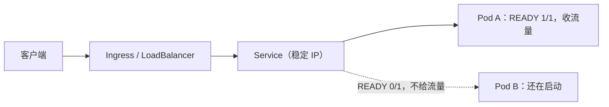

## 这一关在解决什么

要上 K8s 了，但面对一堆 YAML 不知道从哪下手：Deployment、Service、Ingress、ConfigMap……
文档里还有 Operator、Helm、CRD。

**结论先说**：一个人上线一个小服务，只需要**两个资源 + 八个命令**。
先把"部署 → 暴露 → 回滚"这个闭环跑通，其余概念等你真需要时再加。

```sketch
{
  "title": "K8s 最小闭环：部署、暴露、回滚",
  "rows": [
    [
      { "id": "dep", "title": "Deployment", "sub": "副本数与镜像", "tone": "blue" },
      { "id": "pod", "title": "Pod", "sub": "真正跑起来的容器", "tone": "gray" },
      { "id": "svc", "title": "Service", "sub": "给一组 Pod 稳定名字", "tone": "blue" },
      { "id": "ing", "title": "Ingress", "sub": "外面只从这里进", "tone": "green" }
    ]
  ],
  "arrows": [
    { "from": "dep", "to": "pod" },
    { "from": "pod", "to": "svc" },
    { "from": "svc", "to": "ing" }
  ]
}
```

## 先对齐几个词

- **Pod**：K8s 里最小的运行单位，一个 Pod 里通常一个容器。它的 IP 会变。
- **Deployment**：管"跑几个 Pod、用哪个镜像、怎么滚动更新"的声明。
- **Service**：给一组 Pod 一个**固定的名字和 IP**，只把"就绪"的 Pod 放进名单。
- **Ingress**：对外入口，管域名与路径怎么转到哪个 Service。

## 讲解

### 一个请求进来，先碰到谁



看懂这张图，就明白为什么"Pod 起来了但用户还是 502"——它没进 Service 的名单。

### 两个资源就够：Deployment 与 Service

```yaml
# app.yaml
apiVersion: apps/v1
kind: Deployment
metadata:
  name: app
spec:
  replicas: 2
  selector: { matchLabels: { app: app } }
  template:
    metadata: { labels: { app: app } }
    spec:
      containers:
        - name: app
          image: registry.example.com/app@sha256:abc123
          ports: [{ containerPort: 8080 }]
          envFrom:
            - secretRef: { name: app-secret }
          readinessProbe:
            httpGet: { path: /actuator/health/readiness, port: 8080 }
            initialDelaySeconds: 5
            periodSeconds: 5
          livenessProbe:
            httpGet: { path: /actuator/health/liveness, port: 8080 }
            initialDelaySeconds: 30
          resources:
            requests: { cpu: "250m", memory: "512Mi" }
            limits:   { cpu: "1",    memory: "1Gi" }
---
apiVersion: v1
kind: Service
metadata:
  name: app
spec:
  selector: { app: app }
  ports: [{ port: 80, targetPort: 8080 }]
```

- **Deployment**：跑几个副本、什么镜像、怎么探活。它负责**自愈与滚动更新**。
- **Service**：给这组 Pod 一个**稳定名字与虚拟 IP**。Pod 会不停换 IP，Service 不变。

对外暴露还有一步（Ingress 或云厂商的 LoadBalancer）。小集群用 `kubectl port-forward`
先验证也行，别一上来纠结 Ingress Controller。

### 八个命令（覆盖 90% 日常）

```text
$ kubectl apply -f app.yaml                 # 1. 部署（声明式，幂等）
$ kubectl get pods -o wide                  # 2. 看 Pod 在哪个节点、什么状态
$ kubectl describe pod app-xxx              # 3. 排障第一命令（事件在最后）
$ kubectl logs -f app-xxx                   # 4. 看日志（-f 跟随；--previous 看上一个容器）
$ kubectl exec -it app-xxx -- sh            # 5. 进容器
$ kubectl rollout status deploy/app         # 6. 等滚动更新完成
$ kubectl rollout undo deploy/app           # 7. 回滚到上一个版本
$ kubectl get events --sort-by=.lastTimestamp | tail -20   # 8. 集群级事件
```

`rollout undo` 是 K8s 相比单机的最大优势之一：**回滚是一条命令**，
而且保留历史（`--to-revision=3` 可以回到更早）。

### 滚动更新怎么保证不中断

```text
$ kubectl rollout status deploy/app
Waiting for deployment "app" rollout to finish: 1 out of 2 new replicas have been updated...
```

K8s 的默认策略是滚动：**起一个新 Pod → 就绪（readiness 通过）→ 摘一个旧的**。
所以不中断的前提是 **readiness 探针写对**——写错了它会认为 Pod 已就绪却还没法处理请求，
用户就会看到 502。

```yaml
strategy:
  type: RollingUpdate
  rollingUpdate:
    maxSurge: 1           # 允许多起 1 个
    maxUnavailable: 0     # 不允许先少一个（保证容量）
```

### 配置与密钥

```text
$ kubectl create configmap app-config --from-env-file=app.env
$ kubectl create secret generic app-secret --from-literal=DB_PASSWORD=xxx
```

两点纪律：**不要把 Secret 提交进 git**（用 `--dry-run -o yaml` 生成模板也别带真实值）；
**Secret 只是 base64**，不是加密——集群里能读 `Secret` 的人就能看到明文（要更强就上外部密钥管理）。

### 一个请求进来时的路径

```text
客户端 → Ingress/LoadBalancer → Service（虚拟 IP）→ kube-proxy 转发 → 某个 Pod
```

`Service` 做了四层负载均衡，且只把**就绪的 Pod** 放进端点。这就是 readiness 探针
真正影响用户的时刻。

## 动手

有集群可以照着做；没有的话用 `kind` 本地起一个（单机 Docker 就行）：

```text
$ kind create cluster --name demo
$ kubectl apply -f app.yaml
$ kubectl rollout status deploy/app
$ kubectl get pods -o wide

# 改镜像版本再 apply，观察滚动；然后回滚
$ kubectl set image deploy/app app=registry.example.com/app@sha256:def456
$ kubectl rollout status deploy/app
$ kubectl rollout undo deploy/app && kubectl rollout status deploy/app

$ kubectl port-forward svc/app 8080:80      # 本地验证，不用 Ingress
$ kind delete cluster --name demo
```

## 检查一下

```quiz
{"id":"ops-08-quiz","title":"K8s 最小闭环三问","questions":[
 {"question":"Pod 会不断重建、IP 会变，应用之间靠什么互相找到？","options":["Service 的稳定名字与虚拟 IP","Pod 的 IP","节点 IP"],"answer":0,"explain":"Service 给一组 Pod 一个稳定的访问入口，并把就绪的 Pod 放进端点。"},
 {"question":"滚动更新不中断的前提是什么？","options":["readinessProbe 写对了，K8s 才会在 Pod 就绪后才摘旧的","副本数大于 1","用 rollingUpdate 策略"],"answer":0,"explain":"没有正确的 readiness，K8s 会在应用还没准备好时就把它当成可用端点。"},
 {"question":"kubectl rollout undo 回滚的是什么？","options":["Deployment 的上一个 revision（来自保留的 ReplicaSet）","整个集群","镜像仓库里的 tag"],"answer":0,"explain":"K8s 保留历史 ReplicaSet；undo 把 Pod 模板切回上一个 revision，Pod 随之重建。"}
]}
```

## 常见误区

### 误区：Pod 起来了就是部署成功

**你以为**：`kubectl get pods` 都是 Running 就好了。
**实情**：Running 只说明容器在跑。**要看 `READY` 列（1/1）**——它表示 readiness 通过；
0/1 的 Pod 不会进 Service 端点。而且 `Running` 也不代表"这个版本是你想要的"，
要 `kubectl rollout status` 确认。

### 误区：Secret 比 ConfigMap 安全

**你以为**：放进 Secret 就加密了。
**实情**：Secret 只是 **base64 编码**，任何人能 `kubectl get secret -o yaml` 就看到明文。
真正的保护来自：RBAC 收紧、etcd 加密、外部密钥管理（Vault / KMS）。
**别把 Secret 提交进 git** 是底线。

## 小结

K8s 的最小闭环是两个资源（Deployment 管副本与更新、Service 管稳定入口）加八个命令
（apply / get pods / describe / logs / exec / rollout status / rollout undo / get events）。
滚动更新不中断依赖 readiness 探针；回滚是一条命令，这是它相对单机部署的硬优势。
Secret 不是加密，别进 git。
