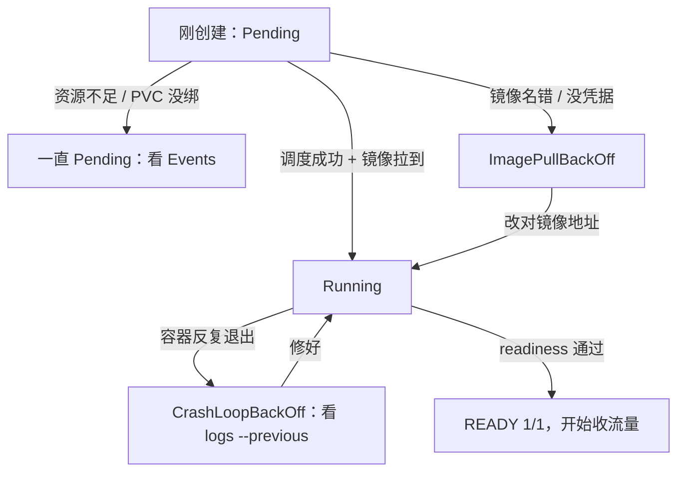

## 这一关在解决什么

`kubectl apply` 之后 `kubectl get pods` 一直不是 Running：`Pending`、`ImagePullBackOff`、
`CrashLoopBackOff`、`CreateContainerConfigError`——每个词都像在黑话。

**结论先说**：这些状态各自只对应**几个固定原因**。顺序永远是
**`get pods`（看状态）→ `describe pod`（看 Events）→ `logs`（看应用）**，
90% 的问题在前两步就能定论，根本不用进容器。

## 先对齐几个词

- **Events**：K8s 记的"发生了什么"，`describe` 最后一段就是它，**只保留最近一小时**。
- **CrashLoopBackOff**：容器反复崩溃，K8s 逐渐拉长重启间隔（back-off）。
- **readiness / liveness**：前者决定"给不给流量"，后者决定"要不要重启"。
- **revision**：Deployment 的历史版本，`rollout undo` 就是切回上一个。

## 讲解

### 状态是这么变的



### 四种状态，四种病

| 状态 | 含义 | 先看什么 |
| --- | --- | --- |
| `Pending` | 调度不上 | `describe` 最后的 Events：资源不足 / 节点亲和 / PVC 没绑上 |
| `ImagePullBackOff` | 拉不到镜像 | 镜像名或 tag 打错、私有仓库没配 `imagePullSecrets`、仓库限流 |
| `CrashLoopBackOff` | 容器反复崩溃重启 | `logs --previous` 看**上一次**为什么退 |
| `CreateContainerConfigError` | 容器配置有问题 | ConfigMap/Secret 名字拼错、缺 key |
| `Running` 但 `READY 0/1` | 探针没过 | `describe` 里的探针失败事件，通常是 readiness 路径/端口不对 |

### `describe` 的最后 20 行是答案

```text
$ kubectl describe pod app-7d9f8-abcde | tail -20
Events:
  Type     Reason     Age   From     Message
  Warning  FailedScheduling  3m  scheduler  0/3 nodes are available:
           2 Insufficient memory, 1 node(s) had untolerated taint
  Warning  Failed  2m  kubelet  Failed to pull image "registry.example.com/app:1.0":
           rpc error: code = NotFound
```

**Events 只保留最近一小时**，所以排障要趁早；也可以把事件送进监控。

### 看日志：别忘了 `--previous`

```text
$ kubectl logs app-7d9f8-abcde                  # 当前容器
$ kubectl logs app-7d9f8-abcde --previous        # 上一次（崩溃的那个）
$ kubectl logs -l app=app --tail=100             # 按标签看一组 Pod
```

`CrashLoopBackOff` 时当前容器往往刚起来、日志还是空的——**要看上一次的**。
这是新手最容易漏的一步：看到空日志就以为"应用没输出"。

### 一个真实的排查链

```text
现象：Pod 一直 CrashLoopBackOff
1) kubectl describe pod → Events: Back-off restarting failed container
2) kubectl logs --previous → Error: Could not resolve placeholder 'DB_PASSWORD'
3) kubectl describe deploy/app | grep -A5 envFrom → secretRef: app-secret
4) kubectl get secret app-secret -o jsonpath='{.data}' → DB_PASSWORD 缺失
结论：Secret 里少了 key。补上即可，不需要动镜像。
```

**这条链的价值在于每一步都在缩小范围**，而不是"改点东西再试试"。

### 探针失败的两种相反原因

```text
$ kubectl describe pod app-xxx | grep -A2 "Liveness probe failed"
Warning  Unhealthy  Liveness probe failed: Get "http://10.1.2.3:8080/actuator/health/liveness": dial tcp: connect: connection refused
```

- **connection refused**：应用还没监听（启动慢 / 端口写错）→ 加大 `initialDelaySeconds` 或改端口。
- **timeout**：应用在监听但响应慢（GC、依赖慢）→ 可能不该用 liveness 判它（会越重启越慢）。

区分这两个，能避免把"依赖慢"写成"进程死了"。

### 资源相关的隐性故障

```text
$ kubectl top pod                       # 需要 metrics-server
$ kubectl describe pod app-xxx | grep -A3 "OOMKilled"
    Last State:  Terminated
      Reason:    OOMKilled
```

`OOMKilled` 就是容器超了 `limits.memory`（第 16 关讲的账在这里直接体现）。
Java 应用要配合 `MaxRAMPercentage`，否则 JVM 按宿主机内存算堆，必然被杀。

## 动手

```text
# 制造四种故障，各排一次（30 分钟，比读十篇文档有用）
# 1) 镜像名写错
$ kubectl set image deploy/app app=registry.example.com/app:doesnotexist
$ kubectl get pods; kubectl describe pod <pod> | tail -10

# 2) 探针路径写错
$ kubectl patch deploy/app --type=json -p='[{"op":"replace","path":"/spec/template/spec/containers/0/readinessProbe/httpGet/path","value":"/nope"}]'

# 3) 内存限额太小
$ kubectl set resources deploy/app --limits=memory=64Mi

# 4) Secret key 缺失
$ kubectl create secret generic app-secret --from-literal=WRONG=1 --dry-run=client -o yaml | kubectl apply -f -

# 每次都走同一条链：get → describe → logs(--previous)
$ kubectl rollout undo deploy/app   # 收尾
```

## 检查一下

```quiz
{"id":"ops-09-quiz","title":"K8s 排障三问","questions":[
 {"question":"CrashLoopBackOff 但 kubectl logs 是空的，应该怎么办？","options":["加 --previous 看上一次容器的日志","等一会儿再看","重启整个 Deployment"],"answer":0,"explain":"当前容器刚起来日志为空；崩溃原因在上一次容器里，必须 --previous。"},
 {"question":"Pod 处于 Pending，最直接的线索在哪？","options":["kubectl describe pod 输出末尾的 Events（调度失败原因）","容器日志","镜像仓库"],"answer":0,"explain":"Pending 是调度阶段的失败，容器根本没创建，日志为空；Events 会写明资源不足/亲和性/PVC 等原因。"},
 {"question":"liveness 探针报 connection refused 与 timeout，区别是什么？","options":["前者应用没在监听（启动慢/端口错），后者在监听但响应慢","两者同义","前者是网络问题，后者是磁盘问题"],"answer":0,"explain":"refused = 端口没人接（加大初始延迟/改端口）；timeout = 接了但慢（改 liveness 策略，别越重启越慢）。"}
]}
```

## 常见误区

### 误区：出问题就 `kubectl delete pod` 让它重建

**你以为**：重建能解决大部分问题。
**实情**：Deployment 会立刻重建一个**同样配置**的 Pod，问题照旧；而你先丢了现场
（上一个容器的日志、事件时间线）。**先 describe + logs --previous，再动手**。
尤其 `CrashLoopBackOff` 时，重建只是把倒计时重置。

### 误区：Pod READY 0/1 但 Running，说明 Pod 坏了

**你以为**：不健康就该重启。
**实情**：`READY 0/1` 是 **readiness 没过**，K8s 只是**不给它流量**，不会重启它——
这是设计如此。要分清：readiness 不过 = 不接流量；liveness 不过 = 重启。
如果本来就期望它慢慢热起来，加大 `initialDelaySeconds` 而不是去删 Pod。

## 小结

K8s 排障固定三步：`get pods` 看状态 → `describe pod` 看 Events → `logs --previous` 看应用。
四种状态对应四类固定原因（调度不上 / 拉不到镜像 / 反复崩 / 配置错），
`Running 但 0/1` 是探针而非崩溃。区分 liveness 的 refused 与 timeout，
能避免"依赖慢 → 反复重启 → 更慢"的雪崩。**动手前先留证据。**
